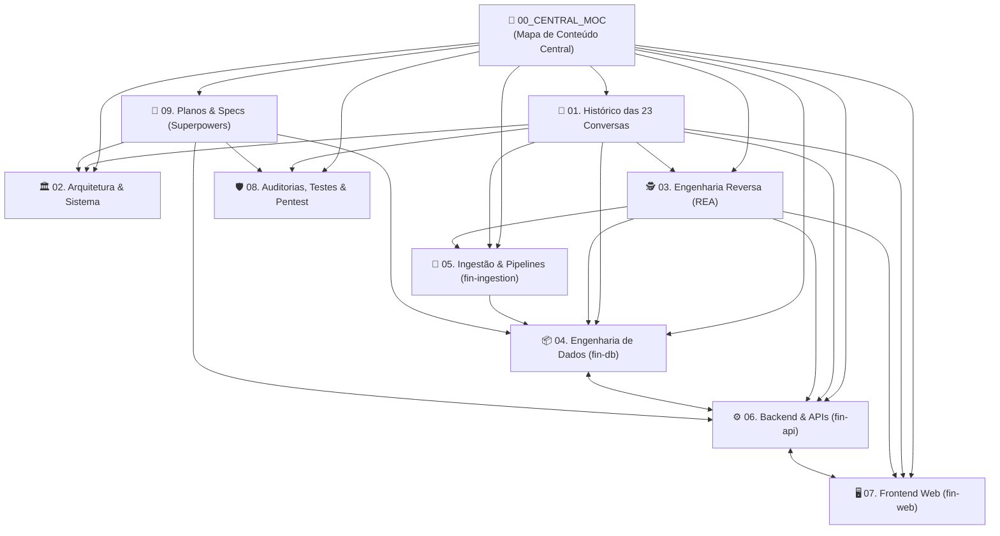

# 🧭 Mapa de Conteúdo Central (MOC) — Ecossistema Fin

Bem-vindo à base de conhecimento central e cofre de arquitetura do **Ecossistema Fin**.

Este documento atua como o **Map of Content (MOC)** principal do Obsidian, interligando todas as notas técnicas, especificações de engenharia reversa, modelos de dados e históricos das **23 conversas** que deram origem à plataforma.

---

## 🏛️ Grafo Visual dos Domínios do Cofre

---

## 🗂️ Índice Estruturado por Domínio

### 📜 1. Histórico & Trilha das 23 Conversas
O registro cronológico, fiel e detalhado de todas as 23 conversas originais:
- [[00_Linha_do_Tempo_e_Matriz_23_Conversas|Matriz Unificada e Linha do Tempo das 23 Conversas]]
- [[Conv_01_a_04_Fundacao_DDL_e_Arquitetura|Conversas 01 a 04: Fundação de Dados, DDL Neon e Arquitetura Macro]]
- [[Conv_05_a_08_Criacao_Modulos_Ecosystem|Conversas 05 a 08: Criação dos Módulos fin-ingestion, fin-infra, fin-web e fin-api]]
- [[Conv_09_a_14_Auditoria_Ativos_Reais_Web_e_ETL|Conversas 09 a 14: Auditoria, Ativos Reais da B3, Carteira Invisível e Fim dos Mocks]]
- [[Conv_15_a_19_Engenharia_Reversa_Profunda_e_Gaps|Conversas 15 a 19: REA Profundo (Fundamentus, Oceans14, Análise de Ações, ETFs Brasil)]]
- [[Conv_20_a_23_Abastecimento_Auditoria_Producao_e_Cloud|Conversas 20 a 23: Abastecimento Idempotente, Auditoria em Produção e Deploy Cloud]]

---

### 🏛️ 2. Arquitetura & Sistema
Padrões estruturais, consistência transacional e infraestrutura:
- [[ADR_001_Evolucao_Triade_StatusInvest_ClubeFII_brapi_CDN_First|ADR 001: Evolução da Plataforma (Status Invest + Clube FII + brapi via CDN-First)]]
- [[Arquitetura_Geral_Ecossistema_Fin|Arquitetura Geral do Ecossistema Fin]]
- [[Arquitetura_Financeira_Missao_Critica|Arquitetura Financeira de Missão Crítica & Ledger de Partidas Dobradas (Síntese)]]
- [[Especificacao_Normativa_Missao_Critica_Auditoria|Especificação Normativa de Missão Crítica & Auditoria Transacional]]
- [[Tese_Carteira_Invisivel_Dual_Engine|A Tese da Carteira Invisível & Arquitetura Dual-Engine]]
- [[Deployment_Cloud_Gratuito_Zero_Cost|Deploy Cloud 100% Gratuito (Zero-Cost Production)]]
- [[Topologia_Producao_e_Observabilidade|Topologia de Produção, Docker Compose e Observabilidade LGTM]]
- [[Topologia_Infraestrutura_VPC_AWS|Topologia de Infraestrutura & Plataforma AWS (fin-infra)]]

---

### 🕵️ 3. Engenharia Reversa de Aplicação (REA)
Análise aprofundada dos 12 portais de investimentos e 4 órgãos oficiais:
- [[Matriz_Unificada_12_Portais_e_Gaps|Matriz Unificada dos 12 Portais & Análise de Gaps]]
- [[Cobertura_12_Sites_Matriz_v3_4|Matriz de Cobertura dos 12 Portais (v3.4)]]
- [[Especificacao_Contratos_Dados_12_Sites_e_Orgaos|Especificação Técnica de Contratos de Dados (12 Sites & Órgãos)]]
- [[Especificacao_Pipelines_Ingestao_REA|Especificação dos Pipelines de Ingestão REA]]
- [[REA_Fundamentus_Linhagem_e_Endpoints_Ocultos|REA Fundamentus: Linhagem Upstream e Endpoints Ocultos]]
- [[REA_Status_Invest_e_Investidor10|REA Status Invest, Investidor10 e Fundamentei]]
- [[REA_Oceans14_e_Modelos_Valuation|REA Oceans14 & Modelos de Valuation Quantitativo]]
- [[REA_Analise_de_Acoes_Preco_Justo|REA Análise de Ações: Consenso e Projeção de Dividendos]]
- [[REA_ETFs_Brasil_e_Indices|REA ETFs Brasil: Decomposição de Cestas e Tracking Error]]
- [[REA_Orgaos_Oficiais_B3_CVM_BCB_ANBIMA|REA Órgãos Oficiais: B3, CVM, BCB e ANBIMA]]

---

### 📦 4. Engenharia de Dados (`fin-db`)
Modelo relacional, séries temporais e governança no PostgreSQL 18:
- [[Modelagem_Relacional_12_Schemas|Modelagem Relacional & Dicionário dos 12 Schemas]]
- [[01_Pacote_Completo_DIYFin_DDL_Original|Pacote Completo DIYFin — DDL SQL & Dicionário de Dados Original]]
- [[02_Melhorias_DDL_v3_1_Indices_Constraints|Melhorias DDL v3.1 — Índices e Constraints]]
- [[03_Melhorias_DDL_v3_2_Particionamento|Análise DDL v3.2 — Particionamento e Otimização]]
- [[04_Complementos_Sites_Analise_v3_3|Complementos Sites Análise v3.3 — Expansão de Schemas]]
- [[Hypertables_TimescaleDB_e_Series_Temporais|Hypertables TimescaleDB & Séries Temporais]]
- [[Catalogo_1242_Ativos_e_Chaves_Naturais|Catálogo de 1.242 Ativos Reais da B3 & Política de Chaves Naturais]]
- [[Migrations_e_Evolucao_DDL_v3_1_a_Stage12|Histórico de Migrações SQL (v1.0 ao Stage 12 v4.0)]]

---

### 🔄 5. Ingestão & Pipelines (`fin-ingestion`)
Motores de captura assíncrona e transformação:
- [[Despachante_de_Tarefas_e_Publicacao_CDN_Snapshots|Despachante Autônomo de Tarefas (Task Dispatcher) e Publicador de Snapshots (CDN / R2)]]
- [[Arquitetura_Autonoma_Fila_Postgres_Docker|Arquitetura Autônoma do fin-ingestion: Fila PostgreSQL, Workers e Docker]]
- [[Plano_Mestre_Abastecimento_10_Pipelines|Plano Mestre de Abastecimento: Os 10 Pipelines Automatizados]]
- [[Especificacao_Tecnica_Scrapers_e_Coletores|Especificação Técnica dos Scrapers, Coletores e dbt]]
- [[Especificacao_Gateway_Egress_Scraping|Especificação de Gateway e Egress de Scraping]]
- [[Anti_Bot_Proxies_Rotativos_e_Evasao|Malha de Proxies Rotativos, Anti-Bot e Evasão]]
- [[Analise_Anti_Bot_e_Gateway_Proxy|Análise Anti-Bot e Gateway Proxy]]

---

### ⚙️ 6. Backend & APIs REST (`fin-api`)
Camada de serviços assíncrona, cache e matemática financeira:
- [[Especificacao_APIs_FastAPI_e_Routers|Especificação das APIs FastAPI, Routers e Contratos Pydantic]]
- [[Cache_Aside_Redis_e_Idempotencia|Cache-Aside no Redis, Padrão SWR e Idempotência]]
- [[Motores_Matematicos_e_Valuation_Quant|Motores Matemáticos, Valuation Quantitativo e Risco]]

---

### 🖥️ 7. Frontend Web (`fin-web`)
Interface moderna e responsiva em Next.js 15:
- [[Arquitetura_Nextjs_App_Router_e_Tokens|Arquitetura Next.js 15, React 19 e Design Tokens]]
- [[Planejamento_Telas_e_Design_System_Original|Planejamento de Telas & Design System Original]]
- [[Eliminacao_de_Mocks_e_Data_Binding|Eliminação de Mocks e Vinculação de Dados Reais]]
- [[Catalogo_Telas_Rotas_e_Componentes|Catálogo de Telas, Rotas e Componentes de Interface]]

---

### 🛡️ 8. Auditorias, Testes & Pentest
Relatórios de validação, segurança e planos de melhoria:
- [[Relatorio_Homologacao_Etapa_2_e_3_Autonomia_e_Snapshots_CDN|Relatório de Homologação das Etapas 2 e 3: Autonomia de Ingestão e Snapshots CDN/R2]]
- [[Relatorio_Homologacao_Etapa_1_Confiabilidade_e_Desacoplamento|Relatório de Homologação da Etapa 1: Confiabilidade Imediata & Desacoplamento Arquitetural]]
- [[Relatorio_Auditoria_Remediacao_Integral_v4|Relatório de Remediação Integral da Auditoria v4.0 (F01–F50 & G01–G13)]]
- [[Homologacao_Remediacao_Auditoria_QA|Relatório de Homologação e Remediação da Auditoria de QA (FIN-QA-01..10)]]
- [[Relatorio_Executivo_Auditoria_Producao|Relatório Executivo de Auditoria em Modo de Produção]]
- [[Pentest_Segurança_e_Vulnerabilidades|Relatório de Pentest, Segurança e Vulnerabilidades]]
- [[Plano_Diretor_Melhorias_Sprint_I_e_II|Plano Diretor de Melhorias Contínuas: Sprints I e II]]

---

### 🎯 9. Planos e Especificações Técnicas (Superpowers)
Roteiros detalhados de implementação e especificações de design arquitetural:

#### 📋 Planos de Implementação (`plans/`)
- [[09_PLANOS_E_SPECS_SUPERPOWERS/plans/2026-10-28-qa-audit-remediation|QA Audit Remediation Implementation Plan (FIN-QA-01..10)]]
- [[09_PLANOS_E_SPECS_SUPERPOWERS/plans/2026-10-26-complementos-sites-analise|Complementos Sites Análise Implementation Plan]]
- [[09_PLANOS_E_SPECS_SUPERPOWERS/plans/2026-10-26-fin-api-implementation|fin-api Implementation Plan]]
- [[09_PLANOS_E_SPECS_SUPERPOWERS/plans/2026-10-26-financial-features-implementation|Financial Features Implementation Plan]]
- [[09_PLANOS_E_SPECS_SUPERPOWERS/plans/2026-10-26-portfolio-graph-reconciliation-implementation|Portfolio Graph Reconciliation Implementation Plan]]
- [[09_PLANOS_E_SPECS_SUPERPOWERS/plans/2026-10-26-rea-12-sites-v3.4|REA 12 Sites v3.4 Implementation Plan]]
- [[09_PLANOS_E_SPECS_SUPERPOWERS/plans/2026-10-27-analise-de-acoes-coverage-implementation|Análise de Ações Full-Stack Coverage Implementation Plan]]
- [[09_PLANOS_E_SPECS_SUPERPOWERS/plans/2026-10-27-etfs-brasil-coverage-implementation|ETFs Brasil Coverage Implementation Plan]]
- [[09_PLANOS_E_SPECS_SUPERPOWERS/plans/2026-10-27-fin-ecosystem-comprehensive-implementation-and-pentest|Fin Ecosystem Comprehensive Implementation and Pentest Plan]]
- [[09_PLANOS_E_SPECS_SUPERPOWERS/plans/2026-10-27-oceans14-comprehensive-implementation|Oceans14 Full-Stack Coverage Implementation Plan]]

#### 📐 Especificações de Design Arquitetural (`specs/`)
- [[09_PLANOS_E_SPECS_SUPERPOWERS/specs/2026-10-26-fin-api-design|fin-api Design Specification]]
- [[09_PLANOS_E_SPECS_SUPERPOWERS/specs/2026-10-26-portfolio-graph-reconciliation-design|Portfolio Graph Reconciliation Design Specification]]
- [[09_PLANOS_E_SPECS_SUPERPOWERS/specs/2026-10-28-cloud-free-deployment-design|Cloud-Free Deployment Design Specification]]

---

## 💡 Dicas de Navegação no Obsidian
- Utilize o atalho **`Cmd + O`** (macOS) para buscar qualquer nota por título ou tag.
- Abra a visualização de grafo (**Graph View** via `Cmd + G`) para visualizar visualmente as conexões orgânicas entre schemas, decisões das conversas e módulos.
- Todas as tabelas, fórmulas matemáticas LaTeX ($\LaTeX$) e diagramas Mermaid estão pré-renderizados para leitura offline instantânea.
