# 📜 Linha do Tempo e Matriz Unificada das 23 Conversas do Ecossistema Fin

Este documento consolida o registro histórico e técnico exaustivo das **23 conversas** que projetaram, implementaram, auditaram e publicaram a plataforma de investimentos **Fin**.

---

## 🧭 Visão Panorâmica da Evolução

```mermaid
timeline
    title Evolução Arquitetural do Ecossistema Fin (23 Conversas)
    section Fundação & Dados (Conv 1 - 4)
      Conv 1 : DDL Inicial Neon (273 tabelas, 36 Hypertables)
      Conv 2 : Expansão v3.1/v3.2 (Tax Lots, RLS, 282 objetos)
      Conv 3 : REA 12 Sites v3.4 (Mapeamento ao vivo)
      Conv 4 : Arquitetura dos 5 Repositórios
    section Módulos & Código (Conv 5 - 8)
      Conv 5 : fin-ingestion (Coletores, raw.payload, dbt)
      Conv 6 : fin-infra (Gateway, Traefik, Proxies)
      Conv 7 : fin-web (Next.js 15, React 19, Design Tokens)
      Conv 8 : fin-api (FastAPI, Redis SWR, No-Scraping Rule)
    section Qualidade & Reconciliação (Conv 9 - 14)
      Conv 9 : Auditoria Geral & Carga de 1.242 Ativos Reais
      Conv 10 : Matriz Unificada dos 12 Portais
      Conv 11 : Tese da Carteira Invisível & Dual Engine
      Conv 12 : Pipeline ETL Status Invest
      Conv 13 : Eliminação de Mocks no fin-web
      Conv 14 : Sincronização Multi-Repo Git
    section REA Profundo & Valuation (Conv 15 - 19)
      Conv 15 : REA Fundamentus, Linhagem & Pentest
      Conv 16 : Subida Integrada & Túneis Cloudflare
      Conv 17 : REA Oceans14 & Modelos de Valuation Quant
      Conv 18 : REA Análise de Ações & Preço Justo
      Conv 19 : REA ETFs Brasil & Rastreio de Índices
    section Produção & Nuvem (Conv 20 - 23)
      Conv 20 : Plano Mestre de Abastecimento (10 Pipelines)
      Conv 21 : Auditoria de Produção & Chrome DevTools MCP
      Conv 22 : Centralização fin-docs & Arquitetura de Missão Crítica
      Conv 23 : Deploy Cloud Distribuído 100% Gratuito
```

---

## 📊 Matriz Comparativa das 23 Conversas

| # | Conversation ID | Data | Título / Foco Principal | Repositórios Afetados | Entregas Técnicas & Invariantes Estabelecidos |
|---|---|:---:|---|---|---|
| **1** | `79731967-b954-41e2-b2f6-29e5509b4a3b` | 26/10/2026 | **Executar Scripts SQL e Organizar Repositório** | `fin-db` | Execução do DDL base no Neon PostgreSQL (`neondb`). Provisionamento de **12 schemas**, **273 tabelas e views**, **36 hypertables** TimescaleDB, extensões `pgvector` e `pg_trgm`. |
| **2** | `8db7512b-60d3-47e2-b384-bca9322be4f9` | 26/10/2026 | **FinDb Schema Extensions & Migration Plan** | `fin-db` | Evolução v3.1 e v3.2. Expansão para 282 objetos (+9 objetos: tax lots, RLS, triggers contábeis, chaves estrangeiras com `canonical.instrument`). |
| **3** | `032ae62b-7737-4a09-9c26-4c9071245c9d` | 26/10/2026 | **Análise e Expansão Fin-DB (REA 12 Sites)** | `fin-db` | Engenharia Reversa ao vivo dos 12 principais portais brasileiros. Especificação do estágio `06_rea_coverage_v3.4.md`. Apollo GraphQL do Fundamentei (102 indicadores). |
| **4** | `fa1c8cee-0c06-4015-85ec-e8dd4aba50d0` | 26/10/2026 | **API Architecture & Repository Structure** | `fin-api`, Ecossistema | Definição da arquitetura macro: monólito modular vs microserviços. Divisão oficial em 5 repositórios (`fin-db`, `fin-api`, `fin-infra`, `fin-ingestion`, `fin-web`). |
| **5** | `f7e7fb65-2b6f-4660-9e43-a92f8cc76f71` | 26/10/2026 | **Financial Data Ingestion System Architecture** | `fin-ingestion` | Criação do repositório de ingestão. Definição do padrão de pouso em `raw.payload`, processamento assíncrono, pipeline de scrapers e camada de transformação dbt. |
| **6** | `fa6f020f-96c0-4675-b16e-bd47a1545d53` | 26/10/2026 | **Análise de Plataformas e Fin-Infra** | `fin-infra` | Criação do repositório de infraestrutura. Proxy reverso, gateway de borda (Traefik/Caddy), túneis Cloudflare, pool de proxies rotativos anti-bloqueio e Docker Compose. |
| **7** | `fc2af18e-c2d2-4031-bc1a-0e57b8c1eac9` | 26/10/2026 | **Criação de Plataforma Financeira Next.js** | `fin-web` | Criação do frontend em Next.js 15 (App Router), React 19, TypeScript, Tailwind CSS, shadcn/ui. Definição do catálogo de páginas e design tokens financeiros. |
| **8** | `16c4d8df-bb86-4e4f-bbed-867c38e96427` | 27/10/2026 | **Architecture Analysis & Fin-API Creation** | `fin-api` | Criação do backend assíncrono em FastAPI. Regra de ouro inviolável: *a API nunca faz scraping sincrônico em requisições de usuário*. Cache-aside no Redis, tarefas com ARQ. |
| **9** | `2d61b5be-abbe-4af6-a52d-408021c7ddf1` | 27/10/2026 | **Full System Review & Testing** | Todos os repos | Revalidação do banco de dados, APIs e frontend. Ingestão dos CSVs oficiais da B3 com **1.242 ativos catalogados** sem dados inventados. Suíte E2E Playwright. |
| **10** | `29b740ee-32b3-44e0-938d-fe796cee41da` | 27/10/2026 | **Plano Diretor e Matriz dos 12 Portais** | Docs, Todos | Levantamento exaustivo e desduplicação das funcionalidades de 12 portais divididos em 6 domínios de negócio. Criação de `plano_abrangente_12_sites.md`. |
| **11** | `ab98922c-ab40-47b5-bdce-92d948adabf7` | 27/10/2026 | **Fin Ecosystem Gap Analysis & Tese** | `fin-db`, `fin-api` | Formulação do manifesto: *"O momento exato: quando o fin enxerga a carteira que nenhum portal consegue ver"*. Arquitetura Dual-Engine: Ingestão Externa + Ledger Analítico. |
| **12** | `75739139-2dda-4039-ab6d-59feb39ca0ec` | 27/10/2026 | **Status Invest Data Pipeline ETL** | `fin-ingestion`, `fin-db` | Pipeline ETL dedicado para captura de demonstrativos, DRE, balanços patrimoniais, múltiplos e dividendos do Status Invest, populando o Neon PostgreSQL. |
| **13** | `80f679c4-65cb-4727-93da-b71986747e7d` | 27/10/2026 | **Análise Profunda do Fin-Web (Fim dos Mocks)** | `fin-web` | Auditoria profunda no frontend e remoção completa de mocks, dados estáticos ou fakes. Amarração direta de todos os cards, tabelas e gráficos aos endpoints vivos da API. |
| **14** | `f50b561c-0ace-46bb-892b-053f0cb454c6` | 27/10/2026 | **Automate Git Push For Local Changes** | 5 Repositórios | Auditoria das árvores Git locais de todos os 5 módulos, resolução de diffs desacompanhados, criação de commits semânticos e sincronização com GitHub. |
| **15** | `dd314499-9397-40f8-a63c-56c39ff51425` | 28/10/2026 | **REA Fundamentus, Linhagem & Pentest** | Todos os repos | Mapeamento de 13 rotas do Fundamentus, descoberta de endpoints ocultos (`/resultado.php`, `amline/cot_hist.php`), linhagem upstream (B3/CVM/BCB), pentest de segurança. |
| **16** | `d2e28710-9181-45a8-9a0a-27383b7e0340` | 28/10/2026 | **Deploying Services & Testing Website** | `fin-infra`, `fin-web` | Subida simultânea da stack local integrada via Cloudflare Tunnels públicos. Verificação de tráfego HTTPS ponta a ponta e auditoria visual no navegador. |
| **17** | `36704987-c39b-4e93-8b6b-b8394c62ee99` | 28/10/2026 | **REA Oceans14 & Valuation Quantitativo** | Todos os repos | Engenharia reversa dos modelos do Oceans14: balanços históricos de 10 anos, DRE analítica, DFC. Modelos de Graham, Bazin, Gordon e DCF implementados nas 4 camadas. |
| **18** | `2409a472-eb6d-4bb8-9a25-cf2535493318` | 28/10/2026 | **REA Análise de Ações & Preço Justo** | Todos os repos | REA de 22 rotas do `analisedeacoes.com`: consenso de mercado de analistas, projeções de dividendos futuros, scores de saúde financeira. Migration 11 no `fin-db`. |
| **19** | `b1005280-f2f1-4d60-b15c-5eb1b017183b` | 28/10/2026 | **REA ETFs Brasil & Cobertura de Índices** | Todos os repos | REA da plataforma ETFs Brasil: cestas teóricas de índices, pesos por componente, tracking error, taxas de administração e spreads. Migration 12 no `fin-db`. |
| **20** | `e86acf92-846f-4599-a1b4-b114eed8a1f4` | 28/10/2026 | **Plano de Abastecimento do Ecossistema Fin** | `fin-ingestion`, `fin-db` | Plano mestre com 10 pipelines de aquisição automatizada e idempotente. Matriz de chaves naturais de conflito (`Zero Duplicates`), high-watermarks e checkpoints. |
| **21** | `c3a6f834-84df-43d4-83e2-e14b2c9b528d` | 28/10/2026 | **Auditoria de Produção & Chrome DevTools MCP** | Todos os repos | Subida real em modo de produção (Redis local, FastAPI, Next.js, Neon DB). Navegação automatizada no Chrome via DevTools MCP, auditoria mobile (iPhone 14), pentest e Sprint I/II. |
| **22** | `872c7edc-f9ab-43a0-b4db-7cae93541318` | 28/10/2026 | **Centralização fin-docs & Missão Crítica** | `fin-docs` | Clonagem e centralização da documentação no cofre `fin-docs`. Elaboração do compêndio normativo `ARQUITETURA_FINANCEIRA_MISSAO_CRITICA.md` (Partidas dobradas, Saga, CDC). |
| **23** | `a126d903-1878-48ee-9b63-1926dd89c776` | 28/10/2026 | **Deploy Cloud Distribuído 100% Gratuito** | Todos os repos | Arquitetura de deploy sem custo: Vercel (web), Koyeb/Render (api com anti-hibernação), Neon (100 CU-horas preservadas), Upstash Redis (< 10k cmds/dia) e GitHub Actions. |

---

## 🔗 Navegação pelos Detalhamentos das Conversas

- [[Conv_01_a_04_Fundacao_DDL_e_Arquitetura|Conversas 1 a 4: Fundação de Dados (DDL Neon) e Arquitetura Macro]]
- [[Conv_05_a_08_Criacao_Modulos_Ecosystem|Conversas 5 a 8: Criação dos Módulos fin-ingestion, fin-infra, fin-web e fin-api]]
- [[Conv_09_a_14_Auditoria_Ativos_Reais_Web_e_ETL|Conversas 9 a 14: Auditoria, Ativos Reais da B3, Carteira Invisível e Fim dos Mocks]]
- [[Conv_15_a_19_Engenharia_Reversa_Profunda_e_Gaps|Conversas 15 a 19: REA Profundo (Fundamentus, Oceans14, Análise de Ações, ETFs Brasil)]]
- [[Conv_20_a_23_Abastecimento_Auditoria_Producao_e_Cloud|Conversas 20 a 23: Abastecimento Idempotente, Auditoria em Produção e Deploy Cloud Gratuito]]
