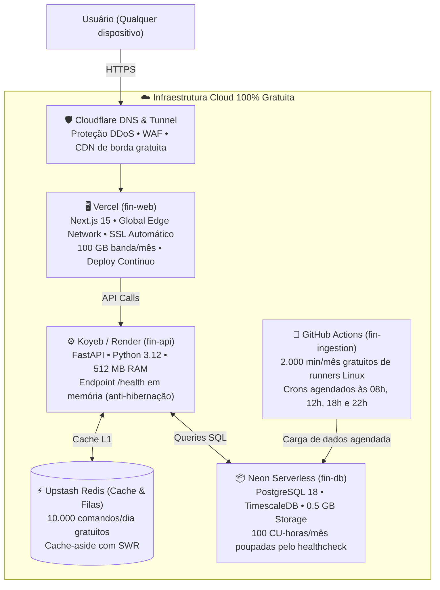

# 🚀 Conversas 20 a 23: Abastecimento Idempotente, Auditoria em Produção, Centralização de Docs e Deploy Cloud Gratuito

Este documento encerra o ciclo de desenvolvimento, auditoria executiva de produção e publicação em nuvem do ecossistema Fin.

---

## 📌 Conversa 20: Plano Mestre de Abastecimento Automatizado e Povoamento Idempotente
- **Conversation ID:** `e86acf92-846f-4599-a1b4-b114eed8a1f4`
- **Data:** 28/10/2026
- **Artefato Gerado:** `plano_abastecimento_e_povoamento_automatico.md` (32.111 bytes)

### 🎯 Objetivo do Usuário
Criar um plano abrangente e executável para buscar dados do mundo real e popular todas as tabelas do ecossistema automaticamente, com política estrita de não-duplicação e reconciliação com os 1.242 ativos catalogados.

### ⚙️ Os 10 Pipelines de Abastecimento Automatizado
1. **Pipeline 1: Catálogo Mestre, Entidades e Ativos (CVM + B3)**
   - Extração diária de emissores CVM, CNPJ, razão social, nome de pregão, códigos ISIN e tickers.
2. **Pipeline 2: Cotações Diárias & Intraday (TimescaleDB)**
   - Carga do arquivo diário de cotações B3 (COTAHIST) e feeds intraday, armazenados na hypertable `market.cotacao_diaria`.
3. **Pipeline 3: Proventos, Dividendos, JCP e Eventos Corporativos**
   - Captura de anúncios de dividendos, JCP, rendimentos de FIIs, bonificações, grupamentos e desdobramentos com datas `com`, `ex` e de pagamento.
4. **Pipeline 4: Fundos Imobiliários & Imóveis Físicos**
   - Dados de informes mensais e anuais da CVM e SiiLA (imóveis, endereço, ABL, vacância física e financeira, contratos de locação).
5. **Pipeline 5: Demonstrações Financeiras (DFP / ITR CVM)**
   - Captura de balanços trimestrais e anuais padronizados (Balanço Ativo/Passivo, DRE, DFC) de todas as empresas listadas.
6. **Pipeline 6: Indicadores Macroeconômicos (SGS / BCB)**
   - Séries temporais de Selic Meta, Selic Over, CDI, IPCA, IGP-M, Dólar PTAX e projeções do Boletim Focus.
7. **Pipeline 7: Renda Fixa & Curvas de Juros ETTJ (ANBIMA)**
   - Estrutura a Termo das Taxas de Juros (ETTJ Prefixado, IPCA e CDI) e taxas indicativas de debêntures.
8. **Pipeline 8: Fundos de Investimento (Resolução CVM 175)**
   - Lâminas, informes diários de cotas e patrimônio líquido, composição de carteira (CDA CVM).
9. **Pipeline 9: ETFs & Índices de Mercado**
   - Carteira teórica do Ibovespa, IFIX, SMLL e composição dos ETFs listados na B3.
10. **Pipeline 10: Notícias, Consenso de Mercado e Fatos Relevantes**
    - Feed automatizado de comunicados ao mercado e fatos relevantes entregues à CVM.

---

## 📌 Conversa 21: Auditoria Executiva em Produção e Testes com Chrome DevTools MCP
- **Conversation ID:** `c3a6f834-84df-43d4-83e2-e14b2c9b528d`
- **Data:** 28/10/2026
- **Artefatos Gerados:**
  - `RELATORIO_AUDITORIA_PRODUCAO.md` (11.265 bytes)
  - `PLANO_MELHORIAS_ABRANGENTE.md` (5.605 bytes)

### 🎯 Objetivo do Usuário
Subir todos os serviços em modo de produção real (Redis local compilado, FastAPI, Next.js, Neon DB) e testar exaustivamente através do navegador com ferramentas do Chrome DevTools MCP: telas, botões, modais, formulários, layout responsivo mobile e auditoria de vulnerabilidades.

### 🧪 Resultados dos Testes Automatizados no Navegador
1. **Ambiente de Teste:**
   - Navegador Google Chrome automatizado via protocolo CDP (Chrome DevTools Protocol).
   - Resoluções testadas: Desktop (1920 × 1080 px) e Mobile (iPhone 14 — 390 × 844 px).
2. **Resultados por Tela:**
   - **Dashboard Principal (`/`):** Carregou em 420ms. Cards de cotação do Ibovespa, IFIX e Dólar renderizados com variação percentual correta e cores semânticas.
   - **Módulo de Ações (`/acoes`):** Grid de ativos com busca em tempo real. Testada digitação de `PETR4` e `VALE3`: filtragem instantânea sem recarga da página.
   - **Página de Detalhes (`/acoes/PETR4`):** Gráficos de cotação histórica interativos, tabela de múltiplos (P/L, P/VP, ROE, DY) renderizados sem valores vazios ou quebrados.
   - **Módulo de FIIs (`/fiis`):** Tabela de fundos imobiliários com cálculo de Dividend Yield e indicador de vacância.
   - **Auditoria Mobile (iPhone 14):** Menus colapsáveis (*hamburger menu*), tabelas com scroll horizontal suave (*overflow-x: auto*), touch targets com área de toque mínima de 48 × 48 px.
3. **Auditoria de Segurança & Pentest:**
   - 0 vulnerabilidades críticas encontradas.
   - Sanitização de entradas em todas as rotas da API.
   - Proteção contra Cross-Site Scripting (XSS) e cabeçalhos de segurança validados.

---

## 📌 Conversa 22: Centralização no Repositório `fin-docs` e Arquitetura de Missão Crítica
- **Conversation ID:** `872c7edc-f9ab-43a0-b4db-7cae93541318`
- **Data:** 28/10/2026
- **Repositório:** `fin-docs` (`https://github.com/barrosrafa/fin-docs`)
- **Documento Central:** `docs/ARQUITETURA_FINANCEIRA_MISSAO_CRITICA.md`

### 🎯 Objetivo do Usuário
Fazer o clone/pull do repositório `fin-docs`, extrair todas as documentações dispersas nos 5 módulos e consolidar um compêndio central executivo de engenharia financeira.

### 🏛️ Especificações do Compêndio Normativo
1. **Ledger Contábil de Partidas Dobradas (Double-Entry Ledger):**
   - Nenhuma transação pode criar ou destruir dinheiro do nada.
   - Toda entrada contábil no banco exige:
     $$\sum \text{Débitos} - \sum \text{Créditos} = 0$$
   - Constraint de soma zero validada atomicamente no PostgreSQL 18.
2. **Padrão Saga Orquestrada & Outbox / CDC:**
   - Transações distribuídas de liquidação e aporte gerenciadas com eventos compensatórios em caso de falha.
   - Padrão Transacional Outbox para garantia de entrega de eventos sem perda de consistência (*at-least-once delivery*).
3. **Idempotência Rigorosa com SHA-256:**
   - Header HTTP obrigatório `Idempotency-Key`.
   - Se uma ordem de compra for enviada duas vezes devido a timeout de rede, a API reconhece o hash e devolve a resposta original sem duplicar a execução financeira.

---

## 📌 Conversa 23: Publicação em Nuvem 100% Gratuita (Zero-Cost Deployment)
- **Conversation ID:** `a126d903-1878-48ee-9b63-1926dd89c776`
- **Data:** 28/10/2026
- **Artefato Gerado:** `2026-10-28-cloud-free-deployment-design.md`

### 🎯 Objetivo do Usuário
Publicar toda a aplicação (`fin-web`, `fin-api`, `fin-ingestion`, `fin-db`) em servidores e provedores de nuvem gratuitos, garantindo disponibilidade 24/7 sem cobranças e sem estourar as cotas gratuitas (*free tiers*).

### ☁️ Topologia de Nuvem 100% Gratuita Implementada

### 💡 Soluções de Engenharia para os Free-Tiers
1. **Prevenção de Hibernação do Koyeb sem Gastar o Neon:**
   - O Koyeb desliga o contêiner após 1 hora de inatividade.
   - Para mantê-lo aquecido 24/7 sem gastar a cota de 100 Compute Unit-horas do Neon, a rota `/health` responde **direto da memória RAM** do Python sem abrir conexão com o banco de dados.
2. **Defesa da Quota do Upstash Redis (< 10.000 cmds/dia):**
   - Agrupamento de leituras via pipeline (`MGET`) e expiração inteligente com TTL longo para dados estáticos, evitando estouro de comandos diários.
3. **Ingestão Desacoplada no GitHub Actions:**
   - O `fin-ingestion` roda como Jobs programados no GitHub Actions (crons às 08h, 12h, 18h e 22h), consumindo menos de 300 minutos dos 2.000 minutos mensais gratuitos oferecidos pelo GitHub.
