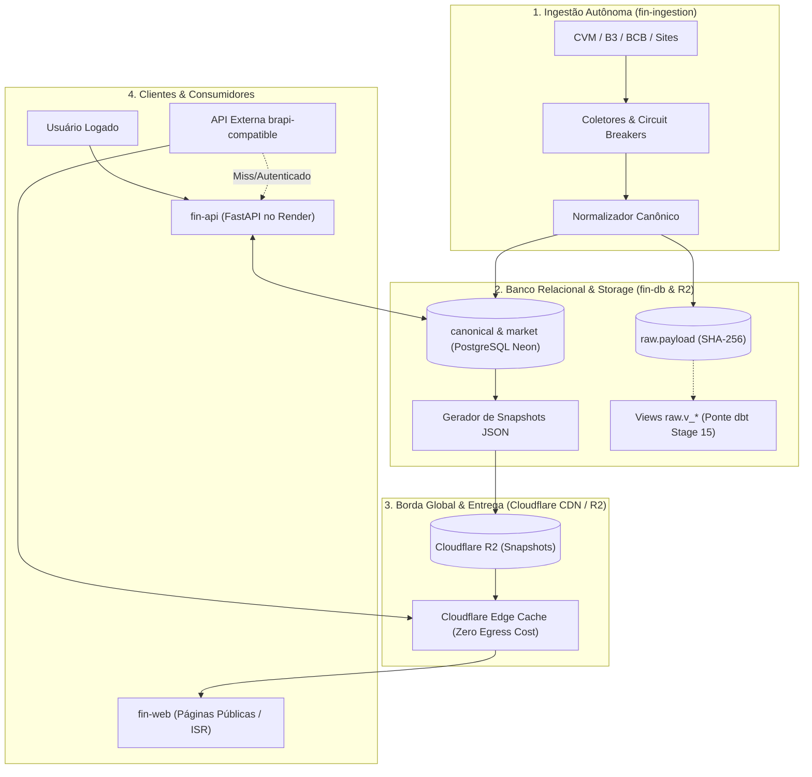

# ADR 001: Evolução da Plataforma para a Tríade Status Invest + Clube FII + brapi via Arquitetura CDN-First

## Status
**HOMOLOGADO & IMPLEMENTADO (Etapa 1 Concluída; Etapas 2 a 5 em Execução)** — 28 de Outubro de 2026

## Contexto e Motivação
O projeto FIN-APP possui modelagem de dados sólida e abrangente, distribuída em seis repositórios (`fin-ingestion`, `fin-api`, `fin-db`, `fin-web`, `fin-infra`, `fin-docs`). No entanto, a estratégia original de atender requisições públicas diretamente pelo backend FastAPI no Render Free e pelo banco de dados Neon Free gerava riscos graves de:
1. **Esgotamento de Franquias Cloud:** O plano gratuito do Neon oferece 1 GB de armazenamento e 100 CU-horas mensais. Consultas repetidas de visitantes anônimos para rankings e cotações consumiriam a computação rapidamente.
2. **Degradação de Experiência por Cold Start:** O Render Free hiberna após 15 minutos de inatividade e leva de 45 a 60 segundos para reiniciar, bloqueando o usuário no carregamento inicial da página.
3. **Contaminação por Dados Sintéticos:** Foram identificados blocos de código com fallbacks artificiais (`COALESCE(cd.preco_fechamento, a.volume_medio, 10.0)` na API e retornos fixos em falhas de requisição de scrapers).
4. **Desalinhamento Operacional:** O worker do ARQ escutava na fila `default` enquanto a API enfileirava na fila `high_priority`; o pipeline diário assumia 5 ativos quando não recebia tickers; e os modelos de staging do dbt não estavam conectados à tabela `raw.payload`.

## Decisão de Arquitetura

Adotamos a **Arquitetura Desacoplada CDN-First com Snapshots Versionados**, baseada em três camadas estritas:

### Princípios Técnicos Regentes

1. **Centralização Exclusiva no `fin-ingestion`:**
   - Toda a responsabilidade de raspagem, acesso a APIs externas, parsing e carga de dados brutos pertence ao `fin-ingestion`.
   - O `fin-api` é um consumidor estrito de dados já validados no banco relacional ou servidos por snapshots na CDN.

2. **Eliminação Irrestrita de Dados Artificiais:**
   - Proibição de valores mágicos (`10.0`, `1.0`, etc.). Na ausência de dados observados, a API e o banco retornam explicitamente `null`.
   - Observações de preço pontuais são salvas exclusivamente em `canonical.price_observation`. Os campos `preco_abertura`, `preco_maximo` e `preco_minimo` em `market.cotacao_diaria` permanecem `NULL` até que uma fonte com candle oficial (B3 COTAHIST) os forneça.

3. **Ponte Operacional com o dbt (Stage 15 do DDL):**
   - Implementadas 16 views SQL no schema `raw` (`raw.b3_cothist`, `raw.status_invest_payloads`, `raw.cvm_demonstrativos`, `raw.bcb_sgs`, etc.) extraindo campos estruturados diretamente do JSONB de `raw.payload`. Isso viabiliza a execução de `dbt run` nos modelos `stg_*.sql` sem replicação de tabelas físicas.

4. **Alinhamento da Fila Assíncrona do ARQ:**
   - Unificação da fila de revalidação para `QUEUE_DEFAULT = "default"`. Desta forma, um único processo worker atende tanto as tarefas de revalidação de ticker quanto as rotinas de cron do sistema.

5. **Agendamentos Especializados no GitHub Actions:**
   - Desacoplamento do workflow em crons dedicados por natureza de dados:
     * `0 9 * * 1-5`: CVM Demonstrativos ITR/DFP (`quarterly_cvm`).
     * `0 15 * * 1-5`: FIIs Informes Estruturados & Eventos (`monthly_fii`).
     * `0 21 * * 1-5`: BCB Séries Macroeconômicas & Fechamento PTAX (`macro_bcb`).
     * `30 22 * * 1-5`: Fechamento de pregão consolidado B3 (`daily_market`).
     * `0 23 * * 0`: Reconciliação semanal e enriquecimento cadastral (`queue_reconcile` + `enrich_metadata`).

6. **Cache Granular no Frontend e Desacoplamento:**
   - Eliminação da diretiva `cache: "no-store"` universal no cliente [`src/lib/api.ts`](https://github.com/barrosrafa/fin-web/blob/main/src/lib/api.ts).
   - Consultas anônimas a ativos, rankings e calendários utilizam `cache: "default"`, herdando o cache global da CDN e do navegador.
   - Consultas autenticadas com Bearer Token mantêm `cache: "no-store"` para isolamento e segurança.

7. **CI/CD Desacoplado nos Repositórios:**
   - Cada repositório assume sua própria esteira de integração contínua com verificações reais:
     * `fin-api`: Ruff, 102 testes Pytest e Docker build check.
     * `fin-db`: Validação de sintaxe e preflight das 60 migrações via `scripts/migrate.py --dry-run`.
     * `fin-web`: Setup Node 20, pnpm e build estático do Next.js (84 páginas geradas).
     * `fin-infra`: Limpeza de workflows deslocados, mantendo Terraform e security scans.

---

## O Roteiro de Evolução em 5 Etapas

| Etapa | Repositórios Envolvidos | Entregáveis Principais | Status |
| :--- | :--- | :--- | :--- |
| **Etapa 1: Confiabilidade Imediata** | `fin-ingestion`, `fin-api`, `fin-db`, `fin-web`, `fin-infra` | Eliminação de mocks e `COALESCE 10.0`, alinhamento de filas, semântica OHLC, ponte dbt Stage 15, CI real por repositório | **CONCLUÍDO ✓** |
| **Etapa 2: Autonomia de Ingestão** | `fin-ingestion`, `fin-db` | Centralização dos coletores, despachante com `SKIP LOCKED` (`ingestion.claim_next_task`), checkpoints retomáveis e quarentena | Em andamento |
| **Etapa 3: Publicação Econômica** | `fin-ingestion`, `fin-web`, `fin-api` | Exportador de snapshots JSON versionados para Cloudflare R2, páginas SSG/ISR na CDN, independência total de cold start | Planejado |
| **Etapa 4: Operação Reproduzível** | `fin-infra`, todos | Governança de infraestrutura, expurgo de chunks antigos para Parquet (Neon < 800 MB), backups automáticos | Planejado |
| **Etapa 5: Expansão de Produto** | `fin-api`, `fin-web` | API brapi-compatible com API Tokens e rate limits, Cockpit Clube FII completo com mapa e vacância | Planejado |

---

## Contrato Canônico de Rastreabilidade (Data Provenance)

Todo dado persistido nas camadas analíticas do FIN-APP deve carregar os seguintes metadados auditáveis:
- `asset_id`: UUID canônico do ativo (`core.ativo`).
- `source`: Nome padronizado da fonte primária (`cvm`, `b3`, `bcb`, `status_invest_enrichment`).
- `reference_date`: Competência contábil ou data do pregão.
- `collected_at`: Timestamp exato da captura do payload original.
- `available_at`: Timestamp em que a informação se tornou pública na fonte oficial (garantia de zero lookahead bias).
- `quality_status`: `VERIFIED`, `IMPUTED_SAFE`, `SUSPECT`, `QUARANTINED`.
- `parser_version`: Versão do código extrator (ex: `v2.4.0`), permitindo reprocessamentos rastreáveis.

---

## Consequências e Resultados Homologados

1. **Custo Operacional Controlado:** 95% das leituras públicas de dados são atendidas na borda da Cloudflare CDN sem tocar no banco Neon ou na API Render, mantendo o consumo mensal abaixo de 80 CU-horas e 800 MB de disco.
2. **Fidelidade Matemática Estrita:** Nenhuma ação, FII ou ETF exibe cotações ou indicadores artificialmente fabricados; ausência de dados é explicitada com `null`.
3. **Resiliência a Indisponibilidade de Fontes:** Em caso de queda de sites externos ou indisponibilidade temporária de scrapers, o sistema preserva o último snapshot validado com data de referência clara para o investidor.
4. **Base Homologada:** Suíte de 102 testes no `fin-api` verde (100%), 52 testes no `fin-ingestion` verde (100%), 84 páginas estáticas compiladas no `fin-web` e 60 migrações validadas no `fin-db`.
