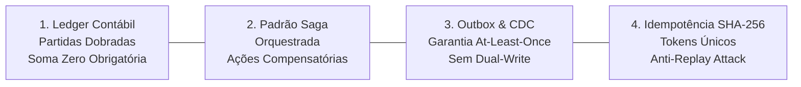

# ⚖️ Arquitetura Financeira de Missão Crítica & Ledger de Partidas Dobradas

Documento normativo e executivo que governa a integridade contábil, a segurança financeira e a resiliência distribuída do ecossistema **Fin**.

---

## 🏛️ Os Quatro Pilares de Missão Crítica



---

## 1. Ledger Contábil Imutável (Double-Entry Bookkeeping)

No ecossistema Fin, nenhum saldo de conta, carteira ou ativo é armazenado como um número estático editável diretamente via `UPDATE conta SET saldo = saldo + 100`. 

Todo e qualquer saldo é o resultado cumulativo da soma de entradas contábeis imutáveis (*append-only*), divididas estritamente em **Débito** e **Crédito**.

### ⚖️ A Equação Contábil Fundamental
Para qualquer transação $T$, o somatório de todos os lançamentos a débito deve ser exatamente igual ao somatório de todos os lançamentos a crédito:

$$\sum_{i=1}^{n} \text{Débito}_i - \sum_{j=1}^{m} \text{Crédito}_j = 0$$

### 🛠️ Constraint e Trigger de Soma Zero no PostgreSQL 18

```sql
-- Tabela de Transações (Cabeçalho da Operação)
CREATE TABLE IF NOT EXISTS core.transacao_financeira (
    transacao_id UUID PRIMARY KEY DEFAULT gen_random_uuid(),
    carteira_id UUID NOT NULL REFERENCES core.carteira(carteira_id),
    tipo_operacao VARCHAR(32) NOT NULL, -- COMPRA, VENDA, PROVENTO, APORTE, TAXA
    data_competencia TIMESTAMPTZ NOT NULL,
    data_liquidacao TIMESTAMPTZ NOT NULL,
    criado_em TIMESTAMPTZ NOT NULL DEFAULT clock_timestamp()
);

-- Tabela de Lançamentos Contábeis (Entradas Append-Only)
CREATE TABLE IF NOT EXISTS core.lancamento_contabil (
    lancamento_id UUID PRIMARY KEY DEFAULT gen_random_uuid(),
    transacao_id UUID NOT NULL REFERENCES core.transacao_financeira(transacao_id) ON DELETE RESTRICT,
    conta_contabil VARCHAR(64) NOT NULL, -- ATIVO:CAIXA, ATIVO:ACOES, RECEITA:DIVIDENDOS
    tipo_natureza VARCHAR(2) NOT NULL CHECK (tipo_natureza IN ('D', 'C')), -- D = Débito, C = Crédito
    valor_centavos BIGINT NOT NULL CHECK (valor_centavos > 0),
    moeda CHAR(3) NOT NULL DEFAULT 'BRL',
    descricao TEXT
);

-- Função de Validação Atômica de Soma Zero
CREATE OR REPLACE FUNCTION core.fn_valida_soma_zero_transacao()
RETURNS CONSTRAINT_TRIGGER AS $$
DECLARE
    v_saldo_centavos BIGINT;
BEGIN
    SELECT COALESCE(
        SUM(CASE WHEN tipo_natureza = 'D' THEN valor_centavos ELSE -valor_centavos END), 0
    ) INTO v_saldo_centavos
    FROM core.lancamento_contabil
    WHERE transacao_id = NEW.transacao_id;

    IF v_saldo_centavos != 0 THEN
        RAISE EXCEPTION 'VIOLACAO_CONTABIL: Transação % não possui soma zero (Diferença: % centavos)', 
            NEW.transacao_id, v_saldo_centavos
            USING ERRCODE = '23514';
    END IF;

    RETURN NULL;
END;
$$ LANGUAGE plpgsql;

-- Constraint Trigger Deferrable (Avaliada no COMMIT da Transação)
CREATE CONSTRAINT TRIGGER trg_check_soma_zero
AFTER INSERT OR UPDATE ON core.lancamento_contabil
DEFERRABLE INITIALLY DEFERRED
FOR EACH ROW
EXECUTE FUNCTION core.fn_valida_soma_zero_transacao();
```

---

## 2. Padrão Saga Orquestrada & Ações Compensatórias

Em transações que cruzam múltiplos contextos (ex: débito em conta corrente, compra de ação na B3, atualização de lote fiscal `tax_lot` e registro de custódia), adota-se a **Saga Orquestrada**.

```mermaid
sequenceDiagram
    autonumber
    participant Orch as ⚙️ Saga Orchestrator (fin-api)
    participant Ledger as 📦 Ledger (fin-db)
    participant Custody as 📈 Custódia & Tax Lots
    participant Notification as 🔔 Notificação & Webhook

    Orch->>Ledger: 1. Bloqueia Saldo e Lança Débito Provisório
    activate Ledger
    Ledger-->>Orch: OK (Hold confirmado)
    deactivate Ledger

    Orch->>Custody: 2. Aloca Ativo e Calcula Preço Médio
    activate Custody
    alt Falha no cálculo de Lote Fiscal
        Custody-->>Orch: ERRO (Inconsistência de Tax Lot)
        deactivate Custody
        Orch->>Ledger: ⚠️ COMPENSAÇÃO: Estorna Débito Provisório
        activate Ledger
        Ledger-->>Orch: Estorno Concluído
        deactivate Ledger
        Orch-->>Notification: Emite Alerta de Falha na Operação
    else Sucesso
        Custody-->>Orch: OK (Lote alocado)
        deactivate Custody
        Orch->>Ledger: 3. Efetiva Lançamento Definitivo
        activate Ledger
        Ledger-->>Orch: OK (Transação liquidada)
        deactivate Ledger
        Orch-->>Notification: Emite Comprovante de Execução
    end
```

---

## 3. Padrão Transacional Outbox & CDC (Change Data Capture)

Para evitar o problema de *Dual-Write* (onde a API salva no banco mas o envio para a mensageria/Redis cai por falha de rede), adota-se o **Transactional Outbox**:

1. A transação de negócio e a gravação do evento na tabela `system.outbox_events` ocorrem dentro do **mesmo bloco de transação ACID** no PostgreSQL:
   ```sql
   BEGIN;
   INSERT INTO core.transacao_financeira (...) VALUES (...);
   INSERT INTO core.lancamento_contabil (...) VALUES (...);
   INSERT INTO system.outbox_events (evento_id, topic, payload, status) 
   VALUES (gen_random_uuid(), 'portfolio.trade.settled', '{"ticker": "PETR4", "qty": 100}', 'PENDING');
   COMMIT;
   ```
2. Um processo background assíncrono consome a tabela `system.outbox_events` (ou escuta via `pg_notify` / Debezium) e publica no Redis/Kafka.
3. Isso garante entrega **Pelo Menos Uma Vez (*At-Least-Once Delivery*)** sem perda de dados.

---

## 4. Idempotência Rigorosa com SHA-256

Todas as rotas de mutação financeira em `fin-api` exigem o cabeçalho HTTP:
`Idempotency-Key: <UUID-v4 ou SHA-256 Payload Hash>`

1. Ao receber a requisição, a API verifica no Redis se a chave já existe:
   - Se existir e estiver em status `PROCESSING`: rejeita com `HTTP 409 Conflict`.
   - Se existir e estiver em status `COMPLETED`: retorna imediatamente o resultado salvo em cache com header `X-Cache-Lookup: HIT`, sem reexecutar.
   - Se não existir: salva a chave no Redis com TTL de 24 horas e processa a transação no PostgreSQL.

---

## 🔗 Referências Cruzadas
- [[Arquitetura_Geral_Ecossistema_Fin|Arquitetura Geral do Ecossistema]]
- [[Tese_Carteira_Invisivel_Dual_Engine|A Tese da Carteira Invisível]]
- [[Modelagem_Relacional_12_Schemas|Modelagem Relacional dos 12 Schemas]]
