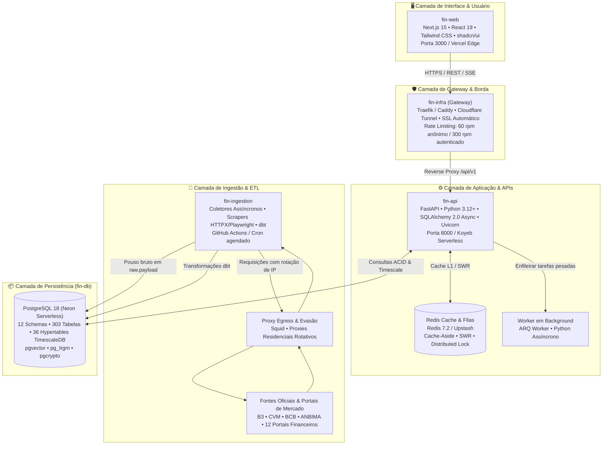

# 🏛️ Arquitetura Geral do Ecossistema Fin

A plataforma **Fin** foi projetada como um ecossistema desacoplado de alta performance, unindo a velocidade de um frontend moderno em Next.js 15, a robustez de um backend assíncrono em FastAPI, a precisão matemática de um banco relacional com séries temporais (PostgreSQL 18 + TimescaleDB) e uma malha de coleta assíncrona com evasão anti-bloqueio.

---

## 🧭 Diagrama Arquitetural de Alto Nível

---

## 📦 Matriz de Responsabilidades dos 5 Módulos

| Módulo | Repositório GitHub | Stack Tecnológica | Papel no Ecossistema |
|---|---|---|---|
| **`fin-db`** | [`barrosrafa/fin-db`](https://github.com/barrosrafa/fin-db) | PostgreSQL 18, TimescaleDB, pgvector, pg_trgm | Repositório central de verdade. Modela os 12 schemas relacionais, 303 tabelas, 36 hypertables, regras de integridade referencial, constraints fiscais e partidas dobradas. |
| **`fin-api`** | [`barrosrafa/fin-api`](https://github.com/barrosrafa/fin-api) | FastAPI, Python 3.12+, SQLAlchemy 2.0, Redis | Backend REST assíncrono. Serve dados de alta performance para a interface, gerencia autenticação, calcula métricas de valuation quantitativo e consolidação de carteira. |
| **`fin-infra`** | [`barrosrafa/fin-infra`](https://github.com/barrosrafa/fin-infra) | Docker Compose, Traefik, Caddy, Cloudflare, Prometheus | Gateway de borda, malha de proxies residenciais para raspagem, observabilidade (Prometheus/Grafana/Loki) e túneis seguros de exposição. |
| **`fin-ingestion`**| [`barrosrafa/fin-ingestion`](https://github.com/barrosrafa/fin-ingestion) | Python, httpx, Playwright, dbt, BeautifulSoup4 | Motor assíncrono de coleta e extração. Povoa a camada `raw.payload` e orquestra a limpeza e estruturação dos dados de 12 sites e 4 órgãos reguladores. |
| **`fin-web`** | [`barrosrafa/fin-web`](https://github.com/barrosrafa/fin-web) | Next.js 15, React 19, TypeScript, Tailwind CSS | Frontend responsivo de alta densidade visual (estilo Bloomberg). Totalmente conectado à API viva, sem nenhum dado mockado. |

---

## 🛡️ Invariantes Arquiteturais e Regras de Isolamento

Para garantir escalabilidade, testabilidade e manutenibilidade sem degradação operacional, o ecossistema obedece a **5 invariantes invioláveis**:

1. **A API Nunca Faz Scraping em Requisição de Usuário:**
   Nenhum endpoint de `fin-api` pode acionar scrapers externos de forma síncrona. Se um usuário solicitar um ativo cujos dados contábeis não estão no banco, a API responde imediatamente com o que existe e registra uma solicitação assíncrona na fila de ingestão.
2. **Padrão de Pouso em Camada Bronze (`raw.payload`):**
   Todo dado capturado da internet pelo `fin-ingestion` é obrigatoriamente persistido primeiro na tabela `raw.payload` em formato JSONB imutável com hash SHA-256. Isso permite reprocessar qualquer transformação analítica do passado sem refazer scraping na fonte original.
3. **Consistência Contábil de Partidas Dobradas (Soma Zero):**
   Toda movimentação patrimonial, aporte, retirada ou cobrança de taxa na carteira obedece à equação contábil $\sum \text{Débitos} - \sum \text{Créditos} = 0$, validada por trigger em banco de dados.
4. **Isolamento de Acesso a Dados:**
   O frontend `fin-web` jamais conecta diretamente ao banco de dados PostgreSQL. Toda comunicação ocorre estritamente via HTTPS/REST através de `fin-api`.
5. **Idempotência Estrita em Toda a Cadeia:**
   Tanto a ingestão quanto as APIs de transação operam sob chaves naturais de conflito (`ON CONFLICT DO NOTHING / UPDATE`) e tokens de idempotência SHA-256, garantindo que retentativas de rede não gerem registros duplicados.

---

## 🔗 Referências Cruzadas
- [[00_Linha_do_Tempo_e_Matriz_23_Conversas|Histórico Completo das 23 Conversas]]
- [[Arquitetura_Financeira_Missao_Critica|Especificação de Missão Crítica & Ledger de Partidas Dobradas]]
- [[Tese_Carteira_Invisivel_Dual_Engine|A Tese da Carteira Invisível & Dual Engine]]
- [[Deployment_Cloud_Gratuito_Zero_Cost|Guia de Deploy Cloud 100% Gratuito]]
