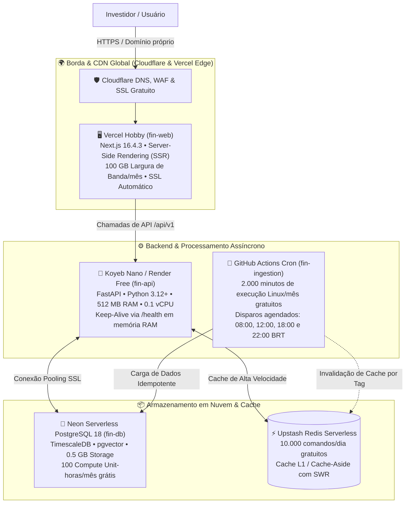

# ☁️ Deploy Cloud 100% Gratuito (Zero-Cost Production Architecture)

Este documento documenta o projeto técnico de implantação e operação contínua do ecossistema **Fin** em nuvem, visando baixo custo. Disponibilidade e custo dependem das cotas contratadas, do tráfego e de medições operacionais.

> **Revisão SDD — 29/10/2026:** os números de planos, capacidade e afirmações de operação contínua abaixo são históricos/propostos e não foram revalidados nos provedores. Não constituem SLA, medição de latência ou garantia de gratuidade. Pings não comprovam disponibilidade. Consulte [[SDD_Execucao_2026-10-29]] para o estado efetivamente implementado e validado.

O checkout local declara Next.js **16.4.3** e React **19.3.0**. O detalhe de ação passa a carregar cadastro, valuation disponível e uma tabela inicial de histórico no servidor por `use cache`, com `cacheLife({ stale: 60, revalidate: 60, expire: 300 })`. Isso se aplica à nova implementação local; não comprova o commit do deploy público. Valuation incompleto responde indisponibilidade. O SSE existente comunica sincronização, e não ticks de preço. Não há homologação de gateway de cotações ou de execução de ordens.

---

## 🏛️ Topologia da Arquitetura Distribuída Gratuita

---

## 🛠️ Detalhamento dos Componentes e Provedores Gratuitos

| Componente | Provedor Gratuito | Especificações do Plano | Função no Ecossistema |
|---|---|---|---|
| **Frontend Web** | **Vercel** (Hobby) | 100 GB largura de banda, builds automáticos via Git, Edge Network global | Hospeda o `fin-web` (Next.js 16.4.3 App Router). Renderiza componentes e serve a aplicação; latência ainda não homologada. |
| **Backend API** | **Koyeb** (Nano) / **Render** | 512 MB RAM, 0.1 vCPU, HTTPS nativo, deploy contínuo via Docker/Git | Executa o `fin-api` (FastAPI). Expõe a API REST protegida e orquestra regras de negócio. |
| **Banco de Dados** | **Neon** (Serverless) | PostgreSQL 18, 0.5 GB armazenamento SSD, 100 Compute Unit-horas/mês | Hospeda o `fin-db` com seus 12 schemas, 303 tabelas, hypertables TimescaleDB e pgvector. |
| **Cache & Filas** | **Upstash** (Serverless) | 10.000 comandos/dia gratuitos, armazenamento de 256 MB, TLS nativo | Cache L1 de cotações, books, valuation e controle distribuído de tokens de idempotência. |
| **Ingestão & ETL** | **GitHub Actions** | 2.000 minutos/mês de runners Ubuntu Linux gratuitos | Executa os coletores e scrapers do `fin-ingestion` 4 vezes ao dia nos horários de fechamento. |
| **Borda & Segurança**| **Cloudflare** (Free) | DNS Anycast ilimitado, mitigação DDoS L3/L4/L7, certificados SSL/TLS | Protege a entrada do sistema, mascara IPs de origem e gerencia subdomínios. |

---

## 💡 As Quatro Engenhosidades Técnicas Anti-Custo

A sustentabilidade de uma arquitetura 100% gratuita depende de impedir que serviços hibernem ou estoure as cotas gratuitas dos provedores:

### 1. Prevenção de Hibernação do Koyeb sem Gastar a Cota do Neon
- **O Problema:** O Koyeb desliga contêineres inativos após 1 hora sem requisições. O Neon cobra minutos de CPU enquanto há conexões abertas (limite de 100 CU-horas/mês). Se um script de ping convencional testar o banco a cada 10 minutos, o Neon consome 100% da cota gratuita em menos de 15 dias.
- **A Solução:** Implementado o endpoint `/health` que responde **exclusivamente a partir da memória RAM da aplicação**, com status `HTTP 200 OK {"status": "alive", "uptime": 12345}` sem abrir pool de conexões com o PostgreSQL. Esse endpoint não comprova operação contínua, nem elimina o consumo de banco pelas demais requisições e tarefas. Verificar políticas do provedor e consumo observado.

### 2. Defesa da Quota do Upstash Redis (< 10.000 comandos/dia)
- **O Problema:** Se cada clique em uma ação disparar 10 comandos Redis (`GET quote`, `GET multiples`, `GET history`), 1.000 visualizações de página esgotam o limite diário gratuito.
- **A Solução:** 
  1. Uso de comandos em lote (`MGET` / `MSET`), onde uma única chamada recupera ou salva múltiplos indicadores com custo de apenas 1 comando no Upstash.
  2. Implementação de cache de memória local L1 na API (via `cachetools` com TTL de 5 segundos) para absorver requisições repetidas em picos de tráfego antes de consultar o Redis.

### 3. Orquestração de Ingestão via GitHub Actions Crons
- **O Problema:** Manter um worker de scraping rodando continuamente exige servidores caros de longa duração.
- **A Solução:** O `fin-ingestion` é empacotado como script CLI (`python -m fin_ingestion run-daily`) executado por workflows do GitHub Actions agendados:
  - `08:00 BRT` — Abertura de mercado e cotações de moedas/macroeconomia.
  - `12:00 BRT` — Boletim intermediário de pregão.
  - `18:30 BRT` — Fechamento B3 e download do arquivo diário de cotações (COTAHIST).
  - `22:00 BRT` — Balanços CVM (DFP/ITR) e informes diários de Fundos e FIIs.
  - *Consumo total estimado:* ~250 minutos/mês dos 2.000 minutos gratuitos oferecidos pelo GitHub.

### 4. Vercel Serverless Edge & Prefetch
- Na implementação local revisada, o detalhe de ação usa `use cache` com `cacheLife({ stale: 60, revalidate: 60, expire: 300 })` para a base pública. Componentes interativos ainda fazem leituras de API. Não houve ensaio de capacidade para milhares de visitantes; cache de servidor não significa ausência de tráfego ao backend.

---

## 🔗 Referências Cruzadas
- [[Conv_20_a_23_Abastecimento_Auditoria_Producao_e_Cloud|Conversas 20 a 23: Detalhes do Deploy Cloud]]
- [[Topologia_Producao_e_Observabilidade|Topologia de Produção e Observabilidade]]
- [[Arquitetura_Geral_Ecossistema_Fin|Arquitetura Geral do Ecossistema]]
