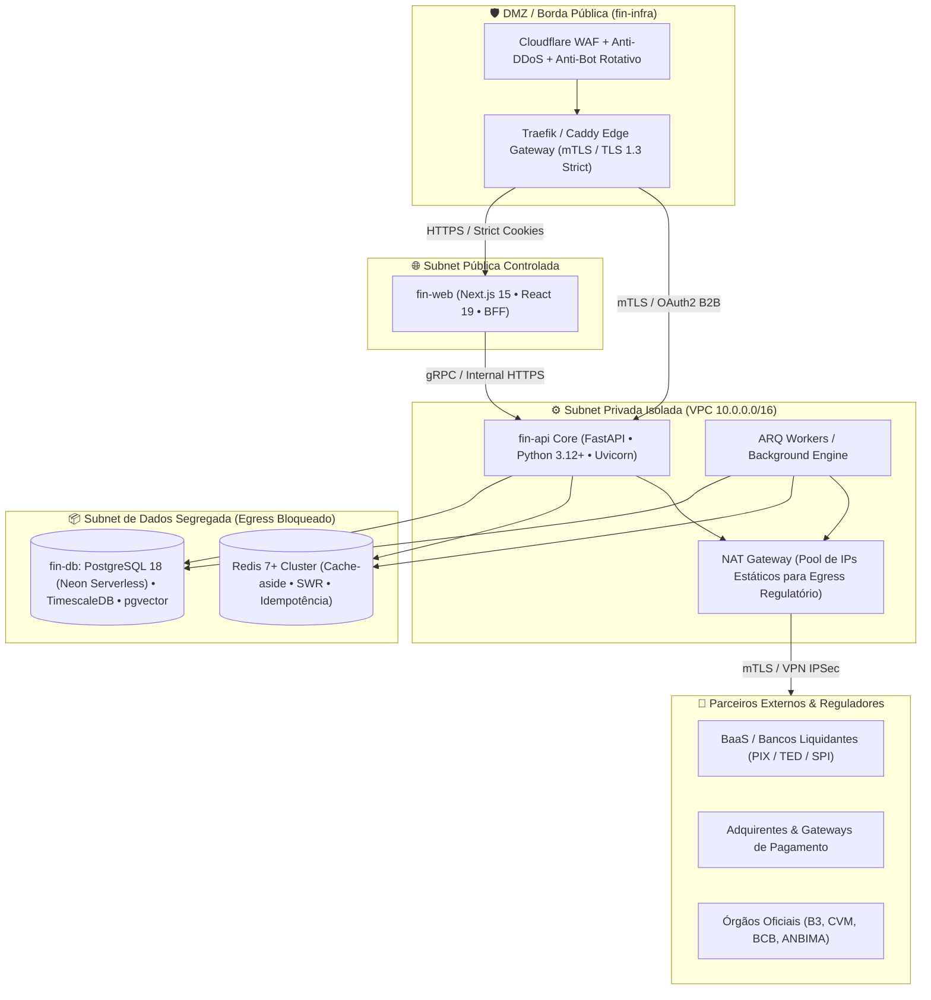
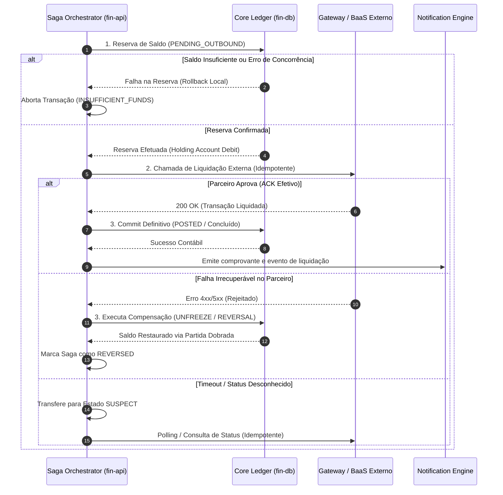
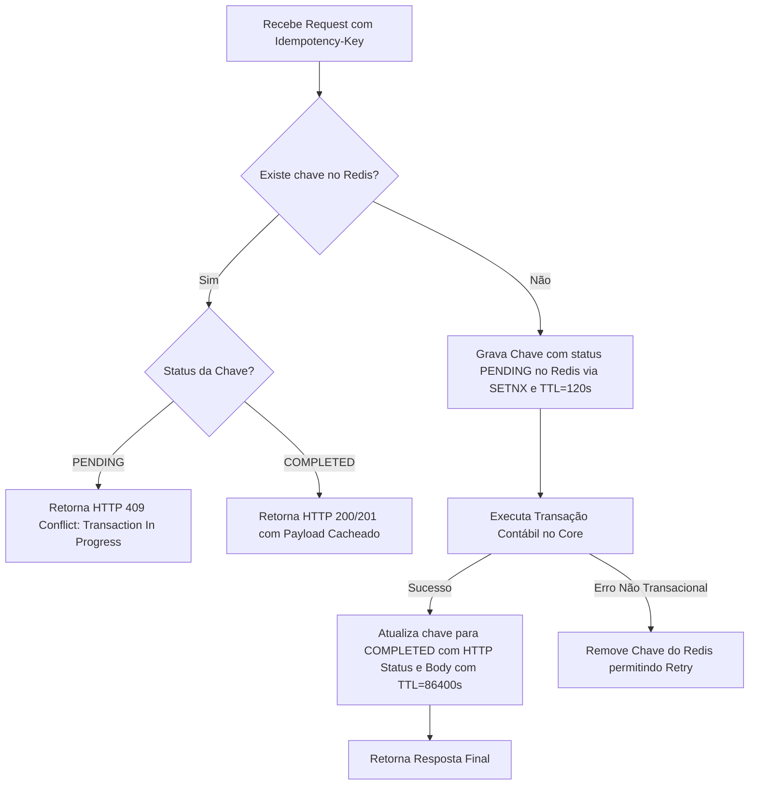
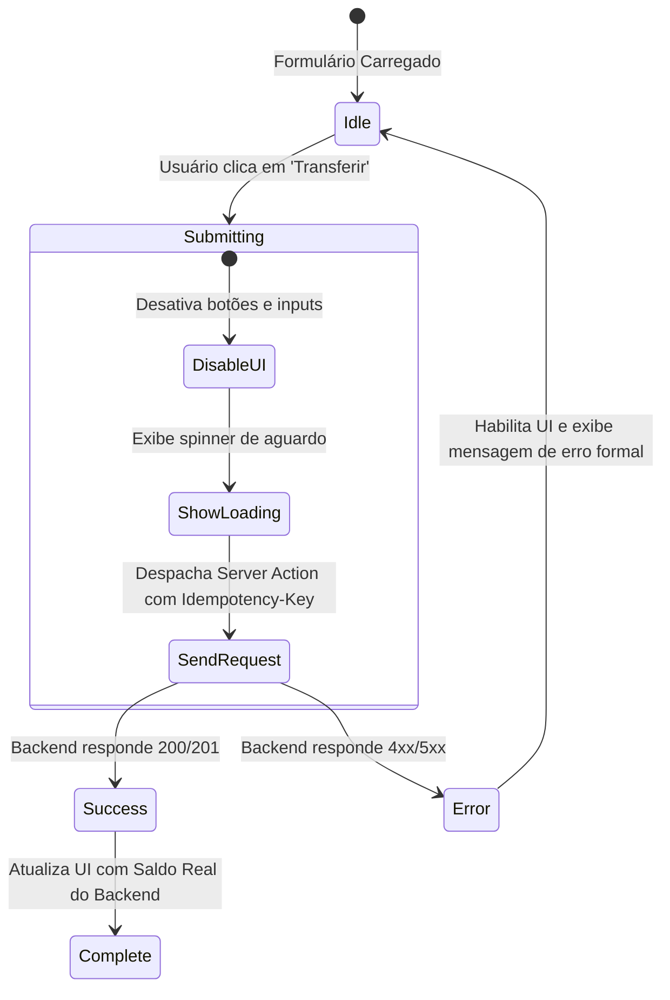
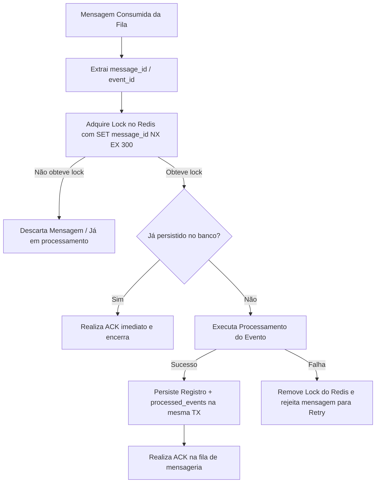
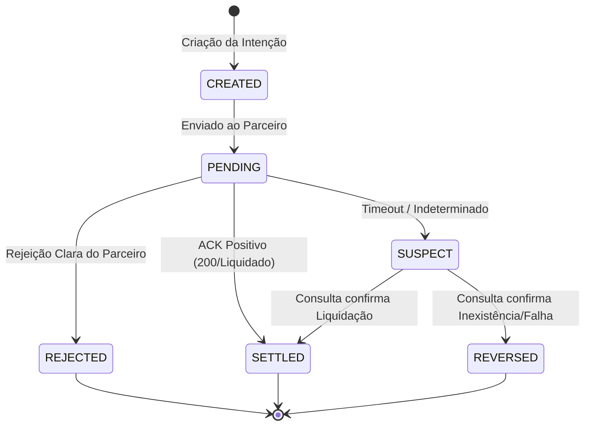
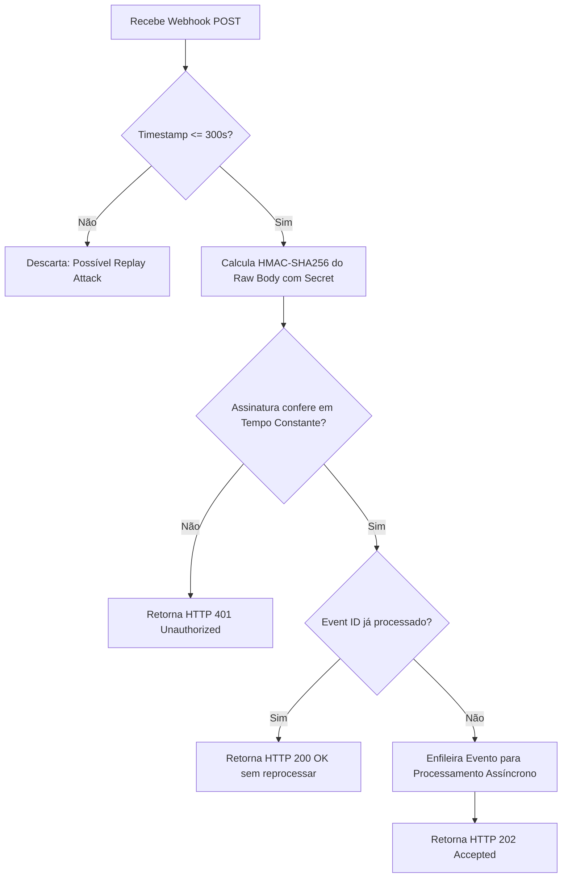
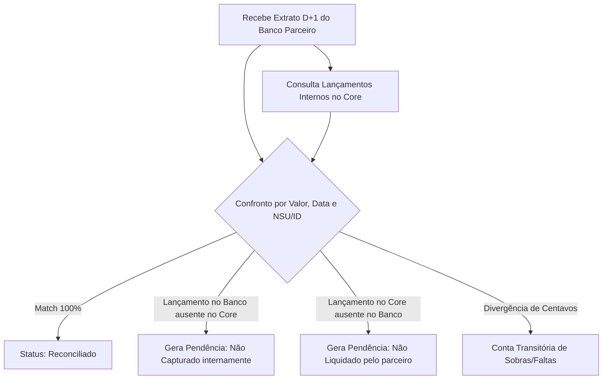

# 🏛️ Especificação Técnica de Arquitetura Financeira de Missão Crítica

**Classificação:** Executivo / Auditoria Técnica Contábil & Regulatória  
**Status:** Vigente (Normativo)  
**Módulos Relacionados:** [[fin-api/README|fin-api]], [[fin-db/README|fin-db]], [[fin-infra/README|fin-infra]], [[fin-ingestion/README|fin-ingestion]], [[fin-web/README|fin-web]]

---

## 1. Visão Geral da Arquitetura & Padrões Distribuídos

### 1.1 Topologia de Rede e Segmentação de Fronteiras
O sistema opera sob o modelo de **Zero Trust**, distribuído em zonas lógicas de isolamento criptográfico, roteamento restrito e ausência de acesso direto entre a borda pública e a camada de persistência:



- **DMZ & Borda (`[[fin-infra/README|fin-infra]]`):** Ponto único de terminação TLS externa (TLS 1.3 mandated), inspeção L7 (WAF), mitigação de DDoS e proxy anti-bot rotativo gerenciado por Traefik e Caddy. Nenhum tráfego público atinge diretamente a camada de banco de dados ou a API sem inspeção prévia.
- **Subnet Privada de Aplicação:** Hospeda as instâncias do `[[fin-api/README|fin-api]]` e os workers de execução assíncrona (ARQ). Não possui interfaces públicas ou IPs elásticos diretamente associados; todo o tráfego de saída destinado a parceiros financeiros (BaaS, BACEN/SPI, Adquirentes) transita obrigatoriamente por NAT Gateways com IPs estáticos e canais seguros (mTLS/IPSec).
- **Subnet de Dados Segregada:** Hospeda o `[[fin-db/README|fin-db]]` (PostgreSQL 18 Neon Serverless / TimescaleDB) e o cluster de cache transacional em memória (Redis). Não possui rotas de saída para a internet pública (`egress: none`), com portas de escuta restritas estritamente aos security groups da camada de aplicação.

---

### 1.2 Transações Distribuídas: Saga Orquestrada e Fluxos de Compensação
Em transferências bancárias complexas, pagamentos de boletos, liquidação instantânea (PIX) e compras de ativos, adota-se o padrão **Saga Orquestrada** gerenciada pelo núcleo do `[[fin-api/README|fin-api]]`.

A coreografia pura foi rejeitada por apresentar risco inaceitável de perda de visibilidade do estado global em auditorias regulatórias, dependência cíclica de mensagens e dificuldade de determinação determinística do estado durante falhas parciais de rede.



**Diretrizes Mandatórias de Compensação:**
1. A compensação contábil **nunca deleta** ou sobrescreve a reserva inicial; ela efetua um novo lançamento de estorno no ledger associado ao `saga_id`.
2. Em caso de *timeout* ou resposta indeterminada do parceiro, a saga entra no estado `SUSPECT` e inicia retentativas com verificação de status. O saldo jamais é desbloqueado sem comprovação formal de recusa do liquidante.

---

### 1.3 Confiabilidade na Publicação: Transactional Outbox Pattern
Para erradicar inconsistências entre a persistência em banco relacional e a publicação de eventos em corretores de mensagens (sem os custos de latência e pontos únicos de falha do Two-Phase Commit / 2PC), adota-se o padrão **Transactional Outbox**. O estado de negócio e o evento de outbox são comitados dentro da mesma transação ACID no PostgreSQL:

```sql
-- Execução atômica dentro de: BEGIN ... COMMIT
INSERT INTO accounting.journal_entries (id, tenant_id, reference_id, entry_type, status, total_amount_cents, created_at)
VALUES (v_journal_id, v_tenant_id, v_ref_id, 'TRANSFER_OUT', 'POSTED', v_amount_cents, CLOCK_TIMESTAMP());

INSERT INTO messaging.outbox_events (
    id,
    aggregate_type,
    aggregate_id,
    event_type,
    payload,
    tenant_id,
    status,
    created_at
) VALUES (
    gen_random_uuid(),
    'JOURNAL_ENTRY',
    v_journal_id,
    'JournalEntryCreated',
    jsonb_build_object(
        'journal_id', v_journal_id,
        'reference_id', v_ref_id,
        'amount_cents', v_amount_cents,
        'tenant_id', v_tenant_id,
        'occurred_at', CLOCK_TIMESTAMP()
    ),
    v_tenant_id,
    'PENDING',
    CLOCK_TIMESTAMP()
);
```

**Mecanismo de Despacho (CDC via Debezium vs. Polling):**
- **Arquitetura Primária (CDC via Debezium):** Debezium lê diretamente os registros de Write-Ahead Logging (WAL) do PostgreSQL utilizando a extensão lógica `pgoutput` via replication slots do PostgreSQL 18. Garante publicação com latência sub-segundo sem onerar o motor de queries.
- **Fallback Operacional:** Worker interno agendado executando `SELECT ... FOR UPDATE SKIP LOCKED` em lotes na tabela `messaging.outbox_events` caso ocorra degradação ou interrupção do conector CDC.

---

### 1.4 Modelo de Multitenancy e Limites de Uso
O isolamento de dados entre inquilinos e instituições financeiras parceiras adota o modelo de **Tabela Compartilhada com Row-Level Security (RLS)** nativo do PostgreSQL:

```sql
-- Ativação mandatória de RLS na tabela de lançamentos contábeis
ALTER TABLE accounting.journal_entries ENABLE ROW LEVEL SECURITY;
ALTER TABLE accounting.journal_entries FORCE ROW LEVEL SECURITY;

CREATE POLICY tenant_isolation_policy ON accounting.journal_entries
    FOR ALL
    USING (tenant_id = NULLIF(current_setting('app.current_tenant_id', true), '')::uuid);
```

**Injeção de Sessão Transacional:**
Cada conexão retirada do pool assíncrono do SQLAlchemy no `[[fin-api/README|fin-api]]` executa no início do handshake transacional:
```python
await session.execute(text("SET LOCAL app.current_tenant_id = :tenant_id"), {"tenant_id": str(tenant_id)})
```
Tentativas de consulta sem tenant contextualizado retornam zero linhas ou sofrem exceção de segurança imediata.

**Limites de Uso e Quotas por Tenant:**
- Implementação de limites de consumo e burst via algoritmo **Token Bucket** gerenciado no Redis 7+.
- Limites estritos de TPS (Transações Por Segundo) e contagem máxima de conexões simultâneas por `tenant_id`, blindando o cluster contra problemas de *noisy neighbors*.

---

## 2. API & Contratos de Serviço

### 2.1 Especificação Rigorosa de Idempotência
Toda requisição HTTP mutatória (`POST`, `PUT`, `PATCH`) em rotas financeiras requer obrigatoriamente o envio do cabeçalho `Idempotency-Key` (UUIDv4 válido).



**Diretrizes de Ciclo de Vida da Chave:**
1. **Armazenamento:** Registro volátil no Redis com chave `idemp:{tenant_id}:{idempotency_key}`.
2. **Concorrência Simultânea:** Caso uma segunda requisição chegue enquanto a primeira está em execução (`status: PENDING`), o gateway responde imediatamente `HTTP 409 Conflict` com cabeçalho `Retry-After: 3`.
3. **Repetição Pós-Conclusão:** O sistema devolve exatamente o status code original (`HTTP 200` ou `HTTP 201`) e o corpo da resposta armazenado em cache, adicionando o cabeçalho `X-Cache-Lookup: HIT - Idempotent Replay`.
4. **Divergência de Parâmetros:** A chave é atrelada ao hash SHA-256 do payload enviado. Se o mesmo identificador de idempotência for reaproveitado com corpo diferente, a chamada é rejeitada com `HTTP 422 Unprocessable Entity` (`IDEMPOTENCY_PAYLOAD_MISMATCH`).

---

### 2.2 Catálogo Padronizado de Códigos de Erro de Negócio
As falhas de negócio aderem à especificação RFC 7807 (*Problem Details for HTTP APIs*):

| Código de Erro | HTTP Status | Causa Raiz | Ação Recomendada |
| :--- | :--- | :--- | :--- |
| `INSUFFICIENT_FUNDS` | 422 | Saldo disponível insuficiente na conta de origem | Notificar usuário para aporte financeiro |
| `DAILY_LIMIT_EXCEEDED` | 422 | Limite de valor financeiro diário/mensal extrapolado | Solicitar aumento de teto cadastral |
| `ACCOUNT_BLOCKED` | 403 | Conta sob bloqueio cautelar (judicial ou fraude) | Acionar equipe de compliance |
| `IDEMPOTENCY_PAYLOAD_MISMATCH` | 422 | Mesma `Idempotency-Key` usada para payloads distintos | Corrigir geração de chaves no cliente |
| `CONCURRENT_TRANSACTION` | 409 | Lock de linha disputado no saldo ou conta destino | Retry automático com backoff exponencial |
| `EXTERNAL_GATEWAY_TIMEOUT` | 504 | Falha de resposta tempestiva do parceiro liquidante | Transição para estado assíncrono PENDING |

**Payload Padronizado:**
```json
{
  "type": "https://api.fin.internal/errors/INSUFFICIENT_FUNDS",
  "title": "Saldo Disponível Insuficiente",
  "status": 422,
  "code": "INSUFFICIENT_FUNDS",
  "detail": "A conta de origem possui saldo disponível de R$ 42,50, inferior ao valor da transação.",
  "instance": "/v1/transfers/8c2323a6-574d-4d76-b68a-a5518b45cba2",
  "invalid_params": [
    {
      "name": "amount_cents",
      "reason": "Excede o saldo disponível em 5750 centavos."
    }
  ],
  "timestamp": "2026-10-28T13:56:36Z",
  "trace_id": "7f8b3c10a4e8d2e1"
}
```

---

### 2.3 Padrão de Tipagem Monetária nos Contratos
> [!CAUTION]
> É terminantemente banido o uso de tipos de ponto flutuante (`float`, `double`) em contratos de API, schemas Pydantic e serializers. Tipos flutuantes causam imprecisão aritmética IEEE 754 inaceitável em auditorias contábeis.

- **Valores Monetários Comuns:** Inteiros de 64 bits representando a **menor unidade da moeda** (`amount_cents` em centavos para moedas com duas casas decimais como BRL e USD).
- **Cotações, Juros e Frações:** Strings numéricas decimais de ponto fixo contendo entre 4 e 8 casas decimais (`unit_price: "10.500000"`).

```json
{
  "transaction_id": "9b1deb4d-3b7d-4bad-9bdd-2b0d7b3dcb6d",
  "currency": "BRL",
  "amount_cents": 1050,
  "unit_exchange_rate": "5.452100",
  "fee_cents": 15
}
```

---

### 2.4 Segurança de Transporte, mTLS e Rate Limiting
1. **mTLS (Mutual TLS):** Mandatório em canais interserviços e integrações B2B bancárias. Certificados digitais x509 emitidos por autoridade certificadora interna com rotação automatizada via HashiCorp Vault.
2. **OAuth2 / OIDC:** Autenticação baseada em JWT assimétrico (EdDSA / RS256) validando escopos granulares mínimos (ex: `transfers:write`, `ledger:read`).
3. **Rate Limiting em Múltiplas Camadas:**
   - **Camada Edge (Traefik/Cloudflare):** Bloqueio por IP de origem contra volumetric attacks.
   - **Camada de Aplicação (`fin-api`):** Algoritmo Token Bucket no Redis particionado por par `tenant_id` + `client_id`.

---

## 3. Banco de Dados (PostgreSQL 18) & Modelagem Contábil

### 3.1 Tipos de Dados Monetários e Decisão de Tipagem
- **Coluna de Quantia:** `BIGINT` (menor unidade da moeda, centavos). Reduz footprint de disco, acelera junções e indexações comparado a strings, elimina qualquer truncamento e viabiliza operações com CPU nativa de 64 bits.
- **Taxas / Juros / Câmbio:** `NUMERIC(18, 8)` com arredondamento formal pelo método **Half to Even** (Round Half to Even / Banker's Rounding).

---

### 3.2 Modelagem de Ledger de Partidas Dobradas (Double-Entry Bookkeeping)
Nenhum saldo é modificado via comando `UPDATE`. Todo e qualquer evento financeiro é expresso por meio de um **Journal Entry** contendo pelo menos duas **Posting Lines** (uma a débito e outra a crédito), com a soma exata dos valores resultando em zero.

```sql
-- Extensões obrigatórias
CREATE EXTENSION IF NOT EXISTS "uuid-ossp";

-- 1. Cabeçalho da Transação (Journal Entry)
CREATE TABLE accounting.journal_entries (
    id UUID PRIMARY KEY DEFAULT gen_random_uuid(),
    tenant_id UUID NOT NULL,
    reference_id VARCHAR(128) NOT NULL,
    entry_type VARCHAR(64) NOT NULL,
    status VARCHAR(32) NOT NULL DEFAULT 'POSTED',
    description TEXT NOT NULL,
    created_at TIMESTAMPTZ NOT NULL DEFAULT CLOCK_TIMESTAMP(),
    CONSTRAINT uq_journal_entries_reference UNIQUE (tenant_id, reference_id)
);

-- 2. Linhas Contábeis (Posting Lines)
CREATE TABLE accounting.posting_lines (
    id UUID PRIMARY KEY DEFAULT gen_random_uuid(),
    tenant_id UUID NOT NULL,
    journal_entry_id UUID NOT NULL REFERENCES accounting.journal_entries(id) ON DELETE RESTRICT,
    account_id UUID NOT NULL,
    direction VARCHAR(2) NOT NULL CHECK (direction IN ('DR', 'CR')), -- Debit / Credit
    amount_cents BIGINT NOT NULL CHECK (amount_cents > 0),
    created_at TIMESTAMPTZ NOT NULL DEFAULT CLOCK_TIMESTAMP()
);

-- 3. Trigger / Constraint de Verificação Mandatória de Soma Zero
CREATE OR REPLACE FUNCTION accounting.fn_assert_journal_entry_balance()
RETURNS CONSTRAINT_TRIGGER AS $$
DECLARE
    v_net_balance BIGINT;
BEGIN
    SELECT COALESCE(SUM(
        CASE 
            WHEN direction = 'CR' THEN amount_cents 
            WHEN direction = 'DR' THEN -amount_cents 
        END
    ), 0)
    INTO v_net_balance
    FROM accounting.posting_lines
    WHERE journal_entry_id = NEW.journal_entry_id;

    IF v_net_balance <> 0 THEN
        RAISE EXCEPTION 'Double-entry balance violation: net balance is % cents (must be 0)', v_net_balance
            USING ERRCODE = '23514'; -- check_violation
    END IF;

    RETURN NULL;
END;
$$ LANGUAGE plpgsql;

CREATE CONSTRAINT TRIGGER trg_check_journal_balance
    AFTER INSERT OR UPDATE ON accounting.posting_lines
    DEFERRABLE INITIALLY DEFERRED
    FOR EACH ROW
    EXECUTE FUNCTION accounting.fn_assert_journal_entry_balance();
```

---

### 3.3 Controle de Concorrência: Locks Pessimistas vs. Append-Only
A prevenção de saldo negativo não depende de leituras otimistas que possam sofrer *race conditions*. Em operações que exigem checagem do saldo atual antes da autorização do débito:

```sql
-- 1. Bloqueia a linha da conta no início da transação
SELECT id, status 
FROM accounting.accounts 
WHERE id = :source_account_id AND tenant_id = :tenant_id
FOR UPDATE;

-- 2. Calcula o saldo consolidado no Ledger (Append-Only)
SELECT COALESCE(SUM(
    CASE 
        WHEN direction = 'CR' THEN amount_cents 
        WHEN direction = 'DR' THEN -amount_cents 
    END
), 0) AS current_balance_cents
FROM accounting.posting_lines
WHERE account_id = :source_account_id;

-- 3. A aplicação valida se current_balance_cents >= debit_amount_cents.
-- Se válido, insere o journal_entry e as posting_lines. Caso contrário, lança ROLLBACK.
```

Para alto throughput, adota-se **Account Bucketing** (segregação de contas transacionais transitórias em subcontas) ou **Ledgers Exclusivamente Append-Only**, onde saldos pontuais são gerados por meio de *materialized balances* com atualização assíncrona ou checkpoints balanceados.

---

### 3.4 Particionamento e Retenção com `pg_partman`
Tabelas de movimentação contábil (`accounting.posting_lines`) e trilha de auditoria crescem de forma exponencial. Adota-se o particionamento declarativo por intervalo de tempo (`RANGE (created_at)`), gerenciado pela extensão `pg_partman`:

```sql
CREATE TABLE accounting.posting_lines (
    id UUID NOT NULL,
    tenant_id UUID NOT NULL,
    journal_entry_id UUID NOT NULL,
    account_id UUID NOT NULL,
    direction VARCHAR(2) NOT NULL,
    amount_cents BIGINT NOT NULL,
    created_at TIMESTAMPTZ NOT NULL,
    PRIMARY KEY (id, created_at)
) PARTITION BY RANGE (created_at);

-- Configuração via pg_partman para partições mensais
SELECT partman.create_parent(
    p_parent_table => 'accounting.posting_lines',
    p_control => 'created_at',
    p_type => 'range',
    p_interval => '1 month',
    p_premake => 3
);
```

**Política de Retenção e Expurgos:**
- **Dados Ativos (0 a 24 meses):** Armazenamento em storage SSD NVMe de alta performance.
- **Arquivo Morto / Auditoria (24 a 60 meses):** Partições destacadas (`DETACH PARTITION`), exportadas para formato Parquet e enviadas a buckets S3/GCS em storage imutável com WORM/Object Lock.

---

### 3.5 Manutenção Operacional e Parâmetros de Autovacuum
Tabelas de alta taxa de inserção e atualização de tabelas de apoio sofrem de *table bloat*. Ajustes de performance no PostgreSQL para o catálogo de missão crítica:

```ini
# postgresql.conf
autovacuum = on
autovacuum_max_workers = 6
autovacuum_naptime = 15s

# Thresholds agressivos para tabelas de ledger
autovacuum_vacuum_threshold = 50
autovacuum_vacuum_scale_factor = 0.05
autovacuum_analyze_threshold = 50
autovacuum_analyze_scale_factor = 0.02

# Redução de custos de I/O em SSDs modernos
autovacuum_vacuum_cost_limit = 2000
autovacuum_vacuum_cost_delay = 2ms
```

---

## 4. Frontend & BFF (Next.js 15)

### 4.1 Delimitação Estrita de Fronteiras
- **Princípio:** O cliente (Next.js / Navegador) é considerado um ambiente **hostil e não confiável**.
- **Regra Absoluta:** O frontend **jamais** calcula saldos, juros, encargos, taxas de transferência ou totais a pagar. Toda regra matemática de negócios é de domínio exclusivo do `[[fin-api/README|fin-api]]`.
- **Validação de Entrada:** A validação no frontend (via Zod / React Hook Form) tem como único propósito a usabilidade (feedback visual de inputs inválidos), não servindo como garantia de segurança.

---

### 4.2 Responsabilidades do Next.js BFF (`[[fin-web/README|fin-web]]`)
- **Camada de Renderização e Orquestração:** Utiliza React Server Components (RSC) para buscar dados autenticados diretamente do backend sem expor segredos ou tokens de terceiros no browser.
- **Server Actions & Route Handlers:** Executam intermediações autenticadas, adicionando headers de segurança e correlacionamento (`X-Correlation-ID`) antes de bater no backend.
- **Gestão de Sessão:** Cookies HTTP-Only, Secure, SameSite=Strict contendo identificadores de sessão criptografados; tokens JWT de acesso bruto nunca trafegam nem são armazenados em `localStorage` ou `sessionStorage`.

---

### 4.3 Prevenção de Duplicidade na UI e Veto a Optimistic UI


> [!IMPORTANT]
> **Veto Formal a Optimistic UI em Débitos:**
> É estritamente proibido deduzir ou alterar saldos na tela do usuário de forma "otimista" antes da confirmação HTTP definitiva do backend. Lançamentos com sucesso presuntivo geram desalinhamento de expectativa caso a requisição sofra rejeição no core bancário.

---

### 4.4 Políticas de Cache e Cabeçalhos de Segurança
Rotas de dados financeiros, extratos e detalhes de transações contêm desativação mandatória de cache em níveis intermediários e de CDN:

```typescript
// app/api/financial/statement/route.ts
import { NextResponse } from 'next/server';

export const dynamic = 'force-dynamic';
export const revalidate = 0;

export async function GET(request: Request) {
  const data = await fetchStatementFromBackend();
  
  return NextResponse.json(data, {
    headers: {
      'Cache-Control': 'no-store, no-cache, must-revalidate, proxy-revalidate, max-age=0',
      'Pragma': 'no-cache',
      'Expires': '0',
      'Surrogate-Control': 'no-store'
    }
  });
}
```

---

### 4.5 Internacionalização e Formatação Monetária Segura
1. **Manipulação Segura:** Valores em centavos trafegam como inteiros e são formatados no momento da renderização utilizando `Intl.NumberFormat`:
   ```typescript
   export function formatCurrencyCents(amountCents: number, currency = 'BRL', locale = 'pt-BR'): string {
     return new Intl.NumberFormat(locale, {
       style: 'currency',
       currency: currency,
       minimumFractionDigits: 2,
       maximumFractionDigits: 2,
     }).format(amountCents / 100);
   }
   ```
2. **Timestamps:** Todos os carimbos de tempo trafegam no padrão ISO 8601 em UTC (`YYYY-MM-DDTHH:mm:ss.sssZ`). A conversão para o fuso horário local do usuário ocorre estritamente na camada de apresentação.

---

## 5. Ingestão de Dados, Pipelines & Processamento em Lote

### 5.1 Garantias de Mensageria e Deduplicação no Consumidor
- **Garantia de Entrega:** O pipeline de mensageria garante entrega no modelo **At-Least-Once**. O consumidor deve estar preparado para receber eventos duplicados.
- **Deduplicação Mandatória no Consumidor:** Cada worker valida e registra a chave de processamento antes de iniciar a execução:



---

### 5.2 Estratégias de Dead Letter Queue (DLQ) e Retry
- **Política de Retentativas:** Backoff exponencial com Full Jitter para evitar efeito manada (*thundering herd*):
  $$\Delta t = \min\left(t_{\max},\, t_{\text{base}} \times 2^{\text{retry}} + \text{uniform}(0, \text{jitter})\right)$$
- **Threshold de Falha:** 5 tentativas consecutivas. Após a quinta tentativa sem sucesso, a mensagem é despachada para a fila de descarte (`*.DLQ`).
- **Reprocessamento Manual:** A fila DLQ é monitorada via alertas críticos. Mensagens em DLQ não são descartadas automaticamente; seu reprocessamento exige submissão por ferramenta operacional autenticada após correção da causa raiz.

---

### 5.3 Processamento em Lote de Arquivos Externos (CNAB 240/400)
1. **Validação de Integridade e Duplicidade de Arquivo:**
   - Cálculo imediato de hash SHA-256 do arquivo recebido.
   - Consulta à tabela `ingestion.file_registry`. Se o hash já existir para a mesma instituição pagadora, o arquivo é rejeitado sumariamente (`FILE_ALREADY_PROCESSED`).
2. **Staging Tables Brutas:**
   - Os registros são carregados integralmente para tabelas de staging (`ingestion.staging_cnab_records`) sem transformações analíticas, mantendo o payload textual original para fins periciais.
3. **Quarentena:**
   - Registros de detalhe com inconsistências de formatação, DV bancário inválido ou soma divergente do header/trailer vão para a tabela de quarentena `ingestion.quarantine_records`, sem paralisar o lote saudável.

---

### 5.4 Otimização de Performance: `COPY` vs. `INSERT`
Para grandes volumes de extratos bancários e arquivos CNAB:
- **Carga de Alta Velocidade:** Emprego de comandos `COPY ... FROM STDIN (FORMAT csv)` via pipeline stream, atingindo ordens de grandeza superiores a queries `INSERT` individuais.
- **Estratégia de Índices:** Em batches contendo mais de $10^6$ linhas, os índices secundários da tabela de staging são desativados antes do início do lote e reconstruídos via `CREATE INDEX CONCURRENTLY` logo após a carga.
- **Coleta de Estatísticas:** Execução mandatória de `ANALYZE ingestion.staging_cnab_records;` após a carga massiva para recalcular planos de execução do otimizador de consultas.

---

### 5.5 Protocolo de Migração de Saldos Históricos (Cutover)
Na migração de legados ou cutover de ambientes, o balanço de corte obedece à equação contábil estrita:

$$\sum_{i=1}^{N} \text{Saldo\_Origem}(i) = \sum_{j=1}^{M} \text{Linhas\_Lançadas\_Débito}(j) - \sum_{k=1}^{P} \text{Linhas\_Lançadas\_Crédito}(k) = 0$$

- **Execução:** O cutover bloqueia novas escritas, emite um snapshot das contas legadas, injeta um lote de balanceamento contra uma conta de liquidação transitória (`Migration_Clearing_Account`) e executa um script de conferência linha a linha.
- Se a divergência líquida for $\neq 0$, o processo sofre Rollback total imediato.

---

## 6. Integrações com Terceiros (BaaS, Bancos & Adquirentes)

### 6.1 Protocolos de Integração e Gestão de Segredos
- **Protocolos:** REST/JSON sobre TLS 1.3 para serviços modernos; ISO 8583 sobre TCP com canal mTLS e PIN blocks criptografados sob HSM para processamento de cartões; SFTP com chaves SSH RSA 4096-bit para troca de arquivos CNAB/conciliação de adquirentes.
- **Gestão de Segredos:** Nenhuma credencial trafega em código ou variáveis de ambiente estáticas. Integração com HashiCorp Vault / AWS Secrets Manager com renovação dinâmica de certificados e tokens mTLS com antecedência de 30 dias da expiração.

---

### 6.2 Máquina de Estados Transacionais



**Matriz de Equivalência de Status:**

| Status Interno Core | Status SPI / BACEN (PIX) | Status CIP (Boletos) | Status Adquirente |
| :--- | :--- | :--- | :--- |
| `CREATED` | `EM_PROCESSAMENTO` | `CADASTRADO` | `INITIATED` |
| `PENDING` | `AGUARDANDO_LIQUIDACAO` | `EM_TRANSITO` | `PENDING_CAPTURE` |
| `SETTLED` | `LIQUIDADO` | `BAIXADO_EFETIVO` | `CAPTURED` |
| `REJECTED` | `DEVOLVIDO_CANCELADO` | `REJEITADO` | `DENIED` |
| `SUSPECT` | `EM_ANALISE_TEMPO` | `PENDENTE_CONFIRMACAO`| `IN_REVIEW` |

---

### 6.3 Resiliência: Circuit Breaker e Fallback
Implementação com Resilience4j / CircuitBreaker pattern no cliente HTTP interno:
- **Janela de Medição:** Últimas 100 requisições.
- **Critério de Abertura (OPEN):** Taxa de falhas (HTTP 5xx ou timeouts > 3000ms) $\ge 50\%$.
- **Tempo no Estado Aberto:** 30 segundos, rejeitando imediatamente as requisições (`FAIL_FAST`) sem sobrecarregar o parceiro.
- **Estado Meio-Aberto (HALF-OPEN):** Permite 10 requisições de teste. Se a taxa de sucesso for $\ge 90\%$, o circuito retorna ao estado **CLOSED**; caso contrário, reabre por mais 60 segundos.
- **Política de Fallback:** Transações não-críticas entram em fila assíncrona; liquidações instantâneas retornam erro amigável ao cliente com recomendação de canal alternativo.

---

### 6.4 Ingestão Segura de Webhooks
Os endpoints receptores de webhooks aplicam três filtros de segurança sucessivos:



**Código de Comparação de Assinatura (Python / `fin-api`):**
```python
import hmac
import hashlib
import time

def verify_webhook_signature(raw_body: bytes, signature_header: str, timestamp_header: str, secret: str) -> bool:
    # 1. Validação de Janela de Tolerância (5 minutos)
    current_time = int(time.time())
    request_time = int(timestamp_header)
    if abs(current_time - request_time) > 300:
        return False
    
    # 2. Construção do Payload Assinado
    signed_payload = f"{timestamp_header}.".encode('utf-8') + raw_body
    expected_signature = hmac.new(
        secret.encode('utf-8'),
        signed_payload,
        hashlib.sha256
    ).hexdigest()
    
    # 3. Comparação em Tempo Constante (Imune a Timing Attacks)
    return hmac.compare_digest(expected_signature, signature_header)
```

---

## 7. Auditoria, Segurança & Compliance

### 7.1 Trilha de Auditoria Imutável (Audit Trail)
- **Armazenamento:** Eventos de auditoria gerados por triggers e interceptors de aplicação são gravados em tabelas append-only.
- **Preservação:** Exportação diária dos logs de transações e acesso para buckets em nuvem com **WORM (Write Once, Read Many) / Object Lock** em modo de conformidade (*Compliance Mode*), impedindo deleção ou adulteração inclusive por administradores raiz (*root*).

---

### 7.2 Metadados de Rastreabilidade Obrigatórios
Todo registro persistido e log gerado possui o seguinte payload canônico de metadados:

```json
{
  "correlation_id": "9a7f34c2-6712-4f32-843b-74d271928374",
  "trace_id": "4bf92f3577b34da6a3ce929d0e0e4736",
  "actor": {
    "type": "USER",
    "id": "e2926710-1845-4a6f-9988-cb2349887711",
    "session_id": "sess_89a7df6b5c3",
    "ip_address": "198.51.100.42",
    "user_agent": "Mozilla/5.0 ...",
    "tenant_id": "7737f190-3329-4d64-a6c6-9907f985094d"
  },
  "action": "LEDGER_ENTRY_POSTED",
  "resource": "accounting.journal_entries/8c2323a6-574d-4d76-b68a-a5518b45cba2",
  "timestamp_utc": "2026-10-28T13:56:36.123456Z"
}
```

---

### 7.3 Proteção de Dados Sensíveis (LGPD / PCI-DSS)
1. **Criptografia em Repouso:** Bancos de dados e storages protegidos via criptografia AES-256 com chaves gerenciadas em KMS (Key Management Service) com rotação periódica automática.
2. **Mascaramento em Logs (Sanitização Automática):**
   - PAN (Número do Cartão): Exibe no máximo os 6 primeiros e 4 últimos dígitos (`411111******1111`).
   - CVV/CVC e Senhas/PINs: **Nunca** gravados em logs, dumps, caches ou arquivos de telemetria. Tráfego purgado antes da camada de logging.
   - CPF/Identificadores Fiscais: Pseudonimizados ou mascarados (`***.456.789-**`).

---

### 7.4 Princípio do Menor Privilégio (PoLP) e Protocolo Break-Glass
- **Acesso Zero em Produção:** Desenvolvedores e engenheiros não possuem acesso de leitura ou escrita direta ao ambiente produtivo do banco de dados.
- **Protocolo Break-Glass (Acesso Just-In-Time):**
  1. O operador solicita credencial temporária via portal interno com justificativa e número de chamado (Jira/ServiceNow).
  2. Aprovação mandatória de pelo menos dois aprovadores independentes (Quorum 2-Man Rule).
  3. Emissão de credencial temporária via HashiCorp Vault com TTL máximo de 2 horas.
  4. Todas as sessões SSH e comandos SQL emitidos são gravados integralmente em vídeo e texto para auditoria posterior.

---

### 7.5 Velocity Checks e Controles Anti-Fraude
Travas automáticas de execução no pipeline de autorização:
- **Teto por Transação:** Limite monetário máximo individual por perfil de usuário.
- **Teto Diário Acumulado:** Contador volátil em memória (Redis) com decremento de limite em tempo real.
- **Velocity Check:** Alerta e bloqueio caso a mesma conta de origem tente disparar mais de 3 transações para o mesmo recebedor em uma janela inferior a 60 segundos.

---

## 8. Playbooks Operacionais, Incidentes & Reconciliação

### 8.1 Matriz de Conciliação Diária (D-0 e D+1)
A reconciliação financeira opera em duas janelas cronológicas:
- **D-0 (Intraday):** Batimento contínuo de mensagens de liquidação (ex: SPI/PIX) contra o Ledger interno a cada 15 minutos.
- **D+1 (Extrato Consolidado):** Processamento do arquivo de extrato oficial enviado pela instituição liquidante/banco parceiro.



**Tratamento de Sobras/Faltas de Centavos:**
Divergências pontuais decorrentes de arredondamentos de juros ou tarifas de adquirentes são lançadas em contas contábeis específicas de ajustes operacionais (`Operational_Rounding_Discrepancies`), desde que situadas abaixo da régua de tolerância auditável (limite operacional máximo de R$ 0,05 por operação; desvios superiores paralisam a conciliação do lote para intervenção humana).

---

### 8.2 Runbook: Indisponibilidade Prolongada de Parceiro Financeiro
1. **Identificação e Alerta:** Circuit breaker aberto por mais de 5 minutos consecutivos aciona o PagerDuty do time de Incident Management e ativa a sala de guerra (*War Room*).
2. **Degradação Graciosa:** O sistema atualiza o catálogo de métodos de transferência no frontend (`[[fin-web/README|fin-web]]`), desativando o parceiro fora do ar e apresentando a opção de liquidação assíncrona ou parceiro secundário.
3. **Contenção:** Transações recebidas para o parceiro são aceitas no estado `PENDING_RETRY` e depositadas em fila assíncrona persistente.
4. **Retomada Controlada:** Quando o parceiro restabelecer a conectividade, o dreno da fila de retentativa é liberado gradualmente (*rate throttled* a 20% do TPS máximo do parceiro) para não provocar novas rejeições ou saturação na recuperação.

---

### 8.3 Procedimento Operacional Padrão: Estornos e Chargebacks
> [!WARNING]
> Jamais altere ou exclua o registro contábil de uma transação contestada.

```sql
-- 1. Criação do registro contábil de estorno (Journal Entry reverso)
INSERT INTO accounting.journal_entries (id, tenant_id, reference_id, entry_type, description)
VALUES (gen_random_uuid(), :tenant_id, :reversal_ref_id, 'CHARGEBACK_REVERSAL', 'Estorno decorrente de contestação judicial/adquirente');

-- 2. Lançamento das pernas contábeis invertidas
-- Se a transação original foi Débito Conta A e Crédito Conta B, o estorno será:
INSERT INTO accounting.posting_lines (journal_entry_id, tenant_id, account_id, direction, amount_cents)
VALUES 
    (:journal_id, :tenant_id, :conta_b_recebedor, 'DR', :amount_cents), -- Debita quem recebeu
    (:journal_id, :tenant_id, :conta_a_pagador,   'CR', :amount_cents); -- Credita quem pagou originariamente
```

Caso a `conta_b_recebedor` não possua saldo suficiente para absorver o débito do estorno, o saldo disponível torna-se zero e a diferença negativa é lançada na conta de provisão de devedores duvidosos ou saldo bloqueado negativo administrativo, nunca violando a integridade das partidas dobradas.

---

### 8.4 Métricas de Disaster Recovery (DR) e Procedimentos de Backup

| Métrica | Meta / Threshold | Implementação Técnica |
| :--- | :--- | :--- |
| **RPO** (*Recovery Point Objective*) | $< 60\text{ segundos}$ | Replicação física síncrona/semi-síncrona do PostgreSQL entre zonas de disponibilidade (Multi-AZ) e envio contínuo de WALs arquivados para bucket redundante |
| **RTO** (*Recovery Time Objective*) | $< 15\text{ minutos}$ | Failover automático via orquestração de banco com Patroni/Kubernetes e infraestrutura provisionada via Terraform em região secundária |

- **Rotina de Backup:** Snapshot integral das bases de dados executado diariamente à 01:00 UTC, acompanhado de arquivo contínuo de WAL (*Write-Ahead Logging*).
- **Testes de Disaster Recovery:** Simulação programada semestral em ambiente isolado, executando restauração completa a partir de snapshots aleatórios e reprodução de WAL (*Point-in-Time Recovery - PITR*) com validação automatizada de balanceamento do ledger pós-restauração.
