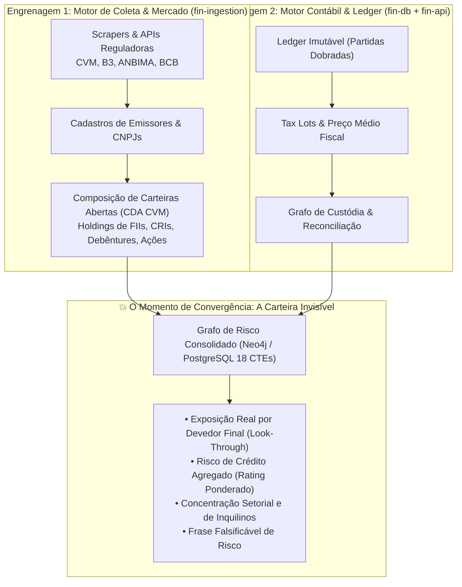

# 👁️ A Tese da Carteira Invisível & Arquitetura Dual-Engine

> *"O momento exato: quando o Fin enxerga a carteira que nenhum portal consegue ver."* — Síntese Arquitetural da Conversa 11.

---

## 🧐 O Problema Estrutural dos Portais Tradicionais

Todos os 12 portais analisados no mercado brasileiro (Status Invest, Investidor10, Fundamentei, Fundamentus, Clube FII, etc.) compartilham a mesma limitação congênita:
- Eles tratam ativos como **entidades isoladas** em gavetas fechadas (*Ações*, *FIIs*, *Fundos*, *Renda Fixa*).
- Eles limitam o controle de carteira a uma planilha superficial com quantidade, preço de compra e rentabilidade bruta.
- **Eles são cegos para o devedor final e para as correlações ocultas de risco.**

### O Caso Prático da "Falsa Diversificação"
Imagine um investidor conservador que monta a seguinte carteira:

| Tipo | Ativo Adquirido | Descrição do Investimento | O Que o Investidor Pensa | O Que os Portais Mostram |
|---|---|---|---|---|
| **Ação** | `VALE3` | Ações ordinárias da mineradora Vale S.A. | Risco de Bolsa de Valores | Ação do setor de Mineração |
| **FII Tijolo**| `HGLG11` | Fundo Imobiliário de Galpões Logísticos | Risco de Imóveis Físicos | Fundo Imobiliário de Tijolo |
| **FII Papel** | `KNIP11` | Fundo de Papel (Certificados de Recebíveis Imobiliários - CRIs) | Risco de Juros / IPCA | Fundo Imobiliário de Papel |
| **Fundo** | `Fundo Multimercado Alfa` | Cota de Fundo de Investimento (CVM 175) | Gestor qualificado de Crédito Privado | Fundo Multimercado |

#### O Diagnóstico Real Revelado pelo Fin
Quando o Fin aplica o motor de **Look-Through de Devedores e Garantias**:
1. O galpão logístico de maior receita do `HGLG11` é alugado para a **Vale S.A.**.
2. O principal CRI em carteira do `KNIP11` é lastreado em debêntures de infraestrutura emitidas pela **Vale S.A.**.
3. A carteira aberta (CDA CVM) do fundo multimercado carrega 15% de patrimônio em notas comerciais da **Vale S.A.**.

> **Resultado Oculto:** O investidor, que acreditava estar diversificado em quatro classes de ativos diferentes, possui mais de **45% do seu patrimônio total exposto à saúde financeira e capacidade de pagamento de uma única empresa**. Se a Vale entrar em crise, todas as quatro posições sofrem rebaixamento simultâneo.

---

## ⚙️ A Solução: Arquitetura Dual-Engine

Para resolver a cegueira analítica do mercado, o Fin foi construído com duas engrenagens autônomas que dialogam por grafos relacionais:



---

## 📐 O Conceito de "Frase Falsificável de Risco"

O Fin abandona resumos vagos e gera **frases falsificáveis matematicamente auditáveis** para cada carteira:

> *"Sua carteira aparenta estar 60% em Renda Fixa e 40% em Renda Variável, mas 28% do seu patrimônio total depende da solvência de debêntures e aluguéis do setor de Telecomunicações (devedor principal: Claro S.A.)."*

### Como o Fin Calcula o Look-Through no PostgreSQL 18
Através de consultas recursivas (`WITH RECURSIVE`) navegando pelas tabelas relacionais do `fin-db`:

```sql
WITH RECURSIVE lookthrough_devedor AS (
    -- Nível 1: Ativos detidos diretamente na custódia do usuário
    SELECT 
        c.usuario_id,
        c.instrument_id,
        inst.ticker,
        inst.emissor_legal_entity_id AS devedor_id,
        c.quantidade * cot.preco_fechamento AS valor_exposto,
        1 AS nivel
    FROM core.custodia c
    JOIN canonical.instrument inst ON c.instrument_id = inst.instrument_id
    JOIN market.cotacao_diaria cot ON cot.instrument_id = c.instrument_id
    WHERE c.usuario_id = :usuario_id
      AND cot.tempo = (SELECT MAX(tempo) FROM market.cotacao_diaria WHERE instrument_id = c.instrument_id)

    UNION ALL

    -- Nível 2 e N: Desdobramento de Fundos, FIIs e CRIs nos devedores finais
    SELECT 
        lt.usuario_id,
        comp.instrument_filho_id AS instrument_id,
        filho.ticker,
        filho.emissor_legal_entity_id AS devedor_id,
        (lt.valor_exposto * (comp.peso_percentual / 100.0)) AS valor_exposto,
        lt.nivel + 1
    FROM lookthrough_devedor lt
    JOIN asset_details.composicao_carteira_fundo comp ON comp.instrument_pai_id = lt.instrument_id
    JOIN canonical.instrument filho ON filho.instrument_id = comp.instrument_filho_id
    WHERE lt.nivel < 4 -- Máximo 4 níveis de profundidade
)
SELECT 
    le.razao_social AS devedor_final,
    le.cnpj,
    SUM(valor_exposto) AS exposicao_total_brl,
    ROUND((SUM(valor_exposto) / (SELECT SUM(valor_exposto) FROM lookthrough_devedor WHERE nivel = 1)) * 100, 2) AS pct_patrimonio_total
FROM lookthrough_devedor lt
JOIN canonical.legal_entity le ON le.legal_entity_id = lt.devedor_id
GROUP BY le.razao_social, le.cnpj
ORDER BY exposicao_total_brl DESC;
```

---

## 🔗 Referências Cruzadas
- [[Arquitetura_Geral_Ecossistema_Fin|Arquitetura Geral do Ecossistema]]
- [[Conv_09_a_14_Auditoria_Ativos_Reais_Web_e_ETL|Conversas 09 a 14: Auditoria e Formulação da Tese]]
- [[Modelagem_Relacional_12_Schemas|Esquemas Relacionais do fin-db]]
