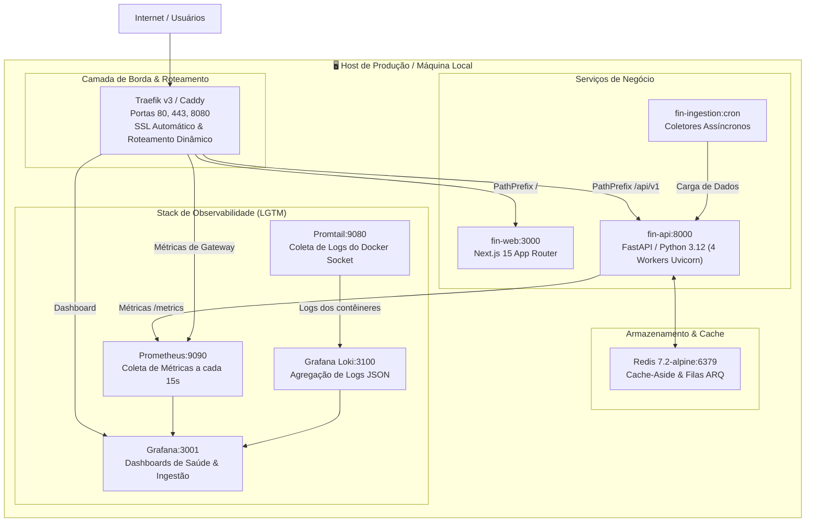

# 🛡️ Topologia de Produção, Orquestração e Observabilidade

Este documento detalha a infraestrutura como código (IaC), a orquestração via Docker Compose e a malha de observabilidade (LGTM Stack) do repositório **`fin-infra`**.

---

## 🏛️ Topologia Local e de Contêineres (Docker Compose)



---

## ⚙️ Especificação do Gateway de Borda (Traefik)

O arquivo `docker-compose.yml` em `fin-infra` configura labels dinâmicos de roteamento:

```yaml
services:
  traefik:
    image: traefik:v3.1
    command:
      - "--api.dashboard=true"
      - "--providers.docker=true"
      - "--providers.docker.exposedbydefault=false"
      - "--entryPoints.web.address=:80"
      - "--entryPoints.websecure.address=:443"
      - "--certificatesresolvers.myresolver.acme.tlschallenge=true"
      - "--certificatesresolvers.myresolver.acme.email=admin@fin.internal"
      - "--certificatesresolvers.myresolver.acme.storage=/letsencrypt/acme.json"
    ports:
      - "80:80"
      - "443:443"
    volumes:
      - "/var/run/docker.sock:/var/run/docker.sock:ro"
      - "traefik-certificates:/letsencrypt"

  fin-api:
    build:
      context: ../fin-api
      dockerfile: Dockerfile
    environment:
      - DATABASE_URL=${DATABASE_URL}
      - REDIS_URL=redis://redis:6379/0
      - ENVIRONMENT=production
    labels:
      - "traefik.enable=true"
      - "traefik.http.routers.fin-api.rule=Host(`api.fin.local`) || PathPrefix(`/api/v1`)"
      - "traefik.http.routers.fin-api.entrypoints=websecure"
      - "traefik.http.routers.fin-api.tls.certresolver=myresolver"
      - "traefik.http.services.fin-api.loadbalancer.server.port=8000"

  fin-web:
    build:
      context: ../fin-web
      dockerfile: Dockerfile
    labels:
      - "traefik.enable=true"
      - "traefik.http.routers.fin-web.rule=Host(`fin.local`) || PathPrefix(`/`)"
      - "traefik.http.routers.fin-web.entrypoints=websecure"
      - "traefik.http.routers.fin-web.tls.certresolver=myresolver"
      - "traefik.http.services.fin-web.loadbalancer.server.port=3000"
```

---

## 📊 Observabilidade Unificada (LGTM Stack)

### 1. Métricas no Prometheus (`:9090`)
- **Latência de Requisição HTTP:** histogramas `http_request_duration_seconds` percentis p50, p90, p99.
- **Saúde do Pool de Conexões Neon:** medidores de conexões ativas, ociosas e tempo de espera de checkout via SQLAlchemy async.
- **Taxa de Acertos do Cache Redis:** taxa de `cache_hits / (cache_hits + cache_misses)`.

### 2. Logs Estruturados no Grafana Loki (`:3100`)
- Todos os serviços emitem logs exclusivamente em formato JSON via stdout:
  ```json
  {"timestamp": "2026-10-28T11:00:00Z", "level": "INFO", "service": "fin-api", "trace_id": "a6c1f721", "route": "/api/v1/assets/PETR4", "status_code": 200, "duration_ms": 14.2}
  ```
- O Promtail consome os logs diretamente do socket do Docker e indexa os campos `service`, `level` e `status_code`.

### 3. Dashboards no Grafana (`:3001`)
- **Dashboard 1: Saúde do Ecossistema** — Visão em tempo real de RPS (requisições por segundo), taxa de erros 4xx/5xx e latência global.
- **Dashboard 2: Ingestão & Pipelines** — Monitoramento de jobs executados, volume de registros inseridos por fonte (B3, CVM, Status Invest) e tempo de execução do dbt.

---

## 🔗 Referências Cruzadas
- [[Arquitetura_Geral_Ecossistema_Fin|Arquitetura Geral do Ecossistema]]
- [[Deployment_Cloud_Gratuito_Zero_Cost|Deploy Cloud Gratuito]]
- [[Relatorio_Executivo_Auditoria_Producao|Relatório de Auditoria em Produção]]
