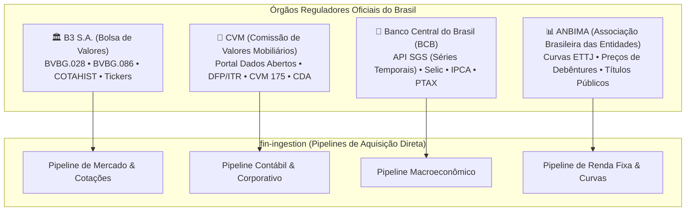

# 🏛️ REA Órgãos Oficiais: B3, CVM, BCB e ANBIMA

O ecossistema Fin prioriza conexões diretas aos **quatro órgãos oficiais reguladores do mercado financeiro nacional**. Isso elimina intermediários, reduz a dependência de scraping instável e confere precisão auditável de nível institucional.

---

## 🧭 Mapa das Quatro Fontes Primárias

---

## 1. 🏛️ B3 (Brasil, Bolsa, Balcão)

### Protocolos e Formatos Ingeridos:
1. **BVBG.028 (Cadastro de Instrumentos Financeiros):**
   - Arquivo diário em XML padronizado internacionalmente (ISO 20022).
   - Informa todos os ativos negociáveis: tickers, códigos ISIN (`BR...`), especificação do ativo (ON, PN, CI), tamanho de lote padrão e data de início de negociação.
2. **BVBG.086 (Preços de Fechamento e Ajustes):**
   - Arquivo diário em XML com preços de fechamento oficial, volume financeiro, quantidade de negócios e preços de ajuste do mercado de derivativos e futuros.
3. **COTAHIST (Série Histórica Diária B3):**
   - Arquivo anual e diário em formato posicional fixo contendo todas as negociações de ações, fundos imobiliários, BDRs e opções:
     - Formato: Data do pregão (`AAAAMMDD`), código de negociação (`ticker`), tipo de mercado (`010` para vista), nome resumido da empresa, preço de abertura, máxima, mínima, preço médio e fechamento.

---

## 2. 📜 CVM (Comissão de Valores Mobiliários)

### Protocolos e Conjuntos de Dados (Portal Dados Abertos CVM):
1. **DFP (Demonstrações Financeiras Padronizadas — Anual):**
   - Arquivos CSV compactados (ZIP) anuais auditados por auditores independentes:
     - Balanço Patrimonial Ativo (BPA) e Balanço Patrimonial Passivo (BPP).
     - Demonstração do Resultado do Exercício (DRE).
     - Demonstração do Fluxo de Caixa (DFC Método Direto e Indireto).
     - Demonstração das Mutações do Patrimônio Líquido (DMPL) e Valor Adicionado (DVA).
2. **ITR (Informações Trimestrais):**
   - Balanços intermediários divulgados obrigatoriamente a cada 3 meses com revisão especial.
3. **FRE (Formulário de Referência):**
   - Documento que detalha controle acionário, composição societária, remuneração da administração (Item 13) e fatores de risco.
4. **Regulação CVM 175 (Fundos de Investimento):**
   - **Informe Diário de Fundos:** Arquivo diário com valor da cota, patrimônio líquido diário, captação e resgate de todos os fundos registrados.
   - **CDA (Composição e Diversificação das Aplicações):** Arquivo mensal (com defasagem legal de 90 dias) detalhando cada título público, debênture e ação detida pelo fundo. Essencial para o cálculo do **Look-Through do Fin**.

---

## 3. 🏦 BCB (Banco Central do Brasil)

### API SGS (Sistema Gerenciador de Séries Temporais):
Acesso direto via REST API sem necessidade de chave de autenticação (`https://api.bcb.gov.br/dados/serie/bcdata.sgs.{codigo}/dados?formato=json`):

| Indicador | Código da Série SGS | Frequência | Utilização no Fin |
|---|:---:|:---:|---|
| **Taxa Selic Meta** | `432` | Diária | Taxa livre de risco ($R_f$) base para modelos de Valuation (CAPM). |
| **Taxa Selic Over Efetiva** | `11` | Diária | Base de cálculo da rentabilidade diária de caixa. |
| **Taxa CDI Diária** | `12` | Diária | Benchmark padrão para fundos e ativos de renda fixa. |
| **IPCA (Índice de Preços ao Consumidor)** | `433` | Mensal | Inflação oficial usada para cálculo de juro real (Tesouro IPCA+). |
| **IGP-M (Índice Geral de Preços - Mercado)** | `189` | Mensal | Indexador da maioria dos contratos de locação dos FIIs de tijolo. |
| **Dólar Comercial PTAX (Venda)** | `1` | Diária | Conversão cambial de ativos internacionais e ADRs. |

---

## 4. 📊 ANBIMA (Associação Brasileira das Entidades dos Mercados Financeiro e de Capitais)

### Conjuntos de Dados e Curvas Ingeridos:
1. **Curvas ETTJ (Estrutura a Termo das Taxas de Juros):**
   - Parâmetros matemáticos da curva de juros obtidos pelo modelo de Svensson:
     - Curva ETTJ Prefixada (taxa zero de juros para prazos de 1 dia a 10 anos).
     - Curva ETTJ IPCA (juro real da economia para títulos públicos NTN-B).
     - Curva ETTJ Dólar / Cupom Cambial.
2. **Preços e Taxas Indicativas de Debêntures:**
   - Tabela diária com spread sobre o CDI ou spread sobre o IPCA de debêntures corporativas negociadas no mercado secundário.
3. **Títulos Públicos Federais (Tesouro Direto / Mercado Secundário):**
   - Taxas de compra e venda indicativas para LFT (Tesouro Selic), LTN / NTN-F (Tesouro Prefixado) e NTN-B (Tesouro IPCA+).

---

## 🔗 Referências Cruzadas
- [[Matriz_Unificada_12_Portais_e_Gaps|Matriz Unificada dos 12 Portais]]
- [[Plano_Mestre_Abastecimento_10_Pipelines|Os 10 Pipelines do fin-ingestion]]
- [[Tese_Carteira_Invisivel_Dual_Engine|A Tese da Carteira Invisível]]
