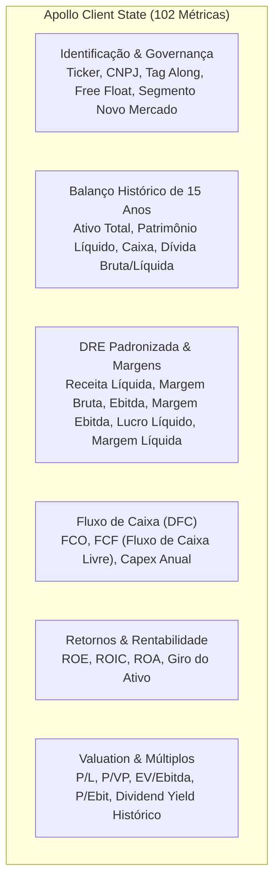

# 📈 REA Status Invest, Investidor10 e Fundamentei

Este documento sintetiza a engenharia reversa das três plataformas mais modernas e avançadas do ecossistema de investimentos brasileiro, com foco em métricas de opções, remuneração de governança, segmentação de receita e estado GraphQL.

---

## 1. 🔍 Status Invest (`statusinvest.com.br`)

O Status Invest é a plataforma mais abrangente em termos de granularidade de mercado e derivativos.

### A. Mercado de Opções & Gregas Matemáticas
O Status Invest calcula e disponibiliza a matriz completa de derivativos de ações brasileiras:
- **Modelo Utilizado:** Modelo de Black-Scholes para opções europeias e Binomial de Cox-Ross-Rubinstein para opções americanas.
- **As 5 Gregas Calculadas:**
  - $\Delta$ (Delta): Sensibilidade do preço da opção em relação à variação de R$ 1,00 na ação subjacente.
  - $\Gamma$ (Gamma): Taxa de variação do Delta (segunda derivada do preço).
  - $\Theta$ (Theta): Perda de valor da opção pela passagem do tempo (*time decay* diário).
  - $\mathcal{V}$ (Vega): Sensibilidade à volatilidade implícita do mercado.
  - $\rho$ (Rho): Sensibilidade à variação da taxa básica de juros (Taxa Selic).
- **Volatilidade Implícita (IV):** Cálculo reverso a partir do último preço de negócio da opção via método de Newton-Raphson.

### B. Remuneração da Administração & Governança (FRE CVM)
- Extração dos dados do Formulário de Referência (FRE CVM Item 13):
  - Remuneração média, máxima e mínima anual da Diretoria Estatutária e do Conselho de Administração.
  - Divisão entre salário fixo, bônus por metas, remuneração baseada em ações (*stock options*) e benefícios indiretos.

### C. Programas de Recompra de Ações (Buybacks)
- Mapeamento das deliberações de Conselho de Administração:
  - Quantidade de ações autorizadas para recompra.
  - Quantidade já executada e prazo de vigência do programa.
  - Impacto projetado no Lucro por Ação (LPA) decorrente do cancelamento das ações em tesouraria.

---

## 2. 🌐 Investidor10 (`investidor10.com.br`)

O Investidor10 se destaca pela visualização de KPIs operacionais e desdobramento da composição de receitas.

### A. Receita Líquida por Segmento de Negócio e Geografia
O portal extrai das notas explicativas das Demonstrações Financeiras Padronizadas (DFP) o desdobramento da receita corporativa:
- **Por Divisão de Negócio:** Exemplo da Petrobras (`Exploração & Produção`, `Refino, Transporte e Comercialização`, `Gás e Baixas Emissões`).
- **Por Região Geográfica:** Receita obtida no mercado doméstico (Brasil) versus mercado internacional (Exportações), crucial para avaliar o impacto da variação cambial do Dólar.

### B. Checklist Automatizado de Buy & Hold
O Investidor10 aplica um algoritmo booleano simples para investidores de longo prazo:
- [x] Mais de 5 anos de listagem na bolsa.
- [x] Lucro líquido positivo em todos os últimos 5 anos.
- [x] Lucros consistentes (CAGR Lucros > 10% nos últimos 5 anos).
- [x] Dívida controlada (Dívida Líquida / Ebitda < 2.5x).
- [x] Rentabilidade sobre o patrimônio alta (ROE > 10%).
- [x] Boa liquidez diária (Volume médio diário > R$ 1 milhão).

---

## 3. ⚛️ Fundamentei (`fundamentei.com`)

O Fundamentei foi desenvolvido em React e utiliza o Apollo Client conectado a um backend GraphQL.

### A. Engenharia Reversa do Estado Global do Apollo Client
Ao inspecionar a árvore do Apollo Client em memória (`window.__APOLLO_STATE__`), a engenharia reversa capturou a lista exaustiva de **102 indicadores e campos estruturados**:

### B. Acomodação no `fin-db`
Todas as 102 métricas identificadas no Fundamentei foram mapeadas e adicionadas diretamente ao schema `analytics` e `asset_details` do banco Neon PostgreSQL (estágio de migração `06_rea_coverage_v3.4`).

---

## 🔗 Referências Cruzadas
- [[Matriz_Unificada_12_Portais_e_Gaps|Matriz Unificada dos 12 Portais]]
- [[Conv_01_a_04_Fundacao_DDL_e_Arquitetura|Conversa 03: Detalhes do REA v3.4]]
- [[Modelagem_Relacional_12_Schemas|Esquemas Relacionais no fin-db]]
