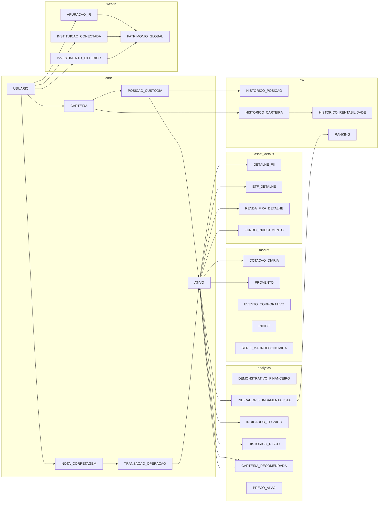

# 📦 Pacote Completo de Engenharia de Dados

Vou entregar os 4 artefatos na ordem solicitada. Como o volume é grande, cada parte está autocontida e pode ser usada separadamente.

---

# PARTE 1 — DDL SQL Completo (PostgreSQL 15+ com TimescaleDB)

## 1.1 Extensões, Schemas e Tipos

```sql
-- =========================================================
-- 0. EXTENSÕES E SCHEMAS
-- =========================================================
CREATE EXTENSION IF NOT EXISTS "uuid-ossp";
CREATE EXTENSION IF NOT EXISTS "pgcrypto";
CREATE EXTENSION IF NOT EXISTS "pg_trgm";
CREATE EXTENSION IF NOT EXISTS timescaledb;

CREATE SCHEMA IF NOT EXISTS core;          -- Cadastros, transacional, custódia
CREATE SCHEMA IF NOT EXISTS market;        -- Cotações, eventos, proventos, macro
CREATE SCHEMA IF NOT EXISTS asset_details; -- Extensões 1:1 por classe de ativo
CREATE SCHEMA IF NOT EXISTS analytics;     -- Fundamentos, técnico, screener, research
CREATE SCHEMA IF NOT EXISTS wealth;        -- Open Finance, IR, patrimônio
CREATE SCHEMA IF NOT EXISTS social;        -- Comunidade, educação, gamificação
CREATE SCHEMA IF NOT EXISTS dw;            -- Agregações históricas (Data Warehouse)
CREATE SCHEMA IF NOT EXISTS system;        -- Planos, segurança, LGPD, auditoria

-- Tipos enumerados (integridade + performance)
CREATE TYPE core.tipo_ativo_enum AS ENUM
    ('ACAO','FII','FIAGRO','ETF','BDR','OPCAO','FUTURO','TESOURO','RENDA_FIXA','FUNDO','CRIPTO','MOEDA');
CREATE TYPE core.tipo_mercado_enum AS ENUM
    ('A_VISTA','FRACIONARIO','OPCAO','FUTURO','TERMO','BALCAO');
CREATE TYPE core.tipo_operacao_enum AS ENUM ('C','V');
CREATE TYPE market.tipo_provento_enum AS ENUM ('DIVIDENDO','JCP','RENDIMENTO','BONIFICACAO','SUBSCRICAO');
CREATE TYPE wealth.tipo_ir_enum AS ENUM ('DAY_TRADE','SWING_TRADE','FII','RENDA_FIXA','EXTERIOR');
```

## 1.2 Schema `core`

```sql
-- =========================================================
-- SCHEMA core
-- =========================================================
CREATE TABLE core.usuario (
    id_usuario        UUID PRIMARY KEY DEFAULT uuid_generate_v4(),
    nome              VARCHAR(100) NOT NULL,
    email             VARCHAR(150) NOT NULL UNIQUE,
    cpf_cnpj         VARCHAR(14) NOT NULL UNIQUE,
    data_nascimento   DATE,
    telefone          VARCHAR(20),
    endereco          TEXT,
    pais              VARCHAR(50) DEFAULT 'BR',
    perfil_investidor VARCHAR(50) CHECK (perfil_investidor IN ('Conservador','Moderado','Arrojado')),
    status            VARCHAR(20) DEFAULT 'Ativo',
    ultimo_acesso     TIMESTAMP,
    mfa               BOOLEAN DEFAULT FALSE,
    aceite_termos     BOOLEAN DEFAULT FALSE,
    data_aceite       TIMESTAMP,
    data_cadastro     TIMESTAMP DEFAULT NOW()
);
CREATE INDEX idx_usuario_email_trgm ON core.usuario USING GIN (email gin_trgm_ops);

CREATE TABLE core.instituicao_financeira (
    id_instituicao   SERIAL PRIMARY KEY,
    nome_instituicao VARCHAR(100) NOT NULL,
    cnpj             VARCHAR(14) UNIQUE,
    codigo_sinacor   VARCHAR(10),
    codigo_compe     VARCHAR(3),
    ispb             VARCHAR(8),
    tipo             VARCHAR(50),
    agencias         TEXT,
    telefone         VARCHAR(20),
    site             VARCHAR(150)
);

CREATE TABLE core.emissor_companhia (
    id_emissor       SERIAL PRIMARY KEY,
    cnpj             VARCHAR(14) UNIQUE NOT NULL,
    nome_empresarial VARCHAR(150) NOT NULL,
    codigo_cvm       VARCHAR(10),
    setor            VARCHAR(50),
    subsetor         VARCHAR(50),
    cnae             VARCHAR(20),
    gics             VARCHAR(50),
    free_float       NUMERIC(5,2),
    tag_along        NUMERIC(5,2),
    composicao_acionaria TEXT,
    data_ipo         DATE,
    data_registro_cvm DATE
);
CREATE INDEX idx_emissor_setor ON core.emissor_companhia(setor);

CREATE TABLE core.grupo_acionista (
    id_grupo    BIGSERIAL PRIMARY KEY,
    id_emissor  INT NOT NULL REFERENCES core.emissor_companhia(id_emissor) ON DELETE CASCADE,
    nome_grupo  VARCHAR(150),
    tipo        VARCHAR(30) CHECK (tipo IN ('Controlador','Minoritario','Tesouraria','Insider'))
);

CREATE TABLE core.historico_acionista (
    id_historico         BIGSERIAL PRIMARY KEY,
    id_acionista         BIGINT REFERENCES core.grupo_acionista(id_grupo) ON DELETE CASCADE,
    id_emissor           INT REFERENCES core.emissor_companhia(id_emissor) ON DELETE CASCADE,
    data_posicao         DATE NOT NULL,
    quantidade_ordinarias BIGINT DEFAULT 0,
    quantidade_preferenciais BIGINT DEFAULT 0,
    percentual_total     NUMERIC(7,4),
    UNIQUE (id_acionista, id_emissor, data_posicao)
);

CREATE TABLE core.ativo (
    id_ativo           SERIAL PRIMARY KEY,
    id_emissor         INT REFERENCES core.emissor_companhia(id_emissor) ON DELETE RESTRICT,
    ticker             VARCHAR(12) UNIQUE NOT NULL,
    isin               VARCHAR(12) UNIQUE,
    codigo_cetip       VARCHAR(20) UNIQUE,
    tipo_ativo         core.tipo_ativo_enum NOT NULL,
    tipo_mercado       core.tipo_mercado_enum,
    moeda              VARCHAR(3) DEFAULT 'BRL',
    data_ipo           DATE,
    data_inicio_negociacao DATE,
    data_vencimento    DATE,
    data_emissao       DATE,
    quantidade_emitida BIGINT CHECK (quantidade_emitida >= 0),
    volume_medio       NUMERIC(18,2),
    liquidez           NUMERIC(18,2),
    indexador          VARCHAR(20),
    mercado_balcao     BOOLEAN DEFAULT FALSE,
    segmento_listagem  VARCHAR(50),
    tipo_titulo        VARCHAR(50)
);
CREATE INDEX idx_ativo_tipo ON core.ativo(tipo_ativo);
CREATE INDEX idx_ativo_emissor ON core.ativo(id_emissor);

CREATE TABLE core.carteira (
    id_carteira   UUID PRIMARY KEY DEFAULT uuid_generate_v4(),
    id_usuario    UUID NOT NULL REFERENCES core.usuario(id_usuario) ON DELETE CASCADE,
    nome_carteira VARCHAR(50) NOT NULL,
    tipo          VARCHAR(20) CHECK (tipo IN ('Real','Simulada')),
    benchmark     VARCHAR(20),
    objetivo      VARCHAR(100),
    moeda         VARCHAR(3) DEFAULT 'BRL',
    status        VARCHAR(20) DEFAULT 'Ativa',
    data_criacao  TIMESTAMP DEFAULT NOW()
);
CREATE INDEX idx_carteira_usuario ON core.carteira(id_usuario);

CREATE TABLE core.posicao_custodia (
    id_posicao              BIGSERIAL PRIMARY KEY,
    id_carteira             UUID NOT NULL REFERENCES core.carteira(id_carteira) ON DELETE CASCADE,
    id_ativo                INT  NOT NULL REFERENCES core.ativo(id_ativo) ON DELETE RESTRICT,
    quantidade_total        NUMERIC(18,6) DEFAULT 0 CHECK (quantidade_total >= 0),
    quantidade_disponivel   NUMERIC(18,6) DEFAULT 0 CHECK (quantidade_disponivel >= 0),
    quantidade_bloqueada    NUMERIC(18,6) DEFAULT 0 CHECK (quantidade_bloqueada >= 0),
    preco_medio_ponderado   NUMERIC(12,4) DEFAULT 0,
    preco_atual             NUMERIC(12,4),
    valor_mercado           NUMERIC(18,2),
    rentabilidade           NUMERIC(10,4),
    data_aquisicao          DATE,
    data_ultima_atualizacao TIMESTAMP DEFAULT NOW(),
    UNIQUE (id_carteira, id_ativo)
);

CREATE TABLE core.nota_corretagem (
    id_nota               BIGSERIAL PRIMARY KEY,
    id_usuario            UUID NOT NULL REFERENCES core.usuario(id_usuario) ON DELETE CASCADE,
    id_instituicao        INT  NOT NULL REFERENCES core.instituicao_financeira(id_instituicao) ON DELETE RESTRICT,
    numero_nota           VARCHAR(20) NOT NULL,
    numero_ordem          VARCHAR(50),
    canal                 VARCHAR(50),
    data_pregao           DATE NOT NULL,
    data_liquidacao       DATE,
    data_vencimento       DATE,
    operacao_normal       NUMERIC(14,2) DEFAULT 0,
    day_trade             NUMERIC(14,2) DEFAULT 0,
    taxa_liquidacao       NUMERIC(10,2) DEFAULT 0,
    emolumentos           NUMERIC(10,2) DEFAULT 0,
    corretagem            NUMERIC(10,2) DEFAULT 0,
    irrf                  NUMERIC(10,2) DEFAULT 0,
    valor_liquido_operacoes NUMERIC(14,2),
    observacao            TEXT,
    UNIQUE (id_instituicao, numero_nota)
);
CREATE INDEX idx_nota_usuario_data ON core.nota_corretagem(id_usuario, data_pregao DESC);

CREATE TABLE core.transacao_operacao (
    id_transacao          BIGSERIAL PRIMARY KEY,
    id_nota               BIGINT NOT NULL REFERENCES core.nota_corretagem(id_nota) ON DELETE CASCADE,
    id_carteira           UUID REFERENCES core.carteira(id_carteira) ON DELETE CASCADE,
    id_ativo              INT  NOT NULL REFERENCES core.ativo(id_ativo) ON DELETE RESTRICT,
    numero_ordem          VARCHAR(50),
    horario               TIME,
    tipo_operacao         core.tipo_operacao_enum NOT NULL,
    quantidade            NUMERIC(18,6) NOT NULL CHECK (quantidade >= 0),
    preco_unitario        NUMERIC(12,4) NOT NULL CHECK (preco_unitario >= 0),
    valor_total           NUMERIC(14,2) NOT NULL CHECK (valor_total >= 0),
    corretagem_rateada    NUMERIC(10,4) DEFAULT 0,
    emolumentos_rateados  NUMERIC(10,4) DEFAULT 0,
    irrf_rateado          NUMERIC(10,4) DEFAULT 0,
    liquidacao            BOOLEAN DEFAULT FALSE,
    UNIQUE (id_nota, numero_ordem)
);

CREATE TABLE core.historico_ticker (
    id_historico BIGSERIAL PRIMARY KEY,
    id_ativo     INT NOT NULL REFERENCES core.ativo(id_ativo) ON DELETE CASCADE,
    ticker_antigo VARCHAR(12),
    ticker_novo   VARCHAR(12),
    isin_antigo   VARCHAR(12),
    data_mudanca  DATE NOT NULL
);
```

## 1.3 Schema `market`

```sql
-- =========================================================
-- SCHEMA market
-- =========================================================
CREATE TABLE market.cotacao_diaria (
    data_pregao        DATE NOT NULL,
    id_ativo           INT  NOT NULL REFERENCES core.ativo(id_ativo) ON DELETE RESTRICT,
    preco_abertura     NUMERIC(10,2),
    preco_maximo       NUMERIC(10,2),
    preco_minimo       NUMERIC(10,2),
    preco_fechamento   NUMERIC(10,2),
    preco_medio        NUMERIC(10,2),
    volume_total       NUMERIC(18,2),
    quantidade_negocios INT,
    preco_ajustado     NUMERIC(10,2),
    variacao_percentual NUMERIC(8,4),
    preco_ajuste_anterior NUMERIC(10,2),
    preco_fechamento_anterior NUMERIC(10,2),
    quantidade_teorica BIGINT,
    ajuste             NUMERIC(10,2),
    PRIMARY KEY (id_ativo, data_pregao)
);
SELECT create_hypertable('market.cotacao_diaria','data_pregao', chunk_time_interval => INTERVAL '1 year');
CREATE INDEX idx_cot_diaria_ativo_data ON market.cotacao_diaria(id_ativo, data_pregao DESC);

CREATE TABLE market.cotacao_intraday (
    id_tick      BIGSERIAL,
    id_ativo     INT NOT NULL REFERENCES core.ativo(id_ativo) ON DELETE RESTRICT,
    timestamp    TIMESTAMPTZ NOT NULL,
    preco_atual  NUMERIC(12,4),
    variacao     NUMERIC(8,4),
    volume       NUMERIC(18,2)
);
SELECT create_hypertable('market.cotacao_intraday','timestamp', chunk_time_interval => INTERVAL '1 day');
CREATE INDEX idx_cot_intraday ON market.cotacao_intraday(id_ativo, timestamp DESC);

CREATE TABLE market.book_ordens (
    id_book    BIGSERIAL,
    id_ativo   INT NOT NULL,
    tipo_oferta CHAR(1) CHECK (tipo_oferta IN ('C','V')),
    preco      NUMERIC(12,4),
    quantidade NUMERIC(18,6),
    corretora  INT,
    timestamp  TIMESTAMPTZ NOT NULL
);
SELECT create_hypertable('market.book_ordens','timestamp', chunk_time_interval => INTERVAL '1 day');

CREATE TABLE market.negocio_intraday (
    id_negocio BIGSERIAL,
    id_ativo   INT NOT NULL,
    timestamp  TIMESTAMPTZ NOT NULL,
    preco      NUMERIC(12,4),
    quantidade NUMERIC(18,6),
    comprador  INT,
    vendedor   INT,
    agressor   CHAR(1) CHECK (agressor IN ('C','V'))
);
SELECT create_hypertable('market.negocio_intraday','timestamp', chunk_time_interval => INTERVAL '1 day');

CREATE TABLE market.leilao (
    id_leilao  BIGSERIAL PRIMARY KEY,
    id_ativo   INT NOT NULL,
    data       DATE NOT NULL,
    tipo       VARCHAR(20) CHECK (tipo IN ('PRE_ABERTURA','FECHAMENTO')),
    preco_teorico NUMERIC(12,4),
    quantidade_teorica NUMERIC(18,6)
);

CREATE TABLE market.after_market (
    id_after   BIGSERIAL,
    id_ativo   INT NOT NULL,
    timestamp  TIMESTAMPTZ NOT NULL,
    preco      NUMERIC(12,4),
    volume     NUMERIC(18,2)
);
SELECT create_hypertable('market.after_market','timestamp', chunk_time_interval => INTERVAL '1 day');

CREATE TABLE market.ajuste_intraday (
    id_ajuste  BIGSERIAL,
    id_ativo   INT NOT NULL,
    data       DATE NOT NULL,
    valor_ajuste NUMERIC(12,4)
);
SELECT create_hypertable('market.ajuste_intraday','data', chunk_time_interval => INTERVAL '1 year');

-- Eventos societários
CREATE TABLE market.evento_corporativo (
    id_evento      BIGSERIAL PRIMARY KEY,
    id_ativo       INT NOT NULL REFERENCES core.ativo(id_ativo) ON DELETE CASCADE,
    tipo_evento    VARCHAR(50),
    data_aprovacao DATE,
    data_ex        DATE,
    fator_proporcao NUMERIC(10,6),
    observacao     TEXT
);

CREATE TABLE market.desdobramento_split (
    id_desdobramento BIGSERIAL PRIMARY KEY,
    id_ativo         INT NOT NULL REFERENCES core.ativo(id_ativo) ON DELETE CASCADE,
    tipo             VARCHAR(20) CHECK (tipo IN ('SPLIT','INPLIT','BONIFICACAO')),
    data_ex          DATE NOT NULL,
    quantidade_antes INT,
    quantidade_depois INT,
    fator            NUMERIC(10,6)
);

CREATE TABLE market.subscricao_acao (
    id_subscricao      BIGSERIAL PRIMARY KEY,
    id_ativo           INT NOT NULL REFERENCES core.ativo(id_ativo) ON DELETE CASCADE,
    tipo               VARCHAR(20) CHECK (tipo IN ('PRIMARIA','SECUNDARIA')),
    data_aprovacao     DATE,
    data_inicio        DATE,
    data_fim           DATE,
    preco_emissao      NUMERIC(12,4),
    quantidade_ofertada BIGINT,
    fator_proporcao    NUMERIC(10,6)
);

-- Proventos
CREATE TABLE market.provento (
    id_provento     BIGSERIAL PRIMARY KEY,
    id_ativo        INT NOT NULL REFERENCES core.ativo(id_ativo) ON DELETE CASCADE,
    tipo_provento   market.tipo_provento_enum NOT NULL,
    data_anuncio    DATE,
    data_com        DATE,
    data_ex         DATE,
    data_registro   DATE,
    data_pagamento  DATE,
    valor_por_acao  NUMERIC(12,6),
    moeda           VARCHAR(3) DEFAULT 'BRL',
    tipo_pagamento  VARCHAR(20),
    imposto         NUMERIC(5,2),
    observacao      TEXT,
    UNIQUE (id_ativo, tipo_provento, data_com, data_pagamento)
);
CREATE INDEX idx_provento_ativo_data ON market.provento(id_ativo, data_com);

CREATE TABLE market.calendario_proventos (
    id_calendario  BIGSERIAL PRIMARY KEY,
    id_ativo       INT NOT NULL,
    id_provento    BIGINT REFERENCES market.provento(id_provento) ON DELETE CASCADE,
    data_com       DATE,
    data_ex        DATE,
    data_pagamento DATE,
    valor_estimado NUMERIC(12,6),
    valor_confirmado NUMERIC(12,6),
    status         VARCHAR(20) CHECK (status IN ('Confirmado','Projetado','Pago'))
);

CREATE TABLE market.previsao_provento (
    id_previsao    BIGSERIAL PRIMARY KEY,
    id_ativo       INT NOT NULL,
    data_referencia DATE NOT NULL,
    valor_estimado_por_acao NUMERIC(12,6),
    metodo_projecao VARCHAR(30) CHECK (metodo_projecao IN ('Historico','Payout','Consenso')),
    confianca      VARCHAR(10) CHECK (confianca IN ('Alta','Media','Baixa'))
);

CREATE TABLE market.historico_provento_recebido (
    id_recebimento BIGSERIAL PRIMARY KEY,
    id_usuario     UUID NOT NULL REFERENCES core.usuario(id_usuario) ON DELETE CASCADE,
    id_provento    BIGINT NOT NULL REFERENCES market.provento(id_provento) ON DELETE RESTRICT,
    id_carteira    UUID REFERENCES core.carteira(id_carteira) ON DELETE CASCADE,
    quantidade     NUMERIC(18,6),
    valor_bruto    NUMERIC(14,2),
    imposto        NUMERIC(10,2),
    valor_liquido  NUMERIC(14,2),
    data_credito   DATE,
    status         VARCHAR(20) CHECK (status IN ('PROVISIONADO','PAGO','RECEBIDO')),
    UNIQUE (id_usuario, id_provento, id_carteira)
);

CREATE TABLE market.antecipacao_dividendo (
    id_antecipacao  BIGSERIAL PRIMARY KEY,
    id_usuario      UUID NOT NULL,
    id_provento     BIGINT NOT NULL,
    valor_antecipado NUMERIC(14,2),
    taxa_desconto   NUMERIC(6,4),
    data_antecipacao DATE,
    data_recebimento_original DATE
);

-- Índices
CREATE TABLE market.indice (
    id_indice    SERIAL PRIMARY KEY,
    ticker_indice VARCHAR(12) UNIQUE,
    nome         VARCHAR(100),
    tipo         VARCHAR(50)
);

CREATE TABLE market.composicao_indice (
    id_composicao BIGSERIAL PRIMARY KEY,
    id_indice     INT NOT NULL REFERENCES market.indice(id_indice) ON DELETE CASCADE,
    id_ativo      INT NOT NULL REFERENCES core.ativo(id_ativo) ON DELETE RESTRICT,
    peso          NUMERIC(7,4),
    qtde_teorica  BIGINT,
    data_vigencia_inicio DATE,
    data_vigencia_fim    DATE
);

-- Macro e mercado
CREATE TABLE market.serie_macroeconomica (
    id_serie       BIGSERIAL,
    codigo_sgs     INT NOT NULL,
    nome           VARCHAR(150),
    fonte          VARCHAR(20) CHECK (fonte IN ('BCB','IBGE','IPEA','Outros')),
    periodicidade  VARCHAR(20),
    data_referencia DATE NOT NULL,
    valor          NUMERIC(18,6),
    unidade        VARCHAR(20),
    PRIMARY KEY (id_serie, data_referencia)
);
SELECT create_hypertable('market.serie_macroeconomica','data_referencia', chunk_time_interval => INTERVAL '5 years');

CREATE TABLE market.curva_juros (
    id_curva       BIGSERIAL,
    data_referencia DATE NOT NULL,
    tipo           VARCHAR(10) CHECK (tipo IN ('PRE','IPCA','DI')),
    vertice        INT,
    taxa           NUMERIC(10,6),
    PRIMARY KEY (id_curva, data_referencia)
);

CREATE TABLE market.cambio (
    id_cambio     BIGSERIAL,
    data_referencia DATE NOT NULL,
    moeda_origem  VARCHAR(3),
    moeda_destino VARCHAR(3),
    taxa_compra   NUMERIC(12,6),
    taxa_venda    NUMERIC(12,6),
    tipo          VARCHAR(15) CHECK (tipo IN ('PTAX','Fechamento','Intraday')),
    PRIMARY KEY (id_cambio, data_referencia)
);

CREATE TABLE market.commodity (
    id_commodity BIGSERIAL,
    data_referencia DATE NOT NULL,
    nome         VARCHAR(50),
    preco_spot   NUMERIC(18,6),
    preco_futuro NUMERIC(18,6),
    vencimento_futuro DATE,
    PRIMARY KEY (id_commodity, data_referencia)
);

CREATE TABLE market.estatistica_mercado (
    id_estatistica BIGSERIAL PRIMARY KEY,
    data_referencia DATE NOT NULL,
    tipo           VARCHAR(30),
    id_ativo       INT,
    valor          NUMERIC(18,6),
    posicao        INT
);

CREATE TABLE market.aluguel_acoes (
    id_aluguel      BIGSERIAL,
    id_ativo        INT NOT NULL,
    data            DATE NOT NULL,
    taxa_aluguel_media NUMERIC(8,4),
    contratos_abertos BIGINT,
    volume_alugado  NUMERIC(18,2),
    short_interest  NUMERIC(8,4),
    PRIMARY KEY (id_aluguel, data)
);
SELECT create_hypertable('market.aluguel_acoes','data', chunk_time_interval => INTERVAL '2 years');

CREATE TABLE market.calendario_economico (
    id_evento       BIGSERIAL PRIMARY KEY,
    data_hora       TIMESTAMPTZ NOT NULL,
    pais            VARCHAR(3),
    titulo          VARCHAR(150),
    importancia     VARCHAR(10) CHECK (importancia IN ('Alta','Media','Baixa')),
    valor_esperado  VARCHAR(50),
    valor_anterior  VARCHAR(50),
    valor_real      VARCHAR(50)
);

CREATE TABLE market.calendario_resultados (
    id_calendario  BIGSERIAL PRIMARY KEY,
    id_emissor     INT NOT NULL REFERENCES core.emissor_companhia(id_emissor) ON DELETE CASCADE,
    data_prevista  DATE,
    data_confirmada DATE,
    periodo_referencia VARCHAR(10),
    tipo           VARCHAR(10) CHECK (tipo IN ('DFP','ITR','Release'))
);
```

## 1.4 Schema `asset_details`

```sql
-- =========================================================
-- SCHEMA asset_details
-- =========================================================
CREATE TABLE asset_details.segmento_fii (
    id_segmento SERIAL PRIMARY KEY,
    nome        VARCHAR(50) UNIQUE NOT NULL
);

CREATE TABLE asset_details.tipo_gestao_fii (
    id_tipo_gestao SERIAL PRIMARY KEY,
    nome           VARCHAR(20) UNIQUE NOT NULL
);

CREATE TABLE asset_details.detalhe_fii (
    id_detalhe_fii  BIGSERIAL PRIMARY KEY,
    id_ativo        INT UNIQUE NOT NULL REFERENCES core.ativo(id_ativo) ON DELETE CASCADE,
    id_segmento     INT REFERENCES asset_details.segmento_fii(id_segmento),
    id_tipo_gestao  INT REFERENCES asset_details.tipo_gestao_fii(id_tipo_gestao),
    gestor          VARCHAR(150),
    administrador   VARCHAR(150),
    numero_cotistas INT,
    prazo_duracao   VARCHAR(50)
);

CREATE TABLE asset_details.historico_vacancia_fii (
    id_ativo       INT NOT NULL REFERENCES core.ativo(id_ativo) ON DELETE CASCADE,
    data_referencia DATE NOT NULL,
    vacancia_fisica NUMERIC(5,2),
    vacancia_financeira NUMERIC(5,2),
    abl_total      NUMERIC(18,2),
    abl_locada     NUMERIC(18,2),
    PRIMARY KEY (id_ativo, data_referencia)
);
SELECT create_hypertable('asset_details.historico_vacancia_fii','data_referencia', chunk_time_interval => INTERVAL '2 years');

CREATE TABLE asset_details.historico_patrimonio_fii (
    id_ativo        INT NOT NULL,
    data_referencia DATE NOT NULL,
    patrimonio_liquido NUMERIC(18,2),
    quantidade_cotas BIGINT,
    valor_patrimonial_cota NUMERIC(12,4),
    PRIMARY KEY (id_ativo, data_referencia)
);
SELECT create_hypertable('asset_details.historico_patrimonio_fii','data_referencia', chunk_time_interval => INTERVAL '2 years');

CREATE TABLE asset_details.composicao_carteira_fii (
    id_composicao  BIGSERIAL PRIMARY KEY,
    id_ativo       INT NOT NULL,
    data_referencia DATE NOT NULL,
    tipo_ativo     VARCHAR(30),
    nome_ativo     VARCHAR(200),
    percentual     NUMERIC(6,3),
    valor          NUMERIC(18,2),
    endereco       TEXT
);

CREATE TABLE asset_details.rentabilidade_fii (
    id_ativo        INT NOT NULL,
    data_referencia DATE NOT NULL,
    rentabilidade_mes NUMERIC(8,4),
    rentabilidade_ano NUMERIC(8,4),
    rentabilidade_12m NUMERIC(8,4),
    rentabilidade_desde_inicio NUMERIC(10,4),
    benchmark       VARCHAR(20),
    PRIMARY KEY (id_ativo, data_referencia)
);

CREATE TABLE asset_details.etf_detalhe (
    id_etf      BIGSERIAL PRIMARY KEY,
    id_ativo    INT UNIQUE NOT NULL REFERENCES core.ativo(id_ativo) ON DELETE CASCADE,
    indice_referencia VARCHAR(50),
    taxa_administracao NUMERIC(6,4),
    patrimonio  NUMERIC(18,2),
    cotas       BIGINT,
    numero_cotistas INT,
    benchmark   VARCHAR(30),
    composicao_carteira_url TEXT
);

CREATE TABLE asset_details.bdr_detalhe (
    id_bdr      BIGSERIAL PRIMARY KEY,
    id_ativo    INT UNIQUE NOT NULL REFERENCES core.ativo(id_ativo) ON DELETE CASCADE,
    empresa_estrangeira VARCHAR(150),
    pais_origem VARCHAR(50),
    ratio       NUMERIC(10,4),
    moeda_origem VARCHAR(3),
    bolsa_origem VARCHAR(20),
    setor_global VARCHAR(50)
);

CREATE TABLE asset_details.opcao_detalhe (
    id_opcao    BIGSERIAL PRIMARY KEY,
    id_ativo    INT UNIQUE NOT NULL REFERENCES core.ativo(id_ativo) ON DELETE CASCADE,
    serie       VARCHAR(20),
    strike      NUMERIC(12,4),
    vencimento  DATE,
    tipo        CHAR(4) CHECK (tipo IN ('CALL','PUT')),
    id_ativo_objeto INT REFERENCES core.ativo(id_ativo),
    premio      NUMERIC(12,4),
    contratos_abertos BIGINT,
    volatilidade_implicita NUMERIC(8,4),
    delta       NUMERIC(8,4),
    gamma       NUMERIC(8,4),
    theta       NUMERIC(8,4),
    vega        NUMERIC(8,4)
);

CREATE TABLE asset_details.tesouro_direto (
    id_tesouro  BIGSERIAL PRIMARY KEY,
    id_ativo    INT UNIQUE NOT NULL REFERENCES core.ativo(id_ativo) ON DELETE CASCADE,
    tipo_titulo VARCHAR(30),
    indexador   VARCHAR(20),
    taxa_compra NUMERIC(8,4),
    taxa_venda  NUMERIC(8,4),
    vencimento  DATE,
    pu          NUMERIC(12,6),
    quantidade_mercado NUMERIC(18,2),
    rentabilidade NUMERIC(8,4)
);

CREATE TABLE asset_details.renda_fixa_detalhe (
    id_rf       BIGSERIAL PRIMARY KEY,
    id_ativo    INT UNIQUE NOT NULL REFERENCES core.ativo(id_ativo) ON DELETE CASCADE,
    emissor     VARCHAR(150),
    indexador   VARCHAR(20),
    taxa        NUMERIC(8,4),
    vencimento  DATE,
    rating      VARCHAR(10),
    garantia    VARCHAR(30),
    liquidez    VARCHAR(20),
    classe      VARCHAR(30),
    spread      NUMERIC(8,4)
);

CREATE TABLE asset_details.fundo_investimento (
    id_fundo    BIGSERIAL PRIMARY KEY,
    id_ativo    INT UNIQUE NOT NULL REFERENCES core.ativo(id_ativo) ON DELETE CASCADE,
    cnpj        VARCHAR(14) UNIQUE,
    classe      VARCHAR(30),
    segmento    VARCHAR(50),
    taxa_adm    NUMERIC(6,4),
    taxa_performance NUMERIC(6,4),
    benchmark   VARCHAR(30),
    patrimonio  NUMERIC(18,2),
    cota_atual  NUMERIC(18,8),
    performance_12m NUMERIC(8,4),
    numero_cotistas INT,
    classificacao_anbima VARCHAR(50),
    gestor      VARCHAR(150)
);

CREATE TABLE asset_details.fundo_carteira (
    id_carteira_fundo BIGSERIAL PRIMARY KEY,
    id_fundo    BIGINT NOT NULL REFERENCES asset_details.fundo_investimento(id_fundo) ON DELETE CASCADE,
    data_referencia DATE NOT NULL,
    tipo_ativo  VARCHAR(30),
    nome_ativo  VARCHAR(200),
    percentual  NUMERIC(6,3)
);

CREATE TABLE asset_details.fundo_rentabilidade (
    id_fundo    BIGINT NOT NULL,
    data_referencia DATE NOT NULL,
    rentabilidade_mes NUMERIC(8,4),
    rentabilidade_ano NUMERIC(8,4),
    rentabilidade_12m NUMERIC(8,4),
    rentabilidade_desde_inicio NUMERIC(10,4),
    sharpe      NUMERIC(8,4),
    volatilidade NUMERIC(8,4),
    PRIMARY KEY (id_fundo, data_referencia)
);

CREATE TABLE asset_details.criptomoeda_detalhe (
    id_cripto   BIGSERIAL PRIMARY KEY,
    id_ativo    INT UNIQUE NOT NULL REFERENCES core.ativo(id_ativo) ON DELETE CASCADE,
    exchange    VARCHAR(50),
    wallet      VARCHAR(150),
    staking_yield NUMERIC(6,4),
    tipo_custodia VARCHAR(30),
    algoritmo_consenso VARCHAR(30),
    market_cap  NUMERIC(20,2),
    volume_24h  NUMERIC(20,2),
    dominancia  NUMERIC(6,4),
    fornecimento_maximo NUMERIC(20,8)
);
```

## 1.5 Schema `analytics`

```sql
-- =========================================================
-- SCHEMA analytics
-- =========================================================
CREATE TABLE analytics.demonstrativo_financeiro (
    id_demonstrativo BIGSERIAL PRIMARY KEY,
    id_emissor       INT NOT NULL REFERENCES core.emissor_companhia(id_emissor) ON DELETE CASCADE,
    data_referencia  DATE NOT NULL,
    data_publicacao  DATE,
    tipo_documento   VARCHAR(10) CHECK (tipo_documento IN ('DFP','ITR','Release')),
    versao           INT DEFAULT 1,
    contas_detalhadas JSONB,
    numero_acoes     BIGINT,
    receita_liquida  NUMERIC(18,2),
    ebitda           NUMERIC(18,2),
    lucro_liquido    NUMERIC(18,2),
    patrimonio_liquido NUMERIC(18,2),
    divida_bruta     NUMERIC(18,2),
    divida_liquida   NUMERIC(18,2),
    UNIQUE (id_emissor, data_referencia, tipo_documento, versao)
);
CREATE INDEX idx_dem_fin_contas_gin ON analytics.demonstrativo_financeiro USING GIN (contas_detalhadas);
CREATE INDEX idx_dem_fin_emissor ON analytics.demonstrativo_financeiro(id_emissor, data_referencia DESC);

CREATE TABLE analytics.indicador_fundamentalista (
    id_indicador    BIGSERIAL PRIMARY KEY,
    id_ativo        INT NOT NULL REFERENCES core.ativo(id_ativo) ON DELETE CASCADE,
    data_referencia DATE NOT NULL,
    pl              NUMERIC(12,4),
    pvp             NUMERIC(12,4),
    psr             NUMERIC(12,4),
    dividend_yield  NUMERIC(8,4),
    payout          NUMERIC(8,4),
    roe             NUMERIC(8,4),
    roic            NUMERIC(8,4),
    ebitda_margem   NUMERIC(8,4),
    margem_liquida  NUMERIC(8,4),
    divida_liquida_ebitda NUMERIC(10,4),
    lpa             NUMERIC(12,4),
    vpa             NUMERIC(12,4),
    ev_ebitda       NUMERIC(12,4),
    ev_ebit         NUMERIC(12,4),
    liquidez_corrente NUMERIC(8,4),
    giro_ativo      NUMERIC(8,4),
    UNIQUE (id_ativo, data_referencia)
);

CREATE TABLE analytics.historico_indicador_fundamentalista (
    id_ativo        INT NOT NULL,
    data_referencia DATE NOT NULL,
    pl              NUMERIC(12,4),
    pvp             NUMERIC(12,4),
    roe             NUMERIC(8,4),
    roic            NUMERIC(8,4),
    dividend_yield  NUMERIC(8,4),
    ev_ebitda       NUMERIC(12,4),
    margem_liquida  NUMERIC(8,4),
    divida_liquida_ebitda NUMERIC(10,4),
    PRIMARY KEY (id_ativo, data_referencia)
);
SELECT create_hypertable('analytics.historico_indicador_fundamentalista','data_referencia', chunk_time_interval => INTERVAL '2 years');

CREATE TABLE analytics.indicador_tecnico (
    id_indicador    BIGSERIAL PRIMARY KEY,
    id_ativo        INT NOT NULL,
    data_pregao     DATE NOT NULL,
    media_movel_20  NUMERIC(12,4),
    media_movel_50  NUMERIC(12,4),
    media_movel_200 NUMERIC(12,4),
    ifr_14          NUMERIC(8,4),
    macd            NUMERIC(12,6),
    banda_boll_sup  NUMERIC(12,4),
    banda_boll_inf  NUMERIC(12,4),
    suporte         NUMERIC(12,4),
    resistencia     NUMERIC(12,4),
    UNIQUE (id_ativo, data_pregao)
);

CREATE TABLE analytics.historico_indicador_tecnico (
    id_ativo       INT NOT NULL,
    data_pregao    DATE NOT NULL,
    media_movel_20 NUMERIC(12,4),
    media_movel_50 NUMERIC(12,4),
    media_movel_200 NUMERIC(12,4),
    ifr_14         NUMERIC(8,4),
    macd           NUMERIC(12,6),
    banda_boll_sup NUMERIC(12,4),
    banda_boll_inf NUMERIC(12,4),
    PRIMARY KEY (id_ativo, data_pregao)
);
SELECT create_hypertable('analytics.historico_indicador_tecnico','data_pregao', chunk_time_interval => INTERVAL '2 years');

CREATE TABLE analytics.historico_risco (
    id_ativo       INT NOT NULL,
    data_calculo   DATE NOT NULL,
    beta           NUMERIC(8,4),
    volatilidade_anualizada NUMERIC(8,4),
    sharpe         NUMERIC(8,4),
    treynor        NUMERIC(8,4),
    sortino        NUMERIC(8,4),
    drawdown_maximo NUMERIC(8,4),
    var            NUMERIC(8,4),
    PRIMARY KEY (id_ativo, data_calculo)
);
SELECT create_hypertable('analytics.historico_risco','data_calculo', chunk_time_interval => INTERVAL '2 years');

CREATE TABLE analytics.matriz_correlacao_historico (
    id_matriz      BIGSERIAL,
    data_calculo   DATE NOT NULL,
    janela_tempo   VARCHAR(10),
    id_ativo_1     INT NOT NULL,
    id_ativo_2     INT NOT NULL,
    coeficiente_pearson NUMERIC(6,4),
    PRIMARY KEY (id_matriz, data_calculo)
);

CREATE TABLE analytics.backtest_resultado (
    id_backtest    BIGSERIAL PRIMARY KEY,
    id_usuario     UUID REFERENCES core.usuario(id_usuario) ON DELETE CASCADE,
    estrategia     VARCHAR(100),
    data_inicio    DATE,
    data_fim       DATE,
    rentabilidade_total NUMERIC(10,4),
    sharpe         NUMERIC(8,4),
    drawdown_maximo NUMERIC(8,4),
    trades_json    JSONB
);

CREATE TABLE analytics.filtro_salvo (
    id_filtro     UUID PRIMARY KEY DEFAULT uuid_generate_v4(),
    id_usuario    UUID NOT NULL REFERENCES core.usuario(id_usuario) ON DELETE CASCADE,
    nome_filtro   VARCHAR(80),
    tipo_ativo    core.tipo_ativo_enum,
    criterios_json JSONB NOT NULL,
    data_criacao  TIMESTAMP DEFAULT NOW()
);
CREATE INDEX idx_filtro_criterios_gin ON analytics.filtro_salvo USING GIN (criterios_json);

CREATE TABLE analytics.ranking_configuracao (
    id_config      UUID PRIMARY KEY DEFAULT uuid_generate_v4(),
    id_usuario     UUID NOT NULL REFERENCES core.usuario(id_usuario) ON DELETE CASCADE,
    tipo_ranking   VARCHAR(30),
    tipo_ativo     core.tipo_ativo_enum,
    ativo_ordenacao VARCHAR(20) DEFAULT 'DESC',
    limite         INT DEFAULT 10,
    data_criacao   TIMESTAMP DEFAULT NOW()
);

CREATE TABLE analytics.carteira_recomendada (
    id_carteira_recomendada BIGSERIAL PRIMARY KEY,
    nome           VARCHAR(100),
    tipo           VARCHAR(20),
    perfil         VARCHAR(20),
    benchmark      VARCHAR(20),
    data_criacao   DATE,
    data_ultima_atualizacao DATE,
    justificativa  TEXT
);

CREATE TABLE analytics.item_carteira_recomendada (
    id_item        BIGSERIAL PRIMARY KEY,
    id_carteira_recomendada BIGINT NOT NULL REFERENCES analytics.carteira_recomendada(id_carteira_recomendada) ON DELETE CASCADE,
    id_ativo       INT NOT NULL REFERENCES core.ativo(id_ativo) ON DELETE RESTRICT,
    peso_percentual NUMERIC(6,3),
    tese_investimento TEXT,
    data_entrada   DATE,
    data_saida     DATE
);

CREATE TABLE analytics.relatorio_analise (
    id_relatorio   BIGSERIAL PRIMARY KEY,
    id_emissor     INT REFERENCES core.emissor_companhia(id_emissor) ON DELETE SET NULL,
    id_ativo       INT REFERENCES core.ativo(id_ativo) ON DELETE SET NULL,
    tipo           VARCHAR(30),
    titulo         VARCHAR(200),
    resumo         TEXT,
    url_pdf        TEXT,
    analista       VARCHAR(100),
    data_publicacao DATE,
    nota_analista  VARCHAR(20)
);

CREATE TABLE analytics.score_ativo (
    id_score       BIGSERIAL PRIMARY KEY,
    id_ativo       INT NOT NULL,
    data_calculo   DATE NOT NULL,
    metodologia    VARCHAR(50),
    pontuacao      NUMERIC(6,2),
    classificacao  VARCHAR(30),
    detalhes_json  JSONB,
    UNIQUE (id_ativo, data_calculo, metodologia)
);

CREATE TABLE analytics.preco_alvo (
    id_preco_alvo  BIGSERIAL PRIMARY KEY,
    id_ativo       INT NOT NULL,
    data_referencia DATE NOT NULL,
    preco_alvo_medio NUMERIC(12,4),
    preco_alvo_maximo NUMERIC(12,4),
    preco_alvo_minimo NUMERIC(12,4),
    numero_analistas INT,
    recomendacao   VARCHAR(20),
    UNIQUE (id_ativo, data_referencia)
);

CREATE TABLE analytics.casa_analise (
    id_casa        SERIAL PRIMARY KEY,
    nome           VARCHAR(150) UNIQUE,
    tipo           VARCHAR(30)
);

CREATE TABLE analytics.analista (
    id_analista    SERIAL PRIMARY KEY,
    nome           VARCHAR(150),
    id_casa        INT REFERENCES analytics.casa_analise(id_casa)
);

CREATE TABLE analytics.insider_transaction (
    id_transacao   BIGSERIAL PRIMARY KEY,
    id_emissor     INT NOT NULL REFERENCES core.emissor_companhia(id_emissor) ON DELETE CASCADE,
    id_insider     VARCHAR(100),
    cargo          VARCHAR(60),
    tipo_operacao  CHAR(1) CHECK (tipo_operacao IN ('C','V')),
    quantidade     BIGINT,
    preco_unitario NUMERIC(12,4),
    data_operacao  DATE NOT NULL
);
```

## 1.6 Schema `wealth`

```sql
-- =========================================================
-- SCHEMA wealth
-- =========================================================
CREATE TABLE wealth.consentimento (
    id_consentimento BIGSERIAL PRIMARY KEY,
    id_usuario     UUID NOT NULL REFERENCES core.usuario(id_usuario) ON DELETE CASCADE,
    status         VARCHAR(20),
    validade       TIMESTAMPTZ,
    scopes         TEXT,
    data_criacao   TIMESTAMP DEFAULT NOW()
);

CREATE TABLE wealth.instituicao_conectada (
    id_instituicao_conectada BIGSERIAL PRIMARY KEY,
    id_usuario     UUID NOT NULL,
    id_instituicao INT NOT NULL,
    id_consentimento BIGINT REFERENCES wealth.consentimento(id_consentimento) ON DELETE CASCADE,
    data_conexao   TIMESTAMPTZ DEFAULT NOW()
);

CREATE TABLE wealth.conta_bancaria (
    id_conta       BIGSERIAL PRIMARY KEY,
    id_usuario     UUID NOT NULL,
    id_instituicao_conectada BIGINT NOT NULL,
    agencia        VARCHAR(10),
    conta          VARCHAR(20),
    tipo           VARCHAR(30),
    saldo_disponivel NUMERIC(18,2),
    moeda          VARCHAR(3) DEFAULT 'BRL'
);

CREATE TABLE wealth.transacao_bancaria (
    id_transacao   BIGSERIAL,
    id_conta       BIGINT NOT NULL,
    data           TIMESTAMPTZ NOT NULL,
    valor          NUMERIC(18,2),
    debito_credito CHAR(1) CHECK (debito_credito IN ('D','C')),
    nomenclatura   VARCHAR(200),
    tipo           VARCHAR(20) CHECK (tipo IN ('PIX','TED','DOC','BOLETO','CARTAO'))
);
SELECT create_hypertable('wealth.transacao_bancaria','data', chunk_time_interval => INTERVAL '6 months');

CREATE TABLE wealth.cartao_credito (
    id_cartao      BIGSERIAL PRIMARY KEY,
    id_usuario     UUID NOT NULL,
    id_instituicao_conectada BIGINT NOT NULL,
    bandeira       VARCHAR(20),
    limite         NUMERIC(18,2),
    fatura_atual   NUMERIC(18,2),
    vencimento     DATE
);

CREATE TABLE wealth.emprestimo (
    id_emprestimo  BIGSERIAL PRIMARY KEY,
    id_usuario     UUID NOT NULL,
    credor         VARCHAR(100),
    valor_original NUMERIC(18,2),
    saldo_devedor  NUMERIC(18,2),
    taxa_juros     NUMERIC(6,4),
    parcelas       INT,
    data_contratacao DATE,
    data_vencimento DATE
);

CREATE TABLE wealth.financiamento (
    id_financiamento BIGSERIAL PRIMARY KEY,
    id_usuario       UUID NOT NULL,
    credor           VARCHAR(100),
    tipo             VARCHAR(30),
    valor_original   NUMERIC(18,2),
    saldo_devedor    NUMERIC(18,2),
    taxa_juros       NUMERIC(6,4),
    prazo            INT,
    parcelas         INT
);

CREATE TABLE wealth.imovel (
    id_imovel      BIGSERIAL PRIMARY KEY,
    id_usuario     UUID NOT NULL,
    descricao      VARCHAR(200),
    endereco       TEXT,
    valor_mercado  NUMERIC(18,2),
    data_aquisicao DATE,
    tipo           VARCHAR(30)
);

CREATE TABLE wealth.veiculo (
    id_veiculo     BIGSERIAL PRIMARY KEY,
    id_usuario     UUID NOT NULL,
    descricao      VARCHAR(200),
    valor_mercado  NUMERIC(18,2),
    ano            INT,
    placa          VARCHAR(10)
);

CREATE TABLE wealth.outros_bens (
    id_bem         BIGSERIAL PRIMARY KEY,
    id_usuario     UUID NOT NULL,
    descricao      VARCHAR(200),
    valor_mercado  NUMERIC(18,2)
);

CREATE TABLE wealth.seguro (
    id_seguro      BIGSERIAL PRIMARY KEY,
    id_usuario     UUID NOT NULL,
    tipo           VARCHAR(30),
    seguradora     VARCHAR(100),
    cobertura      NUMERIC(18,2),
    premio_mensal  NUMERIC(18,2),
    vigencia_inicio DATE,
    vigencia_fim   DATE
);

CREATE TABLE wealth.previdencia_privada (
    id_previdencia BIGSERIAL PRIMARY KEY,
    id_usuario     UUID NOT NULL,
    tipo           VARCHAR(10) CHECK (tipo IN ('PGBL','VGBL')),
    seguradora     VARCHAR(100),
    saldo          NUMERIC(18,2),
    aporte_mensal  NUMERIC(18,2),
    taxa_carregamento NUMERIC(6,4)
);

CREATE TABLE wealth.consorcio (
    id_consorcio   BIGSERIAL PRIMARY KEY,
    id_usuario     UUID NOT NULL,
    tipo           VARCHAR(30),
    valor_carta    NUMERIC(18,2),
    parcela        NUMERIC(18,2),
    parcelas_pagas INT,
    parcelas_total INT
);

CREATE TABLE wealth.planejamento_sucessorio (
    id_planejamento BIGSERIAL PRIMARY KEY,
    id_usuario      UUID NOT NULL,
    tipo            VARCHAR(30),
    descricao       TEXT,
    data_atualizacao DATE
);

CREATE TABLE wealth.patrimonio_global (
    id_patrimonio  BIGSERIAL,
    id_usuario     UUID NOT NULL,
    data_referencia DATE NOT NULL,
    total_ativos   NUMERIC(18,2),
    total_passivos NUMERIC(18,2),
    patrimonio_liquido NUMERIC(18,2),
    PRIMARY KEY (id_patrimonio, data_referencia)
);

CREATE TABLE wealth.investimento_exterior (
    id_investimento BIGSERIAL PRIMARY KEY,
    id_usuario      UUID NOT NULL,
    pais            VARCHAR(3),
    tipo            VARCHAR(30),
    id_ativo        INT,
    ticker          VARCHAR(20),
    quantidade      NUMERIC(18,6),
    preco_medio     NUMERIC(12,4),
    moeda           VARCHAR(3),
    corretora_exterior VARCHAR(100),
    data_aquisicao  DATE
);

CREATE TABLE wealth.divida_externa (
    id_divida      BIGSERIAL PRIMARY KEY,
    id_usuario     UUID NOT NULL,
    credor         VARCHAR(100),
    moeda          VARCHAR(3),
    saldo_devedor  NUMERIC(18,2),
    taxa_juros     NUMERIC(6,4),
    data_vencimento DATE,
    parcela_mensal NUMERIC(18,2)
);

CREATE TABLE wealth.meta_financeira (
    id_meta        BIGSERIAL PRIMARY KEY,
    id_usuario     UUID NOT NULL,
    nome           VARCHAR(100),
    valor_alvo     NUMERIC(18,2),
    prazo          DATE,
    valor_acumulado NUMERIC(18,2) DEFAULT 0,
    progresso_percentual NUMERIC(6,2) GENERATED ALWAYS AS
        (CASE WHEN valor_alvo > 0 THEN (valor_acumulado/valor_alvo)*100 ELSE 0 END) STORED
);

CREATE TABLE wealth.simulador (
    id_simulacao   BIGSERIAL PRIMARY KEY,
    id_usuario     UUID NOT NULL,
    nome           VARCHAR(100),
    parametros_json JSONB,
    data_criacao   TIMESTAMP DEFAULT NOW()
);

CREATE TABLE wealth.rebalanceamento (
    id_rebalanceamento BIGSERIAL PRIMARY KEY,
    id_usuario     UUID NOT NULL,
    id_carteira    UUID,
    regras_json    JSONB,
    data_criacao   TIMESTAMP DEFAULT NOW()
);

CREATE TABLE wealth.apuracao_ir (
    id_apuracao    BIGSERIAL PRIMARY KEY,
    id_usuario     UUID NOT NULL,
    mes_referencia DATE NOT NULL,
    tipo_operacao  wealth.tipo_ir_enum NOT NULL,
    ganho_liquido  NUMERIC(14,2),
    imposto_devido NUMERIC(14,2),
    irrf_retido    NUMERIC(14,2),
    prejuizo_acumulado NUMERIC(14,2),
    darf_gerado    NUMERIC(14,2),
    data_vencimento DATE,
    pago           BOOLEAN DEFAULT FALSE,
    UNIQUE (id_usuario, mes_referencia, tipo_operacao)
);

CREATE TABLE wealth.planejamento_tributario (
    id_planejamento BIGSERIAL PRIMARY KEY,
    id_usuario      UUID NOT NULL,
    ano_referencia  INT,
    estrategia      VARCHAR(60),
    beneficio_estimado NUMERIC(14,2)
);
```

## 1.7 Schema `social`

```sql
-- =========================================================
-- SCHEMA social
-- =========================================================
CREATE TABLE social.favorito (
    id_favorito  BIGSERIAL PRIMARY KEY,
    id_usuario   UUID NOT NULL REFERENCES core.usuario(id_usuario) ON DELETE CASCADE,
    id_ativo     INT NOT NULL REFERENCES core.ativo(id_ativo) ON DELETE CASCADE,
    data_adicao  TIMESTAMP DEFAULT NOW(),
    UNIQUE (id_usuario, id_ativo)
);

CREATE TABLE social.comparacao_ativo (
    id_comparacao BIGSERIAL PRIMARY KEY,
    id_usuario    UUID NOT NULL REFERENCES core.usuario(id_usuario) ON DELETE CASCADE,
    id_ativo      INT NOT NULL,
    ordem_tela    INT,
    data_criacao  TIMESTAMP DEFAULT NOW(),
    UNIQUE (id_usuario, id_ativo)
);

CREATE TABLE social.categoria_noticia (
    id_categoria SERIAL PRIMARY KEY,
    nome         VARCHAR(50) UNIQUE
);

CREATE TABLE social.noticia_ativo (
    id_noticia    BIGSERIAL PRIMARY KEY,
    id_ativo      INT REFERENCES core.ativo(id_ativo) ON DELETE CASCADE,
    id_categoria  INT REFERENCES social.categoria_noticia(id_categoria),
    titulo        VARCHAR(200),
    resumo        TEXT,
    fonte         VARCHAR(80),
    url           TEXT,
    data_publicacao TIMESTAMPTZ,
    tipo          VARCHAR(20),
    sentimento    VARCHAR(10) CHECK (sentimento IN ('Positivo','Neutro','Negativo'))
);
CREATE INDEX idx_noticia_ativo_data ON social.noticia_ativo(id_ativo, data_publicacao DESC);

CREATE TABLE social.assembleia (
    id_assembleia BIGSERIAL PRIMARY KEY,
    id_ativo      INT NOT NULL,
    data          TIMESTAMPTZ,
    pauta         TEXT,
    atas          TEXT,
    editais       TEXT,
    deliberacoes  TEXT
);

CREATE TABLE social.curso (
    id_curso    SERIAL PRIMARY KEY,
    nome        VARCHAR(150),
    descricao   TEXT,
    nivel       VARCHAR(20)
);

CREATE TABLE social.trilha (
    id_trilha   SERIAL PRIMARY KEY,
    nome        VARCHAR(150),
    descricao   TEXT
);

CREATE TABLE social.aula (
    id_aula     BIGSERIAL PRIMARY KEY,
    id_curso    INT REFERENCES social.curso(id_curso) ON DELETE CASCADE,
    id_trilha   INT REFERENCES social.trilha(id_trilha) ON DELETE SET NULL,
    titulo      VARCHAR(150),
    url_video   TEXT,
    duracao_min INT,
    ordem       INT
);

CREATE TABLE social.progresso_aula (
    id_progresso BIGSERIAL PRIMARY KEY,
    id_usuario   UUID NOT NULL,
    id_aula      BIGINT NOT NULL,
    status       VARCHAR(20),
    data_conclusao TIMESTAMP,
    UNIQUE (id_usuario, id_aula)
);

CREATE TABLE social.certificado (
    id_certificado BIGSERIAL PRIMARY KEY,
    id_usuario     UUID NOT NULL,
    id_curso       INT NOT NULL,
    data_conclusao TIMESTAMP,
    url_certificado TEXT,
    hash_validacao VARCHAR(64) UNIQUE
);

CREATE TABLE social.forum (
    id_forum    SERIAL PRIMARY KEY,
    nome        VARCHAR(100),
    descricao   TEXT
);

CREATE TABLE social.topico (
    id_topico   BIGSERIAL PRIMARY KEY,
    id_forum    INT REFERENCES social.forum(id_forum) ON DELETE CASCADE,
    id_usuario  UUID NOT NULL,
    titulo      VARCHAR(200),
    data_criacao TIMESTAMP DEFAULT NOW()
);

CREATE TABLE social.comentario (
    id_comentario BIGSERIAL PRIMARY KEY,
    id_topico     BIGINT REFERENCES social.topico(id_topico) ON DELETE CASCADE,
    id_usuario    UUID NOT NULL,
    id_comentario_pai BIGINT REFERENCES social.comentario(id_comentario) ON DELETE CASCADE,
    conteudo      TEXT,
    data_criacao  TIMESTAMP DEFAULT NOW()
);

CREATE TABLE social.curtida (
    id_curtida  BIGSERIAL PRIMARY KEY,
    id_usuario  UUID NOT NULL,
    id_comentario BIGINT REFERENCES social.comentario(id_comentario) ON DELETE CASCADE,
    UNIQUE (id_usuario, id_comentario)
);

CREATE TABLE social.seguidor (
    id_seguidor BIGSERIAL PRIMARY KEY,
    id_usuario_seguidor UUID NOT NULL,
    id_usuario_seguido  UUID NOT NULL,
    data_inicio TIMESTAMP DEFAULT NOW(),
    UNIQUE (id_usuario_seguidor, id_usuario_seguido)
);

CREATE TABLE social.perfil_publico (
    id_usuario      UUID PRIMARY KEY REFERENCES core.usuario(id_usuario) ON DELETE CASCADE,
    biografia       TEXT,
    carteira_publica BOOLEAN DEFAULT FALSE,
    data_criacao    TIMESTAMP DEFAULT NOW()
);

CREATE TABLE social.gamificacao (
    id_gamificacao BIGSERIAL PRIMARY KEY,
    id_usuario     UUID NOT NULL UNIQUE,
    pontos         INT DEFAULT 0,
    nivel          INT DEFAULT 1
);

CREATE TABLE social.conquista (
    id_conquista SERIAL PRIMARY KEY,
    nome         VARCHAR(100),
    descricao    TEXT,
    pontos       INT
);

CREATE TABLE social.badge (
    id_badge    SERIAL PRIMARY KEY,
    nome        VARCHAR(100),
    url_imagem  TEXT
);
```

## 1.8 Schema `dw` (Agregações Históricas)

```sql
-- =========================================================
-- SCHEMA dw
-- =========================================================
CREATE TABLE dw.historico_posicao (
    id_carteira   UUID NOT NULL,
    data_snapshot DATE NOT NULL,
    id_ativo      INT NOT NULL,
    quantidade    NUMERIC(18,6),
    preco_medio   NUMERIC(12,4),
    preco_fechamento NUMERIC(12,4),
    valor_mercado NUMERIC(18,2),
    PRIMARY KEY (id_carteira, data_snapshot, id_ativo)
);
SELECT create_hypertable('dw.historico_posicao','data_snapshot', chunk_time_interval => INTERVAL '1 year');

CREATE TABLE dw.historico_carteira (
    id_carteira   UUID NOT NULL,
    data_snapshot DATE NOT NULL,
    valor_total   NUMERIC(18,2),
    rentabilidade_dia NUMERIC(8,4),
    rentabilidade_mes NUMERIC(8,4),
    rentabilidade_ano NUMERIC(8,4),
    PRIMARY KEY (id_carteira, data_snapshot)
);
SELECT create_hypertable('dw.historico_carteira','data_snapshot', chunk_time_interval => INTERVAL '1 year');

CREATE TABLE dw.historico_patrimonio (
    id_usuario    UUID NOT NULL,
    data_snapshot DATE NOT NULL,
    total_ativos  NUMERIC(18,2),
    total_passivos NUMERIC(18,2),
    patrimonio_liquido NUMERIC(18,2),
    PRIMARY KEY (id_usuario, data_snapshot)
);
SELECT create_hypertable('dw.historico_patrimonio','data_snapshot', chunk_time_interval => INTERVAL '1 year');

CREATE TABLE dw.historico_rentabilidade (
    id_carteira   UUID NOT NULL,
    data_snapshot DATE NOT NULL,
    twr           NUMERIC(10,6),
    cotizacao     NUMERIC(18,8),
    benchmark     VARCHAR(20),
    excesso       NUMERIC(10,6),
    PRIMARY KEY (id_carteira, data_snapshot)
);
SELECT create_hypertable('dw.historico_rentabilidade','data_snapshot', chunk_time_interval => INTERVAL '1 year');

CREATE TABLE dw.historico_provento (
    id_usuario    UUID NOT NULL,
    mes_referencia DATE NOT NULL,
    id_ativo      INT NOT NULL,
    valor_total   NUMERIC(14,2),
    PRIMARY KEY (id_usuario, mes_referencia, id_ativo)
);

CREATE TABLE dw.historico_ir (
    id_usuario    UUID NOT NULL,
    ano_referencia INT NOT NULL,
    imposto_pago  NUMERIC(14,2),
    prejuizo_compensado NUMERIC(14,2),
    PRIMARY KEY (id_usuario, ano_referencia)
);

CREATE TABLE dw.ranking (
    data_referencia DATE NOT NULL,
    tipo_ranking    VARCHAR(30) NOT NULL,
    id_ativo        INT NOT NULL,
    valor           NUMERIC(18,6),
    posicao         INT,
    PRIMARY KEY (data_referencia, tipo_ranking, id_ativo)
);
SELECT create_hypertable('dw.ranking','data_referencia', chunk_time_interval => INTERVAL '1 year');

CREATE TABLE dw.historico_indicador (
    id_ativo        INT NOT NULL,
    data_referencia DATE NOT NULL,
    tipo_indicador  VARCHAR(30) NOT NULL,
    valor           NUMERIC(18,6),
    PRIMARY KEY (id_ativo, data_referencia, tipo_indicador)
);
SELECT create_hypertable('dw.historico_indicador','data_referencia', chunk_time_interval => INTERVAL '2 years');
```

## 1.9 Schema `system`

```sql
-- =========================================================
-- SCHEMA system
-- =========================================================
CREATE TABLE system.plano (
    id_plano      SERIAL PRIMARY KEY,
    nome          VARCHAR(30) UNIQUE,
    preco         NUMERIC(10,2),
    funcionalidades_json JSONB
);

CREATE TABLE system.assinatura (
    id_assinatura BIGSERIAL PRIMARY KEY,
    id_usuario    UUID NOT NULL REFERENCES core.usuario(id_usuario) ON DELETE CASCADE,
    id_plano      INT NOT NULL REFERENCES system.plano(id_plano),
    status        VARCHAR(20),
    data_renovacao DATE,
    trial_ativo   BOOLEAN DEFAULT FALSE,
    data_criacao  TIMESTAMP DEFAULT NOW()
);

CREATE TABLE system.pagamento (
    id_pagamento  BIGSERIAL PRIMARY KEY,
    id_assinatura BIGINT NOT NULL REFERENCES system.assinatura(id_assinatura) ON DELETE CASCADE,
    gateway       VARCHAR(30),
    transaction_id VARCHAR(80),
    valor         NUMERIC(10,2),
    status        VARCHAR(20),
    data_pagamento TIMESTAMP
);

CREATE TABLE system.fatura (
    id_fatura     BIGSERIAL PRIMARY KEY,
    id_assinatura BIGINT NOT NULL REFERENCES system.assinatura(id_assinatura) ON DELETE CASCADE,
    url_pdf       TEXT,
    cupom_desconto VARCHAR(30),
    data_emissao  DATE,
    data_vencimento DATE,
    valor         NUMERIC(10,2)
);

CREATE TABLE system.feature_flag (
    id_feature    SERIAL PRIMARY KEY,
    nome          VARCHAR(50) UNIQUE,
    descricao     TEXT,
    id_plano_minimo INT REFERENCES system.plano(id_plano),
    ativo         BOOLEAN DEFAULT TRUE
);

CREATE TABLE system.uso_api (
    id_uso        BIGSERIAL,
    id_usuario    UUID,
    endpoint      VARCHAR(150),
    data_hora     TIMESTAMPTZ NOT NULL,
    status_code   INT,
    tempo_resposta_ms INT
);
SELECT create_hypertable('system.uso_api','data_hora', chunk_time_interval => INTERVAL '1 month');

CREATE TABLE system.configuracao_usuario (
    id_usuario    UUID PRIMARY KEY REFERENCES core.usuario(id_usuario) ON DELETE CASCADE,
    tema          VARCHAR(20),
    idioma        VARCHAR(10),
    moeda_preferida VARCHAR(3),
    coluna_personalizada JSONB,
    alertas_ativos BOOLEAN DEFAULT TRUE
);

CREATE TABLE system.alerta (
    id_alerta     BIGSERIAL PRIMARY KEY,
    id_usuario    UUID NOT NULL,
    id_ativo      INT,
    tipo          VARCHAR(30),
    parametro_json JSONB,
    ativo         BOOLEAN DEFAULT TRUE,
    data_criacao  TIMESTAMP DEFAULT NOW()
);

CREATE TABLE system.notificacao (
    id_notificacao BIGSERIAL PRIMARY KEY,
    id_alerta      BIGINT REFERENCES system.alerta(id_alerta) ON DELETE CASCADE,
    id_usuario     UUID NOT NULL,
    canal          VARCHAR(20),
    mensagem       TEXT,
    enviado        BOOLEAN DEFAULT FALSE,
    data_envio     TIMESTAMP
);

CREATE TABLE system.exportacao (
    id_exportacao BIGSERIAL PRIMARY KEY,
    id_usuario    UUID NOT NULL,
    arquivo       TEXT,
    formato       VARCHAR(10) CHECK (formato IN ('CSV','PDF','XLSX')),
    data          TIMESTAMP DEFAULT NOW()
);

CREATE TABLE system.role (
    id_role  SERIAL PRIMARY KEY,
    nome     VARCHAR(30) UNIQUE
);

CREATE TABLE system.permissao (
    id_permissao SERIAL PRIMARY KEY,
    nome         VARCHAR(50) UNIQUE
);

CREATE TABLE system.usuario_role (
    id_usuario UUID NOT NULL,
    id_role    INT NOT NULL,
    PRIMARY KEY (id_usuario, id_role)
);

CREATE TABLE system.sessao (
    id_sessao  UUID PRIMARY KEY DEFAULT uuid_generate_v4(),
    id_usuario UUID NOT NULL REFERENCES core.usuario(id_usuario) ON DELETE CASCADE,
    criada_em  TIMESTAMP DEFAULT NOW(),
    expira_em  TIMESTAMP,
    ip         INET,
    user_agent TEXT
);

CREATE TABLE system.token (
    id_token   BIGSERIAL PRIMARY KEY,
    id_usuario UUID NOT NULL REFERENCES core.usuario(id_usuario) ON DELETE CASCADE,
    hash_token VARCHAR(64) UNIQUE,
    escopos    TEXT,
    expira_em  TIMESTAMP
);

CREATE TABLE system.auditoria_log (
    id_log     BIGSERIAL,
    data_hora  TIMESTAMPTZ NOT NULL DEFAULT NOW(),
    id_usuario UUID,
    operacao   VARCHAR(20),
    tabela     VARCHAR(60),
    registro_id TEXT,
    old_value  JSONB,
    new_value  JSONB
);
SELECT create_hypertable('system.auditoria_log','data_hora', chunk_time_interval => INTERVAL '1 month');

CREATE TABLE system.log_acesso (
    id_log    BIGSERIAL,
    id_usuario UUID,
    data_hora TIMESTAMPTZ NOT NULL,
    ip        INET,
    user_agent TEXT,
    sucesso   BOOLEAN
);
SELECT create_hypertable('system.log_acesso','data_hora', chunk_time_interval => INTERVAL '1 month');

CREATE TABLE system.log_alteracao (
    id_log    BIGSERIAL,
    data_hora TIMESTAMPTZ NOT NULL DEFAULT NOW(),
    tabela    VARCHAR(60),
    registro_id TEXT,
    operacao  VARCHAR(10),
    diff      JSONB
);

CREATE TABLE system.finalidade_consentimento (
    id_finalidade SERIAL PRIMARY KEY,
    nome          VARCHAR(80) UNIQUE
);

CREATE TABLE system.consentimento_lgpd (
    id_consentimento BIGSERIAL PRIMARY KEY,
    id_usuario     UUID NOT NULL REFERENCES core.usuario(id_usuario) ON DELETE CASCADE,
    id_finalidade  INT NOT NULL REFERENCES system.finalidade_consentimento(id_finalidade),
    data_concessao TIMESTAMP DEFAULT NOW(),
    status         VARCHAR(20) DEFAULT 'Ativo'
);

CREATE TABLE system.revogacao_consentimento (
    id_revogacao   BIGSERIAL PRIMARY KEY,
    id_consentimento BIGINT NOT NULL REFERENCES system.consentimento_lgpd(id_consentimento) ON DELETE CASCADE,
    data_revogacao TIMESTAMP DEFAULT NOW(),
    motivo         TEXT
);
```

## 1.10 Continuous Aggregates (TimescaleDB)

```sql
-- =========================================================
-- CONTINUOUS AGGREGATES
-- =========================================================
CREATE MATERIALIZED VIEW analytics.cagg_cotacao_mensal
WITH (timescaledb.continuous) AS
SELECT
    id_ativo,
    time_bucket('1 month', data_pregao) AS mes,
    first(preco_abertura, data_pregao) AS preco_abertura,
    max(preco_maximo) AS preco_maximo,
    min(preco_minimo) AS preco_minimo,
    last(preco_fechamento, data_pregao) AS preco_fechamento,
    sum(volume_total) AS volume_total
FROM market.cotacao_diaria
GROUP BY id_ativo, mes;

SELECT add_continuous_aggregate_policy('analytics.cagg_cotacao_mensal',
    start_offset => INTERVAL '10 years',
    end_offset   => INTERVAL '1 day',
    schedule_interval => INTERVAL '1 day');
```

---

# PARTE 2 — Diagrama ER em Mermaid

Devido ao tamanho, divido em diagramas por schema. Todos usam a sintaxe `erDiagram`.

## 2.1 Núcleo (`core` + `market`)

```mermaid
erDiagram
    USUARIO ||--o{ CARTEIRA : possui
    USUARIO ||--o{ NOTA_CORRETAGEM : emite
    USUARIO ||--o{ HISTORICO_PROVENTO_RECEBIDO : recebe
    USUARIO ||--o{ FILTRO_SALVO : salva
    USUARIO ||--o{ FAVORITO : marca

    EMISSOR_COMPANHIA ||--o{ ATIVO : emite
    EMISSOR_COMPANHIA ||--o{ GRUPO_ACIONISTA : possui
    GRUPO_ACIONISTA ||--o{ HISTORICO_ACIONISTA : registra

    ATIVO ||--o{ COTACAO_DIARIA : tem
    ATIVO ||--o{ COTACAO_INTRADAY : tem
    ATIVO ||--o{ PROVENTO : distribui
    ATIVO ||--o{ EVENTO_CORPORATIVO : sofre
    ATIVO ||--o{ DESDOBRAMENTO_SPLIT : sofre
    ATIVO ||--o{ COMPOSICAO_INDICE : compoe
    ATIVO ||--o{ POSICAO_CUSTODIA : integra
    ATIVO ||--o{ HISTORICO_INDICADOR_FUNDAMENTALISTA : possui
    ATIVO ||--|| DETALHE_FII : detalha_se
    ATIVO ||--|| ETF_DETALHE : detalha_se
    ATIVO ||--|| BDR_DETALHE : detalha_se
    ATIVO ||--|| OPCAO_DETALHE : detalha_se
    ATIVO ||--|| TESOURO_DIRETO : detalha_se
    ATIVO ||--|| RENDA_FIXA_DETALHE : detalha_se
    ATIVO ||--|| FUNDO_INVESTIMENTO : detalha_se
    ATIVO ||--|| CRIPTOMOEDA_DETALHE : detalha_se

    CARTEIRA ||--o{ POSICAO_CUSTODIA : contem
    CARTEIRA ||--o{ TRANSACAO_OPERACAO : registra
    CARTEIRA ||--o{ HISTORICO_CARTEIRA : snapshots

    NOTA_CORRETAGEM ||--o{ TRANSACAO_OPERACAO : detalha
    INSTITUICAO_FINANCEIRA ||--o{ NOTA_CORRETAGEM : intermediou

    INDICE ||--o{ COMPOSICAO_INDICE : compoe_se
    PROVENTO ||--o{ HISTORICO_PROVENTO_RECEBIDO : origina
    PROVENTO ||--o{ CALENDARIO_PROVENTOS : agenda
```



## 2.2 Analytics + Wealth + System

```mermaid
erDiagram
    EMISSOR_COMPANHIA ||--o{ DEMONSTRATIVO_FINANCEIRO : reporta
    EMISSOR_COMPANHIA ||--o{ CALENDARIO_RESULTADOS : divulga
    EMISSOR_COMPANHIA ||--o{ INSIDER_TRANSACTION : registra

    ATIVO ||--o{ INDICADOR_FUNDAMENTALISTA : possui
    ATIVO ||--o{ INDICADOR_TECNICO : possui
    ATIVO ||--o{ HISTORICO_RISCO : possui
    ATIVO ||--o{ SCORE_ATIVO : avalia
    ATIVO ||--o{ PRECO_ALVO : consenso

    CARTEIRA_RECOMENDADA ||--o{ ITEM_CARTEIRA_RECOMENDADA : contem

    USUARIO ||--o{ BACKTEST_RESULTADO : executa
    USUARIO ||--o{ CONSENTIMENTO : assina
    USUARIO ||--o{ CONTA_BANCARIA : possui
    USUARIO ||--o{ INVESTIMENTO_EXTERIOR : possui
    USUARIO ||--o{ DIVIDA_EXTERNA : possui
    USUARIO ||--o{ IMOVEL : possui
    USUARIO ||--o{ VEICULO : possui
    USUARIO ||--o{ SEGURO : possui
    USUARIO ||--o{ PREVIDENCIA_PRIVADA : possui
    USUARIO ||--o{ CONSORCIO : possui
    USUARIO ||--o{ APURACAO_IR : apura
    USUARIO ||--o{ META_FINANCEIRA : define

    CONSENTIMENTO ||--o{ INSTITUICAO_CONECTADA : habilita
    INSTITUICAO_CONECTADA ||--o{ CONTA_BANCARIA : expoe
    CONTA_BANCARIA ||--o{ TRANSACAO_BANCARIA : gera

    USUARIO ||--o{ ASSINATURA : assina
    PLANO ||--o{ ASSINATURA : oferecido
    ASSINATURA ||--o{ PAGAMENTO : cobra
    ASSINATURA ||--o{ FATURA : gera

    USUARIO ||--o{ SESSAO : autentica
    USUARIO ||--o{ TOKEN : emite
    USUARIO ||--o{ CONSENTIMENTO_LGPD : declara
    USUARIO ||--o{ USUARIO_ROLE : possui
    ROLE ||--o{ USUARIO_ROLE : atribui

    USUARIO ||--o{ FAVORITO : marca
    USUARIO ||--o{ COMPARACAO_ATIVO : compara
    USUARIO ||--o{ PROGRESSO_AULA : estuda
    USUARIO ||--o{ CERTIFICADO : recebe
    USUARIO ||--o{ GAMIFICACAO : acumula
    USUARIO ||--o{ PERFIL_PUBLICO : expoe
```



## 2.3 Visão Macro (alto nível)



---

# PARTE 3 — Roadmap Detalhado de MVP

## Fase 0 — Fundação (Semanas 1–3)

**Objetivo:** Infra pronta e ingestão mínima funcionando.

| Entrega | Descrição |
|---|---|
| Provisionamento | PostgreSQL 15 + TimescaleDB em container (Docker Compose) ou RDS |
| DDL v1 | Executar os schemas `core`, `market`, `asset_details` |
| CI/CD de migrações | Flyway ou Liquibase |
| Observabilidade | Prometheus + Grafana; pg_stat_statements |
| Backups | Snapshots diários + WAL archiving |

**Critério de saída:** banco vazio, migrations aplicadas, backup restaurável testado.

## Fase 1 — MVP Ações + FIIs (Semanas 4–10)

**Objetivo:** Cobrir o "core" do Status Invest/Fundamentus.

| Módulo | Escopo |
|---|---|
| **Cadastro** | Ações e FIIs da B3; emissores; setores; segmentos |
| **Cotações** | Diária (OHLCV) via API B3 / Yahoo; histórico de 10 anos |
| **Proventos** | Dividendos, JCP, rendimentos + calendário |
| **Fundamentos** | DRE/BPA/DFC via CVM (ITR/DFP); múltiplos (P/L, P/VP, DY, ROE, ROIC) |
| **FIIs** | Vacância, P/VP, composição, número de cotistas |
| **Screener básico** | Filtros por setor, P/L, DY, P/VP, liquidez |
| **Carteira do usuário** | Cadastro manual, notas, proventos recebidos, evolução |
| **Rankings** | Top 10 DY, Top 10 P/L, Top 10 ROE |
| **Autenticação** | Cadastro, login, MFA básico |
| **Dashboard** | Home com cotações, maiores altas/baixas, proventos próximos |

**Critério de saída:** usuário consegue cadastrar carteira, ver cotações, proventos e screening.

## Fase 2 — Análise Avançada + Discovery (Semanas 11–16)

| Módulo | Escopo |
|---|---|
| **Screener avançado** | Múltiplos critérios, filtros salvos, exportação CSV |
| **Comparador** | Até 10 ativos lado a lado |
| **Indicadores técnicos** | Médias móveis, IFR, MACD, Bollinger (diário) |
| **Histórico de indicadores** | Gráficos de 10 anos (P/L, DY, ROE) |
| **Risco** | Beta, volatilidade, Sharpe, drawdown |
| **Preço-alvo** | Consenso de analistas (via fonte externa) |
| **Relatórios** | Ingestão de PDFs e resumos |
| **Carteiras recomendadas** | Curadoria manual |
| **Rankings dinâmicos** | Configuráveis |
| **FIIs avançado** | Histórico de vacância, composição detalhada |

**Critério de saída:** paridade funcional com Fundamentus/Status Invest em ações e FIIs.

## Fase 3 — Renda Fixa + Fundos + Macro (Semanas 17–22)

| Módulo | Escopo |
|---|---|
| **Tesouro Direto** | Todos os títulos, taxas, PU, curva |
| **Renda Fixa privada** | CDB, LCI, LCA, CRI, CRA, debêntures |
| **Fundos de Investimento** | Cota, PL, rentabilidade, Sharpe, carteira |
| **ETFs e BDRs** | Cadastro, cotação, dividendos |
| **Curva de juros ANBIMA** | ETTJ diária |
| **Macro** | Séries SGS/BCB, IPCA, Selic, PIB |
| **Câmbio e commodities** | PTAX, Brent, minério |
| **Calendário econômico** | COPOM, payroll, IPCA |

**Critério de saída:** paridade com Status Invest + Mais Retorno + Dados de Mercado.

## Fase 4 — Wealth + Open Finance (Semanas 23–30)

| Módulo | Escopo |
|---|---|
| **Open Finance** | Integração com API do BCB (consentimento, contas, transações) |
| **Patrimônio global** | Consolidação: ações + RF + fundos + imóveis + exterior |
| **IR** | Apuração mensal, DARF, compensação de prejuízos |
| **Metas** | Objetivos financeiros e progresso |
| **Backtest** | Estratégias de alocação |
| **Rebalanceamento** | Target allocation e ordens sugeridas |
| **Investimento exterior** | Cadastro manual + cotação via Yahoo |
| **Previdência, seguros, consórcio** | Cadastro e consolidação |

**Critério de saída:** paridade com Meus Dividendos + Kinvo/Investidor10 wealth.

## Fase 5 — Social, Educação e Gamificação (Semanas 31–36)

| Módulo | Escopo |
|---|---|
| **Fórum** | Tópicos, comentários, curtidas |
| **Perfis públicos** | Carteira pública opcional, seguir usuários |
| **Academy** | Cursos, trilhas, aulas, certificados |
| **Gamificação** | Pontos, níveis, badges, ranking |
| **Notícias e fatos relevantes** | Ingestão CVM + RSS |
| **Alertas** | Push/e-mail por preço, provento, evento |

**Critério de saída:** engajamento e retenção.

## Fase 6 — Internacional + Cripto + IA (Semanas 37+)

| Módulo | Escopo |
|---|---|
| **Ações internacionais** | NYSE, NASDAQ via Yahoo/Alpha Vantage |
| **Fundamentos internacionais** | Demonstrações e múltiplos |
| **REITs** | Cadastro e dados |
| **Cripto** | CoinGecko/Binance; staking, wallets |
| **Forex** | Pares, volumes |
| **IA** | Score de viabilidade, sumarização de relatórios, alertas inteligentes |
| **API pública** | Rate limiting, planos, docs |
| **Multi-idioma e multi-moeda** | i18n e câmbio histórico |

## Equipe mínima sugerida (por fase)

| Fase | Eng. Backend | Eng. Dados | Frontend | Product/Design |
|---|---|---|---|---|
| 0–1 | 2 | 1 | 1 | 1 |
| 2–3 | 3 | 2 | 2 | 1 |
| 4–5 | 3 | 2 | 3 | 2 |
| 6+ | 4 | 3 | 3 | 2 |

---

# PARTE 4 — APIs e Fontes de Dados por Tabela

## 4.1 Fontes Brasileiras

| Fonte | URL / API | Cobertura | Custo |
|---|---|---|---|
| **B3 – Dados Abertos** | `https://arquivos.b3.com.br/` | Cotações, proventos, índices, BTC | Gratuito |
| **B3 – UP2DATA** | `https://www.b3.com.br/pt_br/market-data-e-indices/servicos-de-dados/market-data/consultas/` | Cotações intraday, book, negócios | Pago |
| **CVM – Dados Abertos** | `https://dados.cvm.gov.br/` | DFP, ITR, fatos relevantes, IPOs, acionistas | Gratuito |
| **CVM – Portal** | `https://www.rad.cvm.gov.br/` | Documentos completos, atas, editais | Gratuito |
| **BCB – SGS** | `https://api.bcb.gov.br/dados/serie/bcdata.sgs.{codigo}/dados` | Séries macro (Selic, IPCA, PIB, câmbio) | Gratuito |
| **BCB – PTAX** | `https://olinda.bcb.gov.br/olinda/servico/PTAX/versao/v1/odata/` | Câmbio oficial | Gratuito |
| **BCB – Open Finance** | `https://openfinancebrasil.org.br/` | Contas, transações, cartões, consentimento | Gratuito (regulado) |
| **IBGE – SIDRA** | `https://servicodados.ibge.gov.br/api/v3/` | IPCA, PIB, desemprego, população | Gratuito |
| **ANBIMA** | `https://www.anbima.com.br/informacoes/est-termo/` | ETTJ, curvas, debêntures, fundos | Gratuito (delay) |
| **CETIP/DEB** | via B3 | Códigos de títulos | Gratuito |
| **SINACOR** | Padrão de arquivo | Notas de corretagem | N/A (formato) |
| **Tesouro Direto** | `https://www.tesourodireto.com.br/` | Títulos, taxas, PU | Gratuito |
| **ANBIMA Fundos** | `https://www.anbima.com.br/pt_br/informar/consulta-fundos.htm` | Fundos, cotas, PL | Gratuito |
| **CVM Fundos** | `https://dados.cvm.gov.br/dataset/fi-doc-inf_diario` | Informe diário de fundos | Gratuito |

## 4.2 Fontes Internacionais

| Fonte | URL / API | Cobertura | Custo |
|---|---|---|---|
| **Yahoo Finance** | `https://query1.finance.yahoo.com/v8/finance/chart/{ticker}` (não oficial) | Ações globais, ETFs, cripto, FX | Gratuito / não oficial |
| **Alpha Vantage** | `https://www.alphavantage.co/` | Ações, FX, cripto, fundamentos | Freemium |
| **Finnhub** | `https://finnhub.io/` | Ações globais, fundamentos, earnings | Freemium |
| **Polygon.io** | `https://polygon.io/` | Ações EUA, opções, intraday | Pago |
| **IEX Cloud** | `https://iexcloud.io/` | Ações EUA | Pago |
| **Financial Modeling Prep** | `https://financialmodelingprep.com/` | Fundamentos globais, DRE | Freemium |
| **CoinGecko** | `https://www.coingecko.com/api` | Cripto, market cap, dominância | Gratuito |
| **Binance** | `https://api.binance.com/` | Cripto, trades, order book | Gratuito |
| **CoinMarketCap** | `https://coinmarketcap.com/api/` | Cripto, rankings | Freemium |
| **Trading Economics** | `https://tradingeconomics.com/api/` | Macro global, calendário | Pago |
| **Investing.com** | Scraping / parceria | Calendário econômico, cotações | Pago |
| **FRED (St. Louis Fed)** | `https://fred.stlouisfed.org/` | Macro EUA | Gratuito |
| **World Bank** | `https://data.worldbank.org/` | Macro global | Gratuito |

## 4.3 Mapeamento Tabela → Fonte

| Tabela | Fonte Primária | Fonte Secundária | Frequência |
|---|---|---|---|
| `core.emissor_companhia` | CVM Dados Abertos | B3 | Diária |
| `core.ativo` | B3 Dados Abertos + CVM | Yahoo | Diária |
| `core.historico_ticker` | B3 | CVM | Sob evento |
| `core.nota_corretagem` | Upload do usuário (PDF/CSV) | SINACOR | Sob demanda |
| `core.transacao_operacao` | Parsing da nota | SINACOR | Sob demanda |
| `market.cotacao_diaria` | B3 Dados Abertos | Yahoo, Alpha Vantage | Diária (EOD) |
| `market.cotacao_intraday` | B3 UP2DATA | Yahoo, Polygon | Tempo real / 1min |
| `market.book_ordens` | B3 UP2DATA | — | Tempo real |
| `market.negocio_intraday` | B3 UP2DATA | — | Tempo real |
| `market.evento_corporativo` | B3 + CVM | — | Sob evento |
| `market.provento` | B3 + CVM | Yahoo | Diária |
| `market.calendario_proventos` | B3 + Status Invest (scraping) | — | Diária |
| `market.previsao_provento` | Cálculo interno (histórico + payout) | — | Semanal |
| `market.indice` / `composicao_indice` | B3 | — | Mensal (rebalanceamento) |
| `market.serie_macroeconomica` | BCB SGS + IBGE SIDRA | FRED | Diária |
| `market.curva_juros` | ANBIMA | — | Diária |
| `market.cambio` | BCB PTAX | Yahoo, Alpha Vantage | Diária |
| `market.commodity` | Yahoo + Investing | — | Diária |
| `market.aluguel_acoes` | B3 (BTC) | — | Diária |
| `market.calendario_economico` | Investing, Trading Economics | — | Diária |
| `market.calendario_resultados` | CVM + Status Invest | — | Semanal |
| `asset_details.detalhe_fii` | CVM + Informe FII | Clubes FII (scraping) | Mensal |
| `asset_details.historico_vacancia_fii` | Informe FII (CVM) | — | Mensal |
| `asset_details.historico_patrimonio_fii` | Informe FII (CVM) | — | Mensal |
| `asset_details.composicao_carteira_fii` | Informe FII (CVM) | — | Mensal |
| `asset_details.rentabilidade_fii` | Cálculo interno (cotações) | — | Diária |
| `asset_details.etf_detalhe` | B3 + CVM | Yahoo | Semanal |
| `asset_details.bdr_detalhe` | B3 + CVM | Yahoo | Semanal |
| `asset_details.opcao_detalhe` | B3 UP2DATA | — | Diária |
| `asset_details.tesouro_direto` | Tesouro Direto | — | Diária |
| `asset_details.renda_fixa_detalhe` | CVM + ANBIMA | — | Diária |
| `asset_details.fundo_investimento` | CVM + ANBIMA | Mais Retorno (scraping) | Diária |
| `asset_details.fundo_carteira` | CVM (Informe) | — | Mensal |
| `asset_details.criptomoeda_detalhe` | CoinGecko + Binance | CoinMarketCap | Diária |
| `analytics.demonstrativo_financeiro` | CVM Dados Abertos (DFP/ITR) | — | Trimestral |
| `analytics.indicador_fundamentalista` | Cálculo interno | — | Diária |
| `analytics.indicador_tecnico` | Cálculo interno (cotações) | — | Diária |
| `analytics.historico_risco` | Cálculo interno | — | Diária |
| `analytics.matriz_correlacao_historico` | Cálculo interno | — | Semanal |
| `analytics.preco_alvo` | Consenso (Fundamentei, Investing) | Analistas | Semanal |
| `analytics.relatorio_analise` | Ingestão PDF (CVM, casas) | OCR/IA | Sob publicação |
| `analytics.insider_transaction` | CVM (Formulário) | — | Sob evento |
| `wealth.consentimento` / `instituicao_conectada` | Open Finance BCB | — | Tempo real |
| `wealth.transacao_bancaria` | Open Finance BCB | — | Tempo real |
| `wealth.apuracao_ir` | Cálculo interno | — | Mensal |
| `wealth.investimento_exterior` | Cadastro manual + Yahoo | — | Diária |
| `wealth.divida_externa` | Cadastro manual | — | Sob atualização |
| `system.plano` / `assinatura` | Stripe, Pagar.me, Iugu | — | Sob evento |
| `social.noticia_ativo` | CVM + RSS + InfoMoney + Valor | IA para sentimento | Tempo real |
| `social.assembleia` | CVM (RAD) | — | Sob evento |
| `system.uso_api` | Logging interno | — | Tempo real |

## 4.4 Recomendações de Ingestão

| Camada | Ferramenta | Uso |
|---|---|---|
| **Extração batch** | Airbyte, Meltano, Python (requests + pandas) | Cotações EOD, CVM, BCB |
| **Streaming** | Kafka ou Redis Streams | Cotações intraday, book, negócios |
| **Orquestração** | Apache Airflow ou Prefect | DAGs diários/semanais |
| **Transformação** | dbt | Modelagem analítica, agregações |
| **Armazenamento de arquivos** | S3/MinIO | PDFs de relatórios, atas, notas |
| **OCR/IA** | Tesseract + LLM | Extração de relatórios em PDF |
| **Cache** | Redis | Últimas cotações, sessões |
| **Busca** | Elasticsearch | Notícias, relatórios, ativos |
| **Feature Store** | Feast (opcional) | Features para IA (score, alertas) |

## 4.5 Licenciamento e Conformidade

- **B3 UP2DATA:** contrato comercial obrigatório para redistribuir cotações intraday.
- **Yahoo Finance:** uso não oficial, risco de bloqueio; preferir Alpha Vantage/Finnhub para produção.
- **Open Finance:** exige certificação junto ao BCB e adesão ao padrão Open Finance Brasil.
- **LGPD:** consentimento granular por finalidade; direito ao esquecimento implementado via `ON DELETE CASCADE`.
- **CVM:** uso de dados abertos é permitido, mas redistribuição comercial de DFP/ITR exige verificar termos.
- **ANBIMA:** uso comercial de curvas e dados de fundos requer contrato.

---

# ✅ Resumo Executivo

| Artefato | Status | Observação |
|---|---|---|
| **DDL SQL** | ✅ Entregue | 100+ tabelas em 8 schemas, com hypertables, índices GIN, continuous aggregates |
| **Diagrama ER** | ✅ Entregue | 3 diagramas Mermaid: núcleo, avançado, macro |
| **Roadmap MVP** | ✅ Entregue | 6 fases, ~36+ semanas, com critérios de saída |
| **APIs e Fontes** | ✅ Entregue | 30+ fontes mapeadas tabela a tabela |

**Próximos passos recomendados:**
1. Validar o DDL com o time de backend e ajustar tipos/tamanhos.
2. Priorizar Fase 1 (MVP Ações + FIIs) com dados da B3 + CVM.
3. Contratar B3 UP2DATA antes da Fase 2 (intraday).
4. Iniciar certificação Open Finance antes da Fase 4.
5. Criar feature store desde a Fase 1 para viabilizar IA na Fase 6.

Se quiser, posso agora:
- Gerar os **scripts de ingestão (Python + Airflow DAGs)** para as fontes prioritárias.
- Criar os **modelos dbt** para o schema `dw`.
- Escrever as **queries SQL do screener** com filtros dinâmicos via JSONB.
- Detalhar o **plano de certificação Open Finance**.

É só dizer qual próximo artefato.