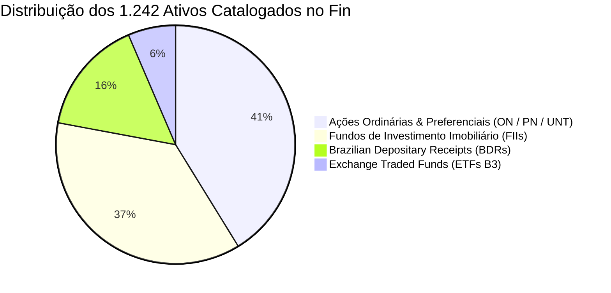

# 📜 Catálogo de 1.242 Ativos Reais da B3 & Política de Chaves Naturais

Para erradicar dados simulados ou incompletos, o ecossistema Fin realizou a ingestão e reconciliação dos arquivos oficiais da B3, catalogando exatamente **1.242 ativos reais** em suas tabelas mestres.

---

## 🏛️ Composição do Universo dos 1.242 Ativos



### Distribuição por Classe de Ativo:
1. **Ações (512 ativos):** Todas as empresas listadas na B3 com negociação regular, abrangendo os três tipos de ações brasileiras:
   - Final `3` (Ordinárias — ex: `PETR3`, `VALE3`, `BBAS3`, `WEGE3`).
   - Final `4` (Preferenciais — ex: `PETR4`, `ITAU4`, `BBDC4`).
   - Final `11` (Units — ex: `TAEE11`, `SANB11`, `KLBN11`, `BPAC11`).
2. **Fundos Imobiliários — FIIs (456 ativos):** Todos os fundos listados com final `11` (ex: `HGLG11`, `KNIP11`, `XPML11`, `MXRF11`, `VISC11`, `BTLG11`), cobrindo fundos de tijolo, papel, fundos de fundos (FOFs) e Fiagros.
3. **BDRs (194 ativos):** Recibos de empresas internacionais listadas em Nova York (NYSE/Nasdaq) negociados na B3 com final `34` e `35` (ex: `AAPL34`, `MSFT34`, `AMZO34`, `NVDC34`, `TSLA34`).
4. **ETFs Nacionais e Internacionais (80 ativos):** Fundos de índice listados na B3 com final `11` (ex: `BOVA11`, `SMAL11`, `IVVB11`, `SPXI11`, `HASH11`, `XFIX11`).

---

## 🛡️ Matriz de Chaves Naturais de Conflito (Zero Duplicates)

Para garantir que reprocessamentos, jobs paralelos ou falhas de rede nunca dupliquem instrumentos, cotações ou pessoas jurídicas, o Fin define uma **política rígida de chaves naturais**:

| Tabela Alvo | Chave Natural de Conflito (Unique Constraint) | Política de Resolução (`ON CONFLICT`) |
|---|---|---|
| `canonical.legal_entity` | `(cnpj)` para empresas brasileiras / `(lei_code)` para estrangeiras | `DO UPDATE SET razao_social = EXCLUDED.razao_social, atualizado_em = NOW()` |
| `canonical.instrument` | `(ticker)` e `(isin_code)` | `DO UPDATE SET nome_resumido = EXCLUDED.nome_resumido, atualizado_em = NOW()` |
| `market.cotacao_diaria` | `(instrument_id, tempo)` | `DO UPDATE SET preco_fechamento = EXCLUDED.preco_fechamento, volume_financeiro = EXCLUDED.volume_financeiro` |
| `market.provento` | `(instrument_id, tipo_provento, data_com, data_pagamento)` | `DO NOTHING` (proventos já homologados são imutáveis) |
| `asset_details.imovel_fii`| `(instrument_id, nome_imovel, cidade, estado)` | `DO UPDATE SET abl_m2 = EXCLUDED.abl_m2, participacao_pct = EXCLUDED.participacao_pct` |
| `analytics.demonstracao_financeira` | `(instrument_id, tipo_demonstracao, ano_referencia, trimestre_referencia)` | `DO UPDATE SET payload_demonstracao = EXCLUDED.payload_demonstracao, atualizado_em = NOW()` |
| `system.idempotency_keys`| `(idempotency_key)` | `DO NOTHING` (rejeição imediata de duplicação transacional) |

---

## 🔄 Reconciliação entre `core.ativo` e `canonical.instrument`

Durante a migração entre versões do schema (Conversa 09 e Conversa 20), o banco possuía duas estruturas para representar instrumentos:
- `core.ativo`: Modelo transacional original.
- `canonical.instrument`: Modelo canônico internacional padronizado.

### Script de Sincronização e De-duplicação Executado:
```sql
-- Garantir que todo ativo do catálogo core exista no canonical.instrument
INSERT INTO canonical.instrument (
    instrument_id,
    ticker,
    nome_resumido,
    tipo_instrumento,
    emissor_legal_entity_id,
    criado_em
)
SELECT 
    a.ativo_id AS instrument_id,
    UPPER(TRIM(a.codigo_ticker)) AS ticker,
    a.nome_pregao AS nome_resumido,
    CASE 
        WHEN a.tipo = 'ACAO' THEN 'ACAO'
        WHEN a.tipo = 'FII' THEN 'FII'
        WHEN a.tipo = 'ETF' THEN 'ETF'
        WHEN a.tipo = 'BDR' THEN 'BDR'
        ELSE 'OUTRO'
    END AS tipo_instrumento,
    a.legal_entity_id AS emissor_legal_entity_id,
    NOW()
FROM core.ativo a
ON CONFLICT (ticker) DO UPDATE SET
    nome_resumido = EXCLUDED.nome_resumido,
    tipo_instrumento = EXCLUDED.tipo_instrumento,
    atualizado_em = NOW();
```

---

## 🔗 Referências Cruzadas
- [[Modelagem_Relacional_12_Schemas|Dicionário dos 12 Schemas]]
- [[Conv_09_a_14_Auditoria_Ativos_Reais_Web_e_ETL|Conversa 09: Carga dos Ativos Reais da B3]]
- [[Plano_Mestre_Abastecimento_10_Pipelines|Plano de Abastecimento dos 10 Pipelines]]
