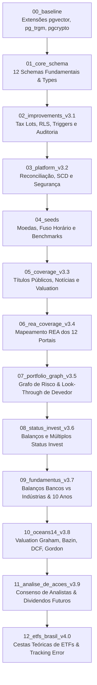

# 🧬 Histórico de Migrações e Evolução do DDL (v1.0 ao Stage 12 v4.0)

Este documento registra a evolução sequencial das migrações do banco de dados `fin-db`, mapeando a criação e o aprimoramento contínuo das 303 tabelas e 36 hypertables.

---

## 🧭 Linha do Tempo dos 13 Estágios de Migração

---

## 📋 Detalhamento Técnico dos 13 Estágios

### 1. `00_baseline` (Fundação & Extensões)
- **Data de Execução:** 26/10/2026 (Conversa 01)
- **Scripts:** `00_extensions_and_schemas.sql`, `01_existing_canonical_raw_schema.sql`, `02_existing_seeds.sql`.
- **Objetos Criados:** Habilitação das extensões `timescaledb`, `vector` (pgvector), `pg_trgm`, `uuid-ossp`, `pgcrypto`. Criação dos esquemas mestres `canonical` e `raw`.

### 2. `01_core_schema` (Modelagem dos 12 Schemas Base)
- **Data de Execução:** 26/10/2026 (Conversa 01)
- **Scripts:** `00_types.sql` até `09_views_and_aggregates.sql`.
- **Objetos Criados:** Provisionamento dos tipos enumerados (`ENUM`), tabelas de ativos, cotações, carteiras, tabelas de apoio social, data warehouse e segurança. Criação das primeiras 36 hypertables do TimescaleDB.

### 3. `02_improvements_v3.1` (Controle Fiscal, RLS e Triggers)
- **Data de Execução:** 26/10/2026 (Conversa 02)
- **Scripts:** `01_corrections_and_constraints.sql` até `08_triggers_rls_views.sql`.
- **Inovações:** Adição da tabela `core.tax_lot` para cálculo de preço médio ponderado; habilitação de Row Level Security (RLS) para isolamento rigoroso entre contas de usuários; triggers de auditoria em operações de compra e venda.

### 4. `03_platform_v3.2` (Reconciliação e Auditoria LGPD)
- **Data de Execução:** 26/10/2026 (Conversa 02)
- **Scripts:** `01_reconciliation.sql` até `07_ai_foundation.sql`.
- **Inovações:** Criação de tabelas de Slowly Changing Dimensions (SCD Tipo 2) para histórico de dados cadastrais; módulo de detecção de fraudes; compliance com LGPD (termo de consentimento e exclusão de dados).

### 5. `04_seeds` (Carga Estática Canônica)
- **Data de Execução:** 26/10/2026 (Conversa 02)
- **Scripts:** `01_core_currencies_and_timezones.sql`, `02_market_benchmarks.sql`, `03_analytics_tags.sql`.
- **Inovações:** Inserção das moedas internacionais (BRL, USD, EUR), fusos horários e benchmarks financeiros (Ibovespa, IFIX, CDI, Selic, S&P 500).

### 6. `05_coverage_v3.3` (Expansão de Títulos e Notícias)
- **Data de Execução:** 26/10/2026 (Conversa 03)
- **Scripts:** `01_canonical_government_bond_quote.sql` até `11_seeds_metric_definition.sql`.
- **Inovações:** Suporte completo a cotações de Títulos Públicos (Tesouro Direto), artigos de notícias e fatos relevantes, transações de *insiders* e tabelas iniciais de valuation.

### 7. `06_rea_coverage_v3.4` (Engenharia Reversa dos 12 Portais)
- **Data de Execução:** 26/10/2026 (Conversa 03)
- **Scripts:** `01_enums_and_core_governance.sql` até `06_seeds_metrics_and_benchmarks.sql`.
- **Inovações:** Adição dos campos do Apollo GraphQL do Fundamentei (102 KPIs), segmentação geográfica do Investidor10, gregas de opções e remuneração da administração do Status Invest.

### 8. `07_portfolio_graph_reconciliation_v3.5` (Grafo da Carteira Invisível)
- **Data de Execução:** 27/10/2026 (Conversa 11)
- **Scripts:** `01_lookthrough_graph.sql`, `02_credor_devedor_cross_risk.sql`.
- **Inovações:** Implementação da função `core.fn_lookthrough_devedor()` e tabelas de mapeamento de risco cruzado de crédito entre Ações, FIIs e Fundos.

### 9. `08_status_invest_coverage_v3.6` (Pipeline Status Invest)
- **Data de Execução:** 27/10/2026 (Conversa 12)
- **Inovações:** Estruturação das tabelas de DRE analítica trimestral e proventos conciliados no padrão do Status Invest.

### 10. `09_fundamentus_coverage_v3.7` (Linhagem Fundamentus & Bancos)
- **Data de Execução:** 28/10/2026 (Conversa 15)
- **Inovações:** Bifurcação contábil para instituições financeiras (COSIF) versus empresas industriais na tabela `analytics.demonstracao_financeira`.

### 11. `10_oceans14_coverage_v3.8` (Modelos de Valuation Quantitativo)
- **Data de Execução:** 28/10/2026 (Conversa 17)
- **Inovações:** Provisionamento da tabela `analytics.valuation_ativo` com suporte aos algoritmos de Benjamin Graham, Décio Bazin, Fluxo de Caixa Descontado (DCF) e Modelo de Gordon.

### 12. `11_analise_de_acoes_coverage_v3.9` (Consenso e Projeções Futuras)
- **Data de Execução:** 28/10/2026 (Conversa 18)
- **Inovações:** Criação da tabela `analytics.consenso_mercado` armazenando recomendações de corretoras (Buy/Hold/Sell), preços-alvo médios e score de saúde financeira (0 a 100).

### 13. `12_etfs_brasil_coverage_v4.0` (Mercado de ETFs & Rastreio)
- **Data de Execução:** 28/10/2026 (Conversa 19)
- **Inovações:** Criação das tabelas `asset_details.detalhe_etf`, `asset_details.composicao_etf` e `asset_details.tracking_etf` para decomposição completa de cestas e tracking error.

---

## 🔗 Referências Cruzadas
- [[Modelagem_Relacional_12_Schemas|Dicionário dos 12 Schemas]]
- [[Hypertables_TimescaleDB_e_Series_Temporais|Hypertables do TimescaleDB]]
- [[Matriz_Unificada_12_Portais_e_Gaps|Matriz Unificada dos 12 Portais]]
