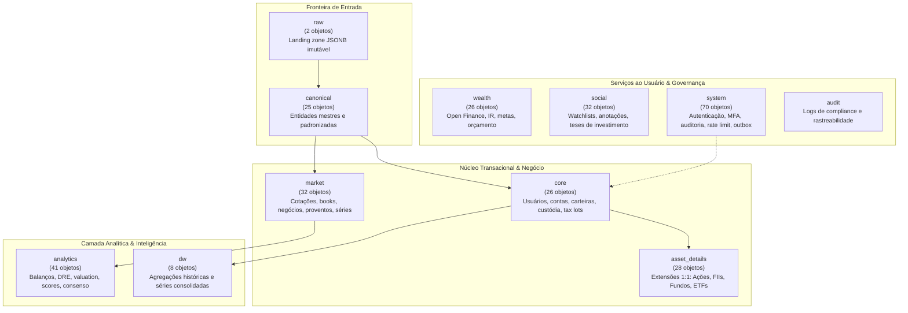

# 📦 Modelagem Relacional & Dicionário dos 12 Schemas do fin-db

O banco de dados do ecossistema Fin é construído no **PostgreSQL 18** com arquitetura multi-schema para garantir separação de domínios, segurança via RBAC (Role-Based Access Control) e facilidade de manutenção.

---

## 🏛️ Visão Estrutural dos 12 Schemas

---

## 📋 Dicionário Detalhado por Schema

### 1. `raw` (2 objetos)
Camada de pouso bruto (*bronze layer*):
- `raw.payload`: Tabela central de ingestão contendo `payload_id`, `source_name`, `source_url`, `content_hash` (SHA-256), `captured_at`, `payload_json` (JSONB).
- `raw.lote_captura`: Agrupamento e auditoria de jobs de coleta executados.

### 2. `canonical` (25 objetos)
Normalização de dados externos antes de entrarem nas tabelas de aplicação:
- `canonical.legal_entity`: Pessoas jurídicas, CNPJ, razão social, nome fantasia, país de origem.
- `canonical.instrument`: Instrumento financeiro mestre, código de negociação (`ticker`), ISIN, tipo de instrumento (`ACAO`, `FII`, `ETF`, `BDR`, `TITULO_PUBLICO`, `DEBENTURE`, `CRIPTO`).
- `canonical.government_bond`: Títulos do Tesouro Direto com indexador, vencimento e taxas.
- `canonical.debenture`: Emissões de debêntures com garantias, repactuações e spreads.
- `canonical.news_article`: Notícias e fatos relevantes ingeridos.
- `canonical.insider_transaction`: Negociações de insiders (diretoria e controladores).
- `canonical.institutional_holding`: Posições de investidores institucionais (> 5% do capital).

### 3. `core` (26 objetos)
Cadastros mestres transacionais e carteira:
- `core.usuario`: Registro de investidores, preferências e perfil de risco.
- `core.carteira`: Carteiras de investimentos (ex: "Aposentadoria", "Reserva de Emergência", "Dividendos").
- `core.custodia`: Posição consolidada atual de cada ativo por carteira (quantidade, preço médio de aquisição).
- `core.tax_lot`: Lotes fiscais de compra para apuração de ganho de capital e regras de Imposto de Renda (preço médio ponderado e FIFO).
- `core.ordem`: Ordens de compra e venda de ativos.
- `core.transacao_financeira`: Cabeçalho da operação financeira.
- `core.lancamento_contabil`: Entradas do **Ledger de Partidas Dobradas** (Débito e Crédito) com validação de soma zero.
- `core.remuneracao_orgao`: Dados de remuneração de conselho e diretoria extraídos do FRE CVM.

### 4. `market` (32 objetos)
Dados de mercado e séries temporais:
- `market.cotacao_diaria`: Hypertable TimescaleDB com OHLCV (Abertura, Máxima, Mínima, Fechamento, Volume, Negócios) diário.
- `market.cotacao_intraday`: Hypertable para ticks e intervalos de 1 a 15 minutos.
- `market.book_ordens`: Hypertable com profundidade de ofertas de compra e venda.
- `market.provento`: Proventos declarados (Dividendos, JCP, Rendimentos de FII) com data com, data ex e pagamento.
- `market.evento_corporativo`: Desdobramentos (*splits*), grupamentos (*reverse splits*), bonificações e amortizações.
- `market.programa_recompra`: Programas de recompra de ações aprovados em conselho.
- `market.serie_macroeconomica`: Hypertable de índices do Banco Central (Selic, IPCA, CDI, Câmbio).
- `market.curva_juros_ettj`: Estrutura a termo das taxas de juros ANBIMA.

### 5. `asset_details` (28 objetos)
Tabelas especializadas 1:1 e 1:N por classe de ativo:
- `asset_details.detalhe_acao`: Ações: setor, subsetor, segmento de listagem (Novo Mercado, Nível 2), tag along, free float, governança.
- `asset_details.detalhe_fii`: FIIs: mandato, segmento (Logística, Lajes, Shoppings, Papel, Híbrido), gestora, administradora, taxa de gestão.
- `asset_details.imovel_fii`: Imóveis físicos de FIIs: nome do edifício/galpão, endereço, ABL total, participação percentual do fundo.
- `asset_details.historico_vacancia_fii`: Hypertable com evolução de vacância física (%) e financeira (%).
- `asset_details.contrato_locacao_fii`: Relação de inquilinos, vencimento de contratos, modalidade (típico vs atípico BTS).
- `asset_details.perfil_fundo`: Fundos CVM 175: classe, subclasse, taxa de administração, taxa de performance, prazo de cotização e liquidação de resgate.
- `asset_details.composicao_carteira_fundo`: Composição de carteira aberta (CDA CVM) para look-through de devedores.
- `asset_details.detalhe_etf` e `asset_details.composicao_etf`: Metadados e carteira teórica de ETFs.

### 6. `analytics` (41 objetos)
Camada de inteligência e inteligência fundamentalista:
- `analytics.demonstracao_financeira`: Balanço Patrimonial, DRE e DFC padronizados de 10 a 20 anos.
- `analytics.receita_segmento`: Receita corporativa por divisão de negócio e geografia.
- `analytics.historico_indicador_fundamentalista`: Hypertable de múltiplos diários (P/L, P/VP, EV/Ebitda, ROE, ROIC, Margens).
- `analytics.valuation_ativo`: Modelos matemáticos de valuation (Graham, Bazin, DCF, Gordon).
- `analytics.consenso_mercado`: Recomendações e preços-alvo médios de analistas de corretoras.
- `analytics.checklist_criterio`: Regras booleanas de avaliação Buy & Hold.
- `analytics.score_eixo`: Radar de saúde financeira em 5 dimensões (0 a 100).
- `analytics.busca_ativo`: Materialized View com índice de trigramas (`pg_trgm`) para busca instantânea em tempo real.

### 7. `wealth` (26 objetos)
Gestão patrimonial completa e Open Finance:
- `wealth.conta_bancaria`: Contas correntes e de investimento.
- `wealth.transacao_bancaria`: Extratos bancários categorizados.
- `wealth.apuracao_ir`: Histórico mensal de cálculo de DARF e prejuízos acumulados a compensar.
- `wealth.aporte_recorrente`: Planejamento de compras regulares de ativos.

### 8. `social` (32 objetos)
Funcionalidades sociais e anotações do investidor:
- `social.watchlist`: Listas de ativos monitorados por tema.
- `social.nota_investidor`: Anotações privadas do usuário sobre sua tese em um papel específico.
- `social.kanban_tese`: Quadro kanban de acompanhamento de teses (Estudo, Alocação, Desinvestimento).

### 9. `dw` (8 objetos)
Data Warehouse analítico de alta velocidade:
- `dw.historico_patrimonio`: Agregações históricas de valor patrimonial consolidado.
- `dw.historico_rentabilidade`: Curva de rentabilidade ponderada pelo tempo (TWR) comparada ao CDI e Ibovespa.

### 10. `system` (70 objetos)
Segurança, controle de acesso e auditoria:
- `system.usuario_credencial`: Senhas hashadas com argon2/bcrypt e segredos MFA (TOTP).
- `system.device_fingerprint`: Rastreamento de dispositivos autorizados e detecção de login suspeito.
- `system.rate_limit`: Hypertable de controle de taxas de requisição por IP e token.
- `system.outbox_events`: Tabela do padrão Transactional Outbox para mensageria assíncrona.
- `system.auditoria_log`: Trilha de auditoria append-only para compliance e LGPD.

---

## 🔗 Referências Cruzadas
- [[Hypertables_TimescaleDB_e_Series_Temporais|Hypertables do TimescaleDB]]
- [[Catalogo_1242_Ativos_e_Chaves_Naturais|Catálogo de Ativos B3]]
- [[Migrations_e_Evolucao_DDL_v3_1_a_Stage12|Histórico de Migrações SQL]]
