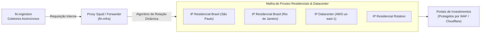

# 🛡️ Malha de Proxies Rotativos, Anti-Bot e Evasão

Para garantir que os coletores do `fin-ingestion` operem sem interrupções por bloqueios de IP, CAPTCHAs ou restrições de taxa (*HTTP 429 Too Many Requests*), o repositório **`fin-infra`** implementa uma camada especializada de saída (*Egress Gateway*).

---

## 🏛️ Topologia da Camada de Egress



---

## 🛠️ As Três Camadas de Evasão Implementadas

### 1. Rotação de Proxies Residenciais
- **Por Que Proxies Residenciais?** WAFs modernos (Cloudflare Bot Management, Akamai Bot Manager, Imperva) identificam e bloqueiam faixas de IP de datacenters comuns (AWS, DigitalOcean, Hetzner, Google Cloud). Os proxies residenciais utilizam IPs legítimos de conexões de banda larga doméstica brasileira (Claro, Vivo, TIM).
- **Modos de Operação do Squid:**
  - *Modo Randômico (Default):* Cada requisição HTTP sai por um IP residencial diferente. Ideal para screeners massivos (`resultado.php`).
  - *Modo Sticky Session (Sessão Persistente):* O mesmo IP é mantido por 5 minutos para uma sequência de páginas que requerem cookies ou sessão autenticada.

### 2. Spoofing de TLS Fingerprint (JA3 / JA4)
- **O Problema:** O Cloudflare inspeciona a ordem dos algoritmos criptográficos (*Cipher Suites*) e as extensões enviadas no pacote inicial `Client Hello` do handshake TLS. Bibliotecas convencionais como `requests` ou `urllib` emitem uma assinatura estática (JA3) facilmente catalogada como bot de Python.
- **A Solução no Fin:** O `fin-ingestion` utiliza adaptadores de TLS baseados em `curl_cffi` e `playwright`, que replicam com fidelidade cirúrgica a ordem de ciphers, ALPN e extensões idênticas às de uma versão recente do Google Chrome para desktop.

### 3. Rate Limiting com Jitter por Domínio Alvo
Para não sobrecarregar os servidores dos portais e evitar comportamentos robóticos evidentes, o `fin-ingestion` implementa limitadores de taxa com ruído estocástico (*Gaussian Jitter*):

```python
import asyncio
import random

async def fetch_with_jitter(client, url: str, base_delay: float = 1.0):
    # Aplica um atraso com ruído aleatório gaussiano (ex: 1.0s ± 0.3s)
    jitter = random.gauss(0, 0.3)
    sleep_time = max(0.2, base_delay + jitter)
    await asyncio.sleep(sleep_time)
    
    return await client.get(url)
```

---

## 📊 Tabela de Políticas por Domínio Alvo

| Domínio Alvo | Nível de Proteção Encontrado | Estratégia Aplicada | Delay Médio Recomendado |
|---|---|---|:---:|
| **Status Invest** | Cloudflare WAF + reCAPTCHA v3 | TLS Spoofing (Chrome 128) + Proxies Residenciais | 1.5s com Jitter |
| **Fundamentus** | Sem WAF rígido / Rate limit moderado | HTTPX Direto com Headers Realistas | 0.5s |
| **Clube FII** | Cloudflare Challenge + Renderização JS | Playwright Headless + Sessão Persistente | 2.5s |
| **CVM / B3 / BCB** | Órgãos Públicos / APIs Abertas | HTTPX Direto (Sem Proxy) | Sem restrição (Batch) |

---

## 🔗 Referências Cruzadas
- [[Plano_Mestre_Abastecimento_10_Pipelines|Plano de Abastecimento]]
- [[Especificacao_Tecnica_Scrapers_e_Coletores|Especificação Técnica dos Scrapers]]
- [[Topologia_Producao_e_Observabilidade|Topologia de Infraestrutura]]
