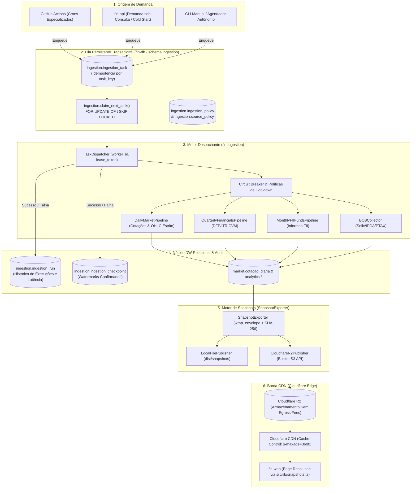

# ⚡ Despachante Autônomo de Tarefas e Publicador de Snapshots (CDN / R2)

Este documento especifica a implementação técnica das **Etapas 2 e 3** da evolução arquitetural do **FIN-APP**, cobrindo o despachante transacional de tarefas em PostgreSQL com reserva via `SKIP LOCKED` e o motor de publicação de snapshots JSON versionados para Cloudflare R2 e Edge CDN.

---

## 🏛️ 1. Visão Geral da Arquitetura de Despacho e Borda



---

## ⚙️ 2. Motor de Despacho de Tarefas (`TaskDispatcher`)

### 2.1. Princípio de Reserva Concorrente (`Lease Pattern`)
O despachante implementado em `fin_ingestion/dispatcher/task_dispatcher.py` consome a fila transacional `ingestion.ingestion_task` sem risco de duplicidade nem condições de corrida (*race conditions*):
1. **Reserva Atômica:** Invoca a função PL/pgSQL `ingestion.claim_next_task(worker_id, lease_duration_sec)`. A query utiliza a cláusula `FOR UPDATE OF t SKIP LOCKED`, permitindo que múltiplos pods ou containers reservem tarefas concorrentemente sem contenção de lock.
2. **Lease Token:** A função gera um UUID criptográfico (`lock_token`) e estipula um prazo limite (`locked_until = NOW() + INTERVAL '300 seconds'`). Somente o processo que possuir o token válido pode atualizar o status final da tarefa.
3. **Mapeamento de Datasets Suportados:**
   * `cotacao_diaria`, `cotacao_intraday`, `b3_daily_quotes` $\rightarrow$ `DailyMarketPipeline`.
   * `demonstrativo_financeiro`, `dfp`, `itr`, `cvm_quarterly_dfp` $\rightarrow$ `QuarterlyFinancialsPipeline`.
   * `informe_mensal_fii`, `fii_rendimentos`, `cvm_fii_monthly` $\rightarrow$ `MonthlyFIIFundsPipeline`.
   * `serie_macro`, `bcb_macro_series` $\rightarrow$ `BCBCollector` (Selic Over, IPCA, CDI).
   * `taxa_anbima`, `anbima_indicativos` $\rightarrow$ `ANBIMACollector` (ETTJ e spreads de crédito).
   * `etf_taxas_nav`, `etfs_brasil_taxas` $\rightarrow$ `ETFsBrasilCollector`.
   * `cota_fundo_investimento`, `cvm_funds_daily` $\rightarrow$ `CVMCollector`.
   * `cadastro_instrumento`, `b3_instrument_cad` $\rightarrow$ `AssetMetadataEnricher`.
4. **Baixa e Auditoria:**
   * **Em caso de Sucesso:** Registra a duração em milissegundos e contagem de registros em `ingestion.ingestion_run` com status `'SUCCEEDED'`, atualiza o *high-watermark* em `ingestion.ingestion_checkpoint` e executa `complete_task(task_id, lock_token)` que transita o status da tarefa para `'COMPLETED'`.
   * **Em caso de Falha:** Registra a stack trace em `ingestion.ingestion_run` com status `'FAILED'`, adiciona ocorrência de anomalia na tabela `ingestion.ingestion_issue` e executa `fail_task(task_id, lock_token, error_message)` para retentativa com backoff exponencial. Se o número de tentativas exaurir `max_attempts`, a tarefa é marcada permanentemente como `'FAILED'`.

---

## 📦 3. Motor de Exportação de Snapshots JSON (`SnapshotExporter`)

### 3.1. Envelope Canônico de Metadados
Todo snapshot JSON exportado pelo `SnapshotExporter` (`fin_ingestion/publishers/snapshot_exporter.py`) é estruturado com um envelope padrão de procedência e integridade:

```json
{
  "meta": {
    "schema": "stock_detail_v1",
    "schema_version": "1.0.0",
    "generated_at": "2026-10-28T18:50:13.305871+00:00",
    "content_hash": "sha256:5600b1ecb2430400d7b2d8118ec5ac97c3bcc0bc1609af43940d0a87f8ccd184",
    "source": "fin-ingestion-snapshot-engine"
  },
  "data": { ... }
}
```

### 3.2. Catálogo de Snapshots Gerados

| Rota / Arquivo de Snapshot | Origem no DW | Conteúdo Consolidado |
| :--- | :--- | :--- |
| `/snapshots/acoes/{ticker}.json` | `core.ativo`, `core.emissor_companhia`, `market.cotacao_diaria`, `analytics.indicador_fundamentalista`, `analytics.valuation`, `market.provento` | Perfil corporativo completo, cotação e variação diária, múltiplos de valuation (P/L, P/VP, EV/EBIT, PSR), eficiência (ROE, ROIC, margens), Graham, Bazin e proventos dos últimos 24 meses. |
| `/snapshots/fiis/{ticker}.json` | `core.ativo`, `asset_details.detalhe_fii`, `market.cotacao_diaria`, `asset_details.fii_imovel`, `asset_details.fii_imovel_participacao`, `asset_details.historico_vacancia_fii`, `market.provento` | Ficha do FII, portfólio físico imobiliário (nome do imóvel, cidade, estado, ABL $m^2$, % de participação), série histórica de vacância física e financeira, rendimentos mensais distribuídos. |
| `/snapshots/market/overview.json` | `market.benchmark`, `market.benchmark_serie` | Séries diárias dos benchmarks IBOVESPA, IFIX, Selic Over, IPCA e PTAX. |
| `/snapshots/rankings/summary.json` | `analytics.indicador_fundamentalista`, `market.cotacao_diaria` | Top 25 Ações por Dividend Yield e Top 25 FIIs por Dividend Yield. |

### 3.3. Drivers de Armazenamento e Borda
* **`LocalFilePublisher`:** Grava em disco estruturado (padrão `dist/snapshots/`) para visualização offline, testes automatizados e builds estáticos.
* **`CloudflareR2Publisher`:** Conecta ao bucket S3 da Cloudflare via credenciais `R2_ACCOUNT_ID`, `R2_ACCESS_KEY_ID`, `R2_SECRET_ACCESS_KEY` e `R2_BUCKET_NAME`. Aplica cabeçalhos HTTP otimizados:
  ```http
  Content-Type: application/json
  Cache-Control: public, max-age=300, s-maxage=3600, stale-while-revalidate=86400
  ```

---

## 🖥️ 4. Integração no Frontend (`fin-web`)

O cliente em `src/lib/snapshots.ts` implementa a resolução prioritária de borda:
1. Quando a variável `NEXT_PUBLIC_CDN_URL` ou `NEXT_PUBLIC_R2_URL` está configurada, requisições para `getBenchmarks()`, `getFIIDetail()` e `getStockCompleteDetails()` buscam diretamente o JSON estático na CDN.
2. Em caso de cache hit na CDN, a resposta é entregue em **menos de 50ms**, sem consumir conexões no pool do PostgreSQL nem ciclos de CPU no backend do Render.
3. Se a CDN retornar HTTP 404 (ativo recém-listado sem snapshot) ou falha de rede transitória, a aplicação executa fallback transparente para a API FastAPI em `https://fin-api-jbrz.onrender.com/api/v1`.

---

## 💻 5. Interface de Linha de Comando (CLI)

Os novos comandos da CLI do `fin-ingestion` operacionalizam as Etapas 2 e 3:

```bash
# Processa até 20 tarefas pendentes da fila com reserva SKIP LOCKED e sai com código 0
uv run fin-ingestion dispatch-tasks --max-tasks 20 --lease-sec 300

# Enfileira manualmente uma tarefa de alta prioridade para o ticker PETR4
uv run fin-ingestion enqueue-task --policy b3_daily_quotes --dataset cotacao_diaria --target PETR4 --priority 1

# Exporta snapshots locais de ações, FIIs e mercado
uv run fin-ingestion export-snapshots --tickers PETR4,VALE3,HGLG11 --output-dir dist/snapshots

# Exporta todos os 100 ativos mais líquidos e publica diretamente no Cloudflare R2
uv run fin-ingestion export-snapshots --r2
```
