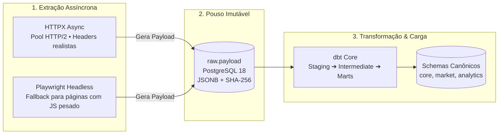

# 🤖 Especificação Técnica dos Scrapers, Coletores e dbt no fin-ingestion

O repositório **`fin-ingestion`** é o motor responsável pela extração contínua, auditoria e transformação de dados financeiros de fontes externas.

---

## 🏛️ Fluxo de Processamento em Três Estágios



---

## 1. ⚙️ Motor de Coleta Assíncrono (Python 3.12 + HTTPX)

A arquitetura de coleta baseia-se em corrotinas assíncronas (`asyncio`) para maximizar a taxa de transferência de I/O de rede sem bloquear a thread principal.

### Padrão de Coletor Base (`BaseCollector`):
```python
import hashlib
import json
import httpx
from datetime import datetime, timezone

class BaseCollector:
    def __init__(self, source_name: str, base_url: str):
        self.source_name = source_name
        self.base_url = base_url
        self.client = httpx.AsyncClient(
            http2=True,
            timeout=30.0,
            headers={
                "User-Agent": "Mozilla/5.0 (Windows NT 10.0; Win64; x64) AppleWebKit/537.36 (KHTML, like Gecko) Chrome/128.0.0.0 Safari/537.36",
                "Accept-Language": "pt-BR,pt;q=0.9,en-US;q=0.8,en;q=0.7",
            }
        )

    async def fetch_and_land(self, endpoint: str, db_pool) -> str:
        url = f"{self.base_url}/{endpoint.lstrip('/')}"
        response = await self.client.get(url)
        response.raise_for_status()

        payload_bytes = response.content
        content_hash = hashlib.sha256(payload_bytes).hexdigest()

        # Pouso atômico na camada raw.payload
        async with db_pool.acquire() as conn:
            await conn.execute("""
                INSERT INTO raw.payload (
                    source_name,
                    source_url,
                    content_hash,
                    payload_json,
                    captured_at
                ) VALUES ($1, $2, $3, $4::jsonb, $5)
                ON CONFLICT (content_hash) DO NOTHING;
            """, self.source_name, url, content_hash, response.text, datetime.now(timezone.utc))

        return content_hash
```

---

## 2. 🎭 Fallback com Playwright Headless

Determinadas plataformas (ex: gráficos interativos do Clube FII e telas de opções do Status Invest) montam o DOM inteiramente via JavaScript no lado do cliente (*Single Page Applications*).

Para essas rotas, o `fin-ingestion` aciona um coletor secundário com **Playwright Chromium**:
1. Lança uma instância de navegador headless com flags anti-detecção (`--disable-blink-features=AutomationControlled`).
2. Intercepta as respostas de rede (`page.on("response", ...)`) capturando diretamente o payload JSON devolvido pelas APIs internas da plataforma.
3. Extrai os dados antes mesmo de eles serem desenhados no canvas/HTML, economizando tempo de CPU.

---

## 3. 🔄 Camada de Transformação com dbt Core

Uma vez armazenados em `raw.payload`, os dados brutos são processados através do **dbt (data build tool)**:

### Estrutura de Modelos dbt:
- **`models/staging/`:**
  - Extrai os campos do JSONB bruto, converte strings numéricas com vírgula para `NUMERIC` com ponto decimal e padroniza datas no padrão ISO 8601 (`YYYY-MM-DD`).
- **`models/intermediate/`:**
  - Aplica regras de negócio intermediárias, calcula médias móveis de proventos e unifica tickers antigos que sofreram renomeação na B3.
- **`models/marts/`:**
  - Povoa as tabelas finais dos esquemas `canonical`, `market`, `asset_details` e `analytics`.

---

## 🔗 Referências Cruzadas
- [[Plano_Mestre_Abastecimento_10_Pipelines|Os 10 Pipelines de Abastecimento]]
- [[Anti_Bot_Proxies_Rotativos_e_Evasao|Malha de Proxies e Evasão]]
- [[Modelagem_Relacional_12_Schemas|Esquemas Canônicos no fin-db]]
