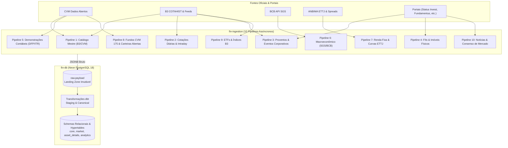

# 🔄 Plano Mestre de Abastecimento Automatizado: Os 10 Pipelines do fin-ingestion

Este documento consolida a especificação dos **10 pipelines automatizados** de captura, transformação e povoamento contínuo do banco de dados `fin-db`.

---

## 🧭 Visão Geral dos 10 Pipelines

---

## 📋 Detalhamento dos 10 Pipelines de Abastecimento

### Pipeline 1: Catálogo Mestre, Entidades e Ativos (CVM + B3)
- **Frequência:** Diária (06:00 BRT).
- **Fontes:** Cadastro geral de companhias da CVM (`cad_cia_aberta.csv`) e arquivo BVBG.028 da B3.
- **Destino:** `canonical.legal_entity`, `canonical.instrument`, `core.ativo`.
- **Estratégia:** Identifica novas emissões de ações, novos FIIs, listagens de BDRs e cancelamentos de registro de empresas.

### Pipeline 2: Cotações Diárias & Intraday (TimescaleDB)
- **Frequência:** 
  - *Intraday:* A cada 15 minutos durante o horário do pregão (10:00 às 17:30 BRT).
  - *Diário:* Diariamente às 19:00 BRT (após o fechamento do arquivo COTAHIST da B3).
- **Destino:** `market.cotacao_diaria` e `market.cotacao_intraday`.
- **Validação:** Checagem de integridade (Preço Mínimo $\le$ Abertura/Fechamento $\le$ Preço Máximo; Volume $\ge 0$).

### Pipeline 3: Proventos, Dividendos, JCP e Eventos Corporativos
- **Frequência:** Duas vezes ao dia (12:30 e 20:00 BRT).
- **Fontes:** Avisos aos Acionistas entregues à CVM, feed da B3 e scrapers de validação cruzada (Status Invest e FIIs.com.br).
- **Destino:** `market.provento` e `market.evento_corporativo`.
- **Regra de Negócio:** Captura antecipada da `data_com`, `data_ex`, valor bruto por cota e data de liquidação para cálculo de proventos a receber na carteira do usuário.

### Pipeline 4: Fundos Imobiliários & Imóveis Físicos
- **Frequência:** Semanal (aos domingos às 03:00 BRT) e diária para fatos relevantes.
- **Fontes:** Informes Mensais Estruturados da CVM, portais Clube FII e SiiLA.
- **Destino:** `asset_details.detalhe_fii`, `asset_details.imovel_fii`, `asset_details.historico_vacancia_fii`.
- **Dados Coletados:** Relação de imóveis, ABL, taxa de vacância física/financeira, contratos de locação atípicos (BTS) e indexadores de reajuste.

### Pipeline 5: Demonstrações Financeiras (DFP / ITR CVM)
- **Frequência:** Trimestral contínua (com pico nos períodos de safra de balanços: março/abril, maio, agosto e novembro).
- **Fontes:** Conjunto de dados abertos da CVM (Arquivos `DFP_CIA_ABERTA_*.zip` e `ITR_CIA_ABERTA_*.zip`).
- **Destino:** `analytics.demonstracao_financeira`.
- **Estrutura:** Normalização contábil dos balanços patrimoniais, DRE (diferenciando Bancos de Indústrias) e DFC.

### Pipeline 6: Indicadores Macroeconômicos (SGS / BCB)
- **Frequência:** Diária às 08:30 BRT.
- **Fontes:** API REST pública do Sistema Gerenciador de Séries Temporais do Banco Central.
- **Destino:** `market.serie_macroeconomica`.
- **Séries:** Selic Meta (`432`), Selic Over (`11`), CDI Diário (`12`), IPCA Mensal (`433`), IGP-M (`189`) e Dólar PTAX (`1`).

### Pipeline 7: Renda Fixa & Curvas de Juros ETTJ (ANBIMA)
- **Frequência:** Diária às 18:00 BRT.
- **Fontes:** Portal de estatísticas da ANBIMA.
- **Destino:** `market.curva_juros_ettj`, `canonical.government_bond`, `canonical.debenture`.
- **Parâmetros:** Coeficientes de Svensson das curvas ETTJ Prefixada e IPCA, taxas indicativas de compra/venda de NTN-B e spreads de debêntures.

### Pipeline 8: Fundos de Investimento (Resolução CVM 175)
- **Frequência:** Diária às 21:00 BRT para cotas; mensal para carteiras abertas.
- **Fontes:** Informes Diários de Fundos e Arquivos CDA (Composição e Diversificação das Aplicações) da CVM.
- **Destino:** `asset_details.perfil_fundo`, `asset_details.composicao_carteira_fundo`.
- **Importância Crítica:** Alimenta o grafo de **Look-Through de Devedor** da Carteira Invisível.

### Pipeline 9: ETFs & Índices de Mercado B3
- **Frequência:** Diária às 19:30 BRT.
- **Fontes:** Boletins da B3 e portal ETFs Brasil.
- **Destino:** `asset_details.detalhe_etf`, `asset_details.composicao_etf`, `asset_details.tracking_etf`.
- **Métricas:** Decomposição da carteira de ações do Ibovespa, IFIX e cálculo do Tracking Error diário.

### Pipeline 10: Notícias, Consenso de Mercado e Fatos Relevantes
- **Frequência:** A cada 30 minutos em horário comercial.
- **Fontes:** Fatos relevantes CVM e agregadores de recomendações de corretoras (Análise de Ações).
- **Destino:** `canonical.news_article`, `analytics.consenso_mercado`.

---

## ⏱️ Sistema de High-Watermarks e Checkpoints

Para garantir que pipelines interrompidos possam retomar exatamente de onde pararam sem reprocessar gigabytes de dados históricos:
1. Cada pipeline mantém seu ponteiro (*High-Watermark*) na tabela `system.pipeline_checkpoint`.
2. O ponteiro registra a última data (`last_processed_date`) ou o último ID sequencial (`last_record_id`) homologado com sucesso.
3. Se o job cair no meio do caminho, o reinício lê o checkpoint e busca apenas os registros criados após a marcação.

---

## 🔗 Referências Cruzadas
- [[Especificacao_Tecnica_Scrapers_e_Coletores|Especificação Técnica dos Coletores]]
- [[Anti_Bot_Proxies_Rotativos_e_Evasao|Malha de Proxies e Evasão Anti-Bloqueio]]
- [[Catalogo_1242_Ativos_e_Chaves_Naturais|Catálogo de 1.242 Ativos da B3]]
