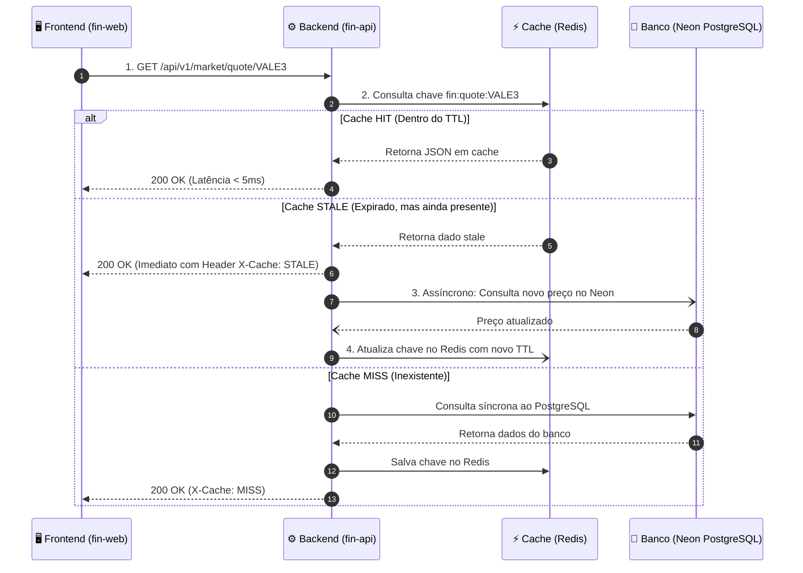

# ⚡ Cache-Aside no Redis, Padrão SWR e Idempotência no fin-api

Para garantir respostas sub-milissegundos e proteger o banco de dados Neon Serverless contra sobrecarga de leituras, o **`fin-api`** implementa uma camada de cache de alta performance no **Redis 7.2 / Upstash**.

---

## 🏛️ Fluxo do Padrão Stale-While-Revalidate (SWR)

O padrão SWR garante que o usuário nunca espere uma consulta pesada ao banco de dados se houver um dado em cache, mesmo que ligeiramente defasado:

---

## ⏱️ Matriz de Políticas de TTL por Volatilidade de Dados

Nem todo dado financeiro muda na mesma frequência. O Fin adota uma hierarquia estrita de expiração:

| Classe de Dado | Chave no Redis | TTL (Tempo de Vida) | Justificativa |
|---|---|:---:|---|
| **Cotação em Pregão Aberto** | `fin:market:quote:{ticker}` | 60 segundos | Preços de ações oscilam minuto a minuto na B3. |
| **Livro de Ofertas (Book)** | `fin:market:book:{ticker}` | 10 segundos | Profundidade de ofertas possui alta rotatividade. |
| **Série Temporal Diária** | `fin:market:history:{ticker}:{period}` | 1 hora | Após o fechamento do pregão, cotações diárias são imutáveis. |
| **Balanço / DRE Contábil** | `fin:analytics:statements:{ticker}` | 24 horas | Empresas só divulgam balanços uma vez a cada trimestre. |
| **Valuation Quantitativo** | `fin:analytics:valuation:{ticker}` | 12 horas | Múltiplos só se alteram com novo preço de fechamento. |
| **Consenso de Analistas** | `fin:analytics:consensus:{ticker}` | 24 horas | Recomendações de corretoras mudam esporadicamente. |
| **Catálogo Mestre de Ativos**| `fin:assets:master_list` | 7 dias | Novos ativos só entram na B3 mediante IPO ou nova emissão. |

---

## 🛡️ Middleware de Idempotência com SHA-256

Para operações transacionais financeiras (registro de aportes, compras, retiradas ou reconciliações de carteira), a duplicação por clique duplo ou timeout de rede é catastrófica.

### Algoritmo do Middleware de Idempotência:
1. O cliente HTTP envia o header `Idempotency-Key: <UUID-v4>`.
2. A API calcula o hash SHA-256 do corpo da requisição (*body payload*).
3. A API executa uma operação atômica no Redis via `SET key value NX EX 86400` (chave válida por 24 horas):
   - **Se o Redis retornar 0 (Chave já existe):**
     - Se o valor armazenado for `IN_PROGRESS`: a API rejeita com `HTTP 409 Conflict {"error": "Operação em processamento"}`.
     - Se o valor for a resposta serializada salva anteriormente: devolve imediatamente o resultado salvo com status original e header `X-Idempotent-Replay: true`.
   - **Se o Redis retornar 1 (Chave nova gravada com sucesso):**
     - Marca o status como `IN_PROGRESS`.
     - Executa a transação no PostgreSQL dentro de bloco ACID.
     - Salva a resposta final no Redis associada à chave.

---

## 🔒 Travamento Distribuído com Redlock

Quando dois jobs de ingestão tentam atualizar o mesmo demonstrativo trimestral simultaneamente:
1. O coletor adquire um lock distribuído no Redis via comando atômico:
   `SET lock:ingest:ticker:PETR4 <unique_worker_id> NX PX 30000`
2. Se o lock for adquirido, o worker processa a carga com segurança de concorrência.
3. Ao finalizar, o worker libera o lock via script Lua garantindo que apenas quem criou a trava possa desfazê-la.

---

## 🔗 Referências Cruzadas
- [[Especificacao_APIs_FastAPI_e_Routers|Especificação das APIs FastAPI]]
- [[Arquitetura_Financeira_Missao_Critica|Ledger de Partidas Dobradas]]
- [[Deployment_Cloud_Gratuito_Zero_Cost|Deploy Cloud Gratuito]]
