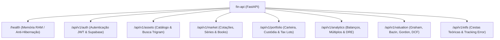

# ⚙️ Especificação das APIs FastAPI, Routers e Contratos no fin-api

O repositório **`fin-api`** provê o backend REST assíncrono do ecossistema, construído em **FastAPI**, **Python 3.12+**, **SQLAlchemy 2.0 Async** e **Pydantic v2**.

---

## 🧭 Catálogo Geral de Roteadores da API

Todos os endpoints operam sob o prefixo `/api/v1` (exceto `/health` para monitoramento de infraestrutura):



---

## 📋 Especificação Detalhada por Router

### 1. Router de Infraestrutura (`/health`)
- `GET /health`
  - **Função:** Keep-alive e monitoramento para provedores em nuvem (Koyeb, Render).
  - **Comportamento Crítico:** Responde **direto da memória RAM** em < 2ms com `HTTP 200 OK {"status": "healthy", "service": "fin-api"}`, sem consultar o banco PostgreSQL (preservando cotas de CPU do Neon).

---

### 2. Router de Ativos (`/api/v1/assets`)
- `GET /api/v1/assets/search?q={query}&limit=10`
  - **Função:** Autocomplete instantâneo de busca por ticker ou razão social.
  - **Implementação SQL:** Índice GIN com operador de similaridade de trigramas (`pg_trgm`) sobre `canonical.instrument(ticker, nome_resumido)`.
- `GET /api/v1/assets/{ticker}`
  - **Retorno:** Metadados do instrumento, classe de ativo, dados da empresa emissora e cotação mais recente.

---

### 3. Router de Mercado (`/api/v1/market`)
- `GET /api/v1/market/quote/{ticker}`
  - **Retorno:** Cotação atual, variação no dia (%), preço de abertura, máxima, mínima e volume negociado.
  - **Cache:** Cache-aside no Redis com TTL de 60 segundos.
- `GET /api/v1/market/history/{ticker}?period={1M|6M|1Y|5Y|MAX}&interval={1D|1W|1M}`
  - **Função:** Série temporal de cotações agrupada via TimescaleDB `time_bucket()`.
- `GET /api/v1/market/dividends/{ticker}`
  - **Retorno:** Histórico cronológico de proventos pagos (dividendos, JCP, rendimentos) com `data_com`, `data_ex` e `valor_bruto`.

---

### 4. Router de Carteira & Consolidação (`/api/v1/portfolio`)
- `GET /api/v1/portfolio/{carteira_id}/summary`
  - **Retorno:** Patrimônio total atualizado a mercado, rentabilidade acumulada, total investido e lucro/prejuízo não realizado.
- `GET /api/v1/portfolio/{carteira_id}/positions`
  - **Retorno:** Lista de ativos em custódia com quantidade, preço médio ponderado fiscal (`tax_lot`), cotação atual e peso percentual na carteira.
- `GET /api/v1/portfolio/{carteira_id}/lookthrough`
  - **Função Exclusiva Fin:** Retorna a decomposição consolidada de risco de crédito por **devedor final** (navegando por Ações, FIIs e CRIs detidos).
- `POST /api/v1/portfolio/{carteira_id}/transactions`
  - **Header Obrigatório:** `Idempotency-Key: <UUID>`
  - **Payload:** Compra ou venda de ativo. Dispara lançamento atômico no **Ledger de Partidas Dobradas** com validação de soma zero.

---

### 5. Router de Valuation Quantitativo (`/api/v1/valuation`)
- `GET /api/v1/valuation/{ticker}`
  - **Retorno:** Valor intrínseco calculado por Graham, Bazin, Gordon e DCF, acompanhado das respectivas margens de segurança.
- `POST /api/v1/valuation/{ticker}/simulate`
  - **Payload:** Premissas customizadas do usuário (taxa de desconto WACC, taxa de crescimento $g$, margem de segurança exigida). Retorna o preço justo recalculado em tempo real.

---

## 📦 Exemplo de Contrato Pydantic v2

```python
from pydantic import BaseModel, Field
from typing import Optional, List
from datetime import date, datetime

class AssetQuoteResponse(BaseModel):
    ticker: str = Field(..., example="PETR4")
    nome_resumido: str = Field(..., example="PETROBRAS")
    tipo_instrumento: str = Field(..., example="ACAO")
    preco_atual: float = Field(..., example=37.85)
    variacao_diaria_pct: float = Field(..., example=1.42)
    volume_financeiro_brl: float = Field(..., example=1250400000.0)
    data_cotacao: datetime

class ValuationMetricResponse(BaseModel):
    ticker: str
    preco_mercado: float
    preco_justo_graham: Optional[float] = None
    margem_graham_pct: Optional[float] = None
    preco_teto_bazin: Optional[float] = None
    margem_bazin_pct: Optional[float] = None
    preco_justo_dcf: Optional[float] = None
    margem_dcf_pct: Optional[float] = None
    score_saude_financeira: Optional[int] = Field(None, ge=0, le=100)
    consenso_analistas: Optional[str] = Field(None, example="COMPRA")
```

---

## 🔗 Referências Cruzadas
- [[Cache_Aside_Redis_e_Idempotencia|Cache no Redis e Idempotência]]
- [[Motores_Matematicos_e_Valuation_Quant|Motores Quantitativos]]
- [[Arquitetura_Financeira_Missao_Critica|Ledger de Partidas Dobradas]]
