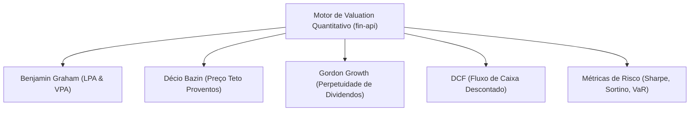

# 🧮 Motores Matemáticos, Valuation Quantitativo e Risco no fin-api

O repositório **`fin-api`** contém um módulo dedicado de computação financeira e finanças quantitativas (`app.services.quant`), implementando fórmulas matemáticas clássicas e métricas estatísticas de risco.

---

## 🏛️ Os Motores de Precificação de Ativos



---

## 1. 📐 Implementação dos Modelos de Valuation em Python

```python
import math
from typing import Dict, Any, Optional

class ValuationEngine:
    @staticmethod
    def calculate_graham(lpa: float, vpa: float) -> Optional[float]:
        """Fórmula de Benjamin Graham: V = sqrt(22.5 * LPA * VPA)"""
        if lpa <= 0 or vpa <= 0:
            return None  # Não se aplica a empresas com prejuízo ou PL negativo
        return round(math.sqrt(22.5 * lpa * vpa), 2)

    @staticmethod
    def calculate_bazin(dividendos_medios_3anos: float, dy_alvo: float = 0.06) -> Optional[float]:
        """Método de Décio Bazin: Preço Teto = D_medio / 0.06"""
        if dividendos_medios_3anos <= 0:
            return None
        return round(dividendos_medios_3anos / dy_alvo, 2)

    @staticmethod
    def calculate_gordon(d1: float, taxa_desconto_r: float, taxa_crescimento_g: float) -> Optional[float]:
        """Modelo de Gordon: P0 = D1 / (r - g)"""
        if taxa_desconto_r <= taxa_crescimento_g or d1 <= 0:
            return None
        return round(d1 / (taxa_desconto_r - taxa_crescimento_g), 2)

    @staticmethod
    def calculate_dcf(
        fluxos_projetados: list[float], 
        wacc: float, 
        crescimento_perpetuo: float, 
        divida_liquida: float, 
        total_acoes: int
    ) -> Optional[float]:
        """Fluxo de Caixa Descontado (FCFF) com Valor Terminal na Perpetuidade"""
        if wacc <= crescimento_perpetuo or total_acoes <= 0:
            return None

        # 1. Valor Presente dos Fluxos Projetados
        vp_fluxos = sum(fcf / ((1 + wacc) ** t) for t, fcf in enumerate(fluxos_projetados, start=1))

        # 2. Valor Terminal na Perpetuidade
        ultimo_fluxo = fluxos_projetados[-1]
        valor_terminal = (ultimo_fluxo * (1 + crescimento_perpetuo)) / (wacc - crescimento_perpetuo)
        vp_valor_terminal = valor_terminal / ((1 + wacc) ** len(fluxos_projetados))

        # 3. Enterprise Value e Equity Value
        enterprise_value = vp_fluxos + vp_valor_terminal
        equity_value = enterprise_value - divida_liquida

        if equity_value <= 0:
            return 0.0

        return round(equity_value / total_acoes, 2)
```

---

## 2. 📊 Tabela de Sensibilidade do DCF (WACC vs. Crescimento Perpétuo)

O `fin-api` gera tabelas bidimensionais de sensibilidade para que o investidor visualize o impacto de variações macroeconômicas no valor justo:

| WACC \ $g$ Perpétuo | 1.5% | 2.0% | 2.5% | 3.0% |
|:---:|:---:|:---:|:---:|:---:|
| **10.0%** | R$ 48,20 | R$ 51,40 | R$ 55,30 | R$ 60,10 |
| **11.0%** | R$ 42,10 | R$ 44,60 | R$ 47,50 | R$ 51,00 |
| **12.0%** | R$ 37,30 | R$ 39,20 | R$ 41,40 | R$ 44,00 |
| **13.0%** | R$ 33,30 | R$ 34,80 | R$ 36,50 | R$ 38,50 |

---

## 3. 🛡️ Métricas Quantitativas de Risco de Portfólio

### A. Índice de Sharpe
Mede o retorno excedente da carteira por unidade de risco total (desvio padrão):

$$\text{Sharpe} = \frac{R_p - R_f}{\sigma_p}$$
- $R_p$: Retorno anualizado da carteira.
- $R_f$: Retorno do ativo livre de risco (Taxa CDI / Selic).
- $\sigma_p$: Volatilidade (desvio padrão anualizado) da carteira.

### B. Índice de Sortino
Diferente do Sharpe, penaliza **apenas a volatilidade negativa (*Downside Deviation*)**, não penalizando oscilações para cima:

$$\text{Sortino} = \frac{R_p - R_f}{\sigma_{\text{down}}}$$

Onde $\sigma_{\text{down}} = \sqrt{\frac{1}{N} \sum_{t=1}^{N} \min(0, R_t - R_f)^2}$.

### C. Value at Risk (VaR Histórico 95% e 99%)
Calcula a perda máxima esperada em um horizonte de tempo (ex: 1 dia ou 21 dias) para um determinado nível de confiança estatística:

$$\text{VaR}_{95\%} = \text{Percentil 5\% da série histórica de retornos diários} \times \text{Patrimônio Total}$$

### D. Drawdown Máximo (Maximum Drawdown - MDD)
Mede a maior queda percentual de um pico (*Peak*) até o fundo subsequente (*Trough*) antes de atingir uma nova máxima:

$$\text{MDD} = \frac{\text{Trough Value} - \text{Peak Value}}{\text{Peak Value}}$$

---

## 🔗 Referências Cruzadas
- [[REA_Oceans14_e_Modelos_Valuation|REA Oceans14 e Modelos de Valuation]]
- [[Especificacao_APIs_FastAPI_e_Routers|Especificação das APIs FastAPI]]
- [[Tese_Carteira_Invisivel_Dual_Engine|A Tese da Carteira Invisível]]
