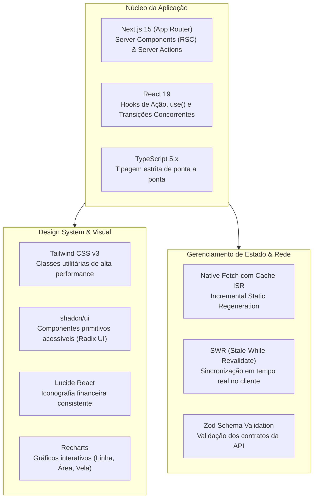

# 🖥️ Arquitetura Next.js 15, React 19 e Design Tokens no fin-web

O repositório **`fin-web`** entrega a experiência visual e interativa da plataforma, construído sobre os padrões mais modernos do ecossistema React.

---

## 🏛️ Stack Tecnológica & Decisões Arquiteturais



---

## 🎨 Design Tokens & Estética de Terminal Financeiro

Inspirado em terminais profissionais de mercado (*Bloomberg Terminal*, *Koyfin*, *TradingView*), o `fin-web` prioriza **alta densidade de informação**, contraste visual apurado e legibilidade numérica.

### 1. Paleta de Cores Semântica

| Token Semântico | Variável CSS | Valor Hexadecimal | Aplicação no Sistema |
|---|---|:---:|---|
| **Background Base** | `--background` | `#09090b` (Zinc 950) | Fundo escuro profundo que reduz fadiga ocular. |
| **Card / Surface** | `--card` | `#18181b` (Zinc 900) | Superfície elevada para cards de cotação e tabelas. |
| **Borda / Divisor** | `--border` | `#27272a` (Zinc 800) | Linhas de divisão finas (1px) de alta precisão. |
| **Verde Positivo** | `--accent-up` | `#10b981` (Emerald 500) | Variação positiva de cotação, proventos e lucros. |
| **Vermelho Negativo**| `--accent-down`| `#ef4444` (Red 500) | Variação negativa de cotação, perdas e prejuízos. |
| **Acento Dourado** | `--accent-gold`| `#f59e0b` (Amber 500) | Destaque para Dividend Yield e ativos em watchlist. |
| **Texto Primário** | `--foreground` | `#f4f4f5` (Zinc 100) | Títulos, nomes de ativos e valores principais. |
| **Texto Secundário**| `--muted` | `#a1a1aa` (Zinc 400) | Legendas, datas, volumes e rótulos secundários. |

---

## 🔤 Tipografia Numérica Alinhada

Em finanças, o desalinhamento de casas decimais em tabelas destrói a usabilidade. O Fin implementa:
1. **Fonte Monoespaçada para Números:** Todas as cotações, variações percentuais e múltiplos utilizam fontes monoespaçadas com recurso de dígitos tabulares ativado:
   ```css
   .financial-number {
       font-family: var(--font-geist-mono), monospace;
       font-feature-settings: "tnum" 1, "zero" 1;
       text-align: right;
   }
   ```
2. **Formatação Monetária Padronizada:** Padrão brasileiro `pt-BR` (ex: `R$ 1.250.400,50`) e decimais controlados (2 casas para cotações e 4 casas para proventos unitários fracionados).

---

## 🧩 Server Components vs. Client Components

Para atingir pontuação 100 no Google Lighthouse e carregamento inicial em < 500ms:
- **Server Components (Default):** Todas as páginas estáticas, estrutura de layout, cabeçalhos, metadados de SEO e renderização inicial de tabelas acontecem no servidor Node.js/Edge da Vercel.
- **Client Components (`"use client"`):** Reservados estritamente para elementos que necessitam de interatividade do navegador:
  - Gráficos interativos com hover tooltip (`Recharts`).
  - Campo de busca com debounce e autocomplete.
  - Simulador interativo de Valuation (onde o usuário arrasta sliders de WACC).
  - Seletores de período temporal (`1D`, `5D`, `1M`, `1Y`, `MAX`).

---

## 🔗 Referências Cruzadas
- [[Eliminacao_de_Mocks_e_Data_Binding|Eliminação de Mocks no Frontend]]
- [[Catalogo_Telas_Rotas_e_Componentes|Catálogo de Telas e Rotas]]
- [[Relatorio_Executivo_Auditoria_Producao|Auditoria no Chrome DevTools MCP]]
