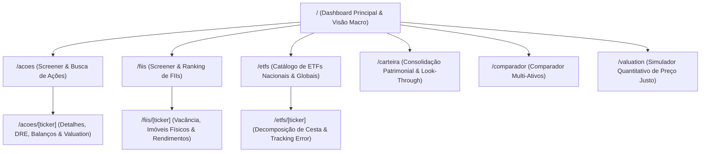

# 📱 Catálogo de Telas, Rotas e Componentes de Interface no fin-web

Este documento cataloga a árvore de rotas, as telas funcionais e os principais componentes reutilizáveis implementados no repositório **`fin-web`**.

---

## 🗺️ Mapa Completo de Rotas da Aplicação

---

## 📋 Detalhamento das Telas e Funcionalidades

### 1. Dashboard Principal (`/`)
- **Ticker Tape de Topo:** Faixa contínua com cotações em tempo real do Ibovespa, IFIX, S&P 500, Dólar PTAX e Bitcoin.
- **Cards de Indicadores Macro:** Taxa Selic Meta atual, CDI acumulado e projeção IPCA 12 meses.
- **Rankings Rápidos:** Maiores altas do pregão, maiores baixas e maiores volumes financeiros negociados na B3.

### 2. Módulo de Ações (`/acoes` e `/acoes/[ticker]`)
- **Screener Avançado (`/acoes`):**
  - Tabela responsiva com mais de 500 ações.
  - Filtros deslizantes por faixa de P/L, P/VP, Dividend Yield (DY > 6%), Margem Líquida e Liquidez Média Diária.
  - Exportação de dados filtrados em CSV/JSON.
- **Página de Detalhes do Ativo (`/acoes/[ticker]`):**
  - Gráfico de cotações interativo com seleção de períodos (`1D`, `5D`, `1M`, `6M`, `1Y`, `5Y`, `MAX`).
  - Abas de dados fundamentais:
    - *Visão Geral:* Múltiplos, dados da empresa, setor e governança.
    - *Demonstrações Contábeis:* Balanço Patrimonial, DRE analítica e Fluxo de Caixa (10 anos).
    - *Proventos:* Histórico anual de dividendos e JCP com gráfico de proventos por mês.
    - *Valuation:* Valor intrínseco de Graham, Bazin e DCF com margem de segurança calculada.

### 3. Módulo de Fundos Imobiliários (`/fiis` e `/fiis/[ticker]`)
- **Screener de FIIs (`/fiis`):**
  - Segmentação por tipo de mandato (Tijolo, Papel, FOF, Fiagro, Desenvolvimento).
  - Colunas com Dividend Yield anualizado, P/VP, Vacância Física e Liquidez.
- **Página de Detalhes do FII (`/fiis/[ticker]`):**
  - Histórico de rendimentos mensais por cota e data de corte (*data com*).
  - Portfólio de imóveis físicos: mapa com localização geográfica, ABL total e participação do fundo.
  - Tabela de contratos: vencimentos ano a ano e divisão entre indexadores (IGP-M vs IPCA).

### 4. Módulo de ETFs (`/etfs` e `/etfs/[ticker]`)
- **Página de Detalhes do ETF (`/etfs/[ticker]`):**
  - Gráfico de aderência: comparação visual da curva do ETF versus seu índice de referência (ex: `BOVA11` vs Ibovespa).
  - Tabela de holdings: lista completa das 10 maiores ações que compõem o fundo e seus respectivos pesos percentuais.
  - Métricas de Tracking Difference e Tracking Error anualizado.

### 5. Carteira do Investidor & Look-Through (`/carteira`)
- **Resumo Patrimonial:** Saldo total investido, rentabilidade TWR e MWR comparada ao CDI e Ibovespa.
- **Gráficos de Alocação:** Gráfico de rosca (*Donut Chart*) por classe de ativo (Ações, FIIs, Renda Fixa, Cripto).
- **Visão da Carteira Invisível (Look-Through):** Gráfico de barras revelando a exposição consolidada aos devedores finais de crédito, cruzando todas as posições do investidor.

### 6. Comparador de Ativos (`/comparador`)
- Permite selecionar até 4 ativos lado a lado (ex: `PETR4`, `VALE3`, `WEGE3`, `ITUB4`).
- Tabela comparativa destacando em verde o ativo vencedor em cada indicador (Maior ROE, Menor P/L, Maior DY, Menor Dívida).

---

## 🔗 Referências Cruzadas
- [[Arquitetura_Nextjs_App_Router_e_Tokens|Arquitetura Next.js e Tokens]]
- [[Eliminacao_de_Mocks_e_Data_Binding|Eliminação de Mocks e SWR]]
- [[Relatorio_Executivo_Auditoria_Producao|Auditoria no Chrome DevTools MCP]]
