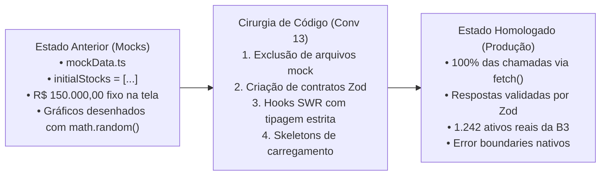

# 🔌 Eliminação de Mocks e Vinculação de Dados Reais no fin-web

Na Conversa 13 e consolidada na Conversa 21, foi realizada uma cirurgia completa de código no **`fin-web`** para cumprir a determinação mandatória: **100% dos dados devem vir da API viva, com zero números mockados, dados fixos ou arrays simulados.**

---

## 🧹 O Processo de Saneamento do Frontend



---

## 🛠️ Contratos Tipados com Zod no Frontend

Para evitar que a interface quebre caso a API retorne um campo nulo ou com tipo inesperado, todas as respostas passam por schemas de validação **Zod**:

```typescript
// src/lib/schemas/asset.ts
import { z } from "zod";

export const AssetQuoteSchema = z.object({
  ticker: z.string(),
  nome_resumido: z.string(),
  tipo_instrumento: z.enum(["ACAO", "FII", "ETF", "BDR", "TITULO_PUBLICO"]),
  preco_atual: z.number(),
  variacao_diaria_pct: z.number(),
  volume_financeiro_brl: z.number(),
  data_cotacao: z.string(),
});

export const ValuationSchema = z.object({
  ticker: z.string(),
  preco_mercado: z.number(),
  preco_justo_graham: z.number().nullable().optional(),
  margem_graham_pct: z.number().nullable().optional(),
  preco_teto_bazin: z.number().nullable().optional(),
  margem_bazin_pct: z.number().nullable().optional(),
  preco_justo_dcf: z.number().nullable().optional(),
  margem_dcf_pct: z.number().nullable().optional(),
  score_saude_financeira: z.number().min(0).max(100).nullable().optional(),
  consenso_analistas: z.string().nullable().optional(),
});

export type AssetQuote = z.infer<typeof AssetQuoteSchema>;
export type ValuationData = z.infer<typeof ValuationSchema>;
```

---

## 📡 Hook de Dados Reais com SWR e Fallback

```typescript
// src/hooks/useAssetQuote.ts
"use client";

import useSWR from "swr";
import { AssetQuote, AssetQuoteSchema } from "@/lib/schemas/asset";

const fetcher = async (url: string): Promise<AssetQuote> => {
  const res = await fetch(url);
  if (!res.ok) {
    throw new Error(`Erro na API (${res.status}): Falha ao carregar cotação`);
  }
  const data = await res.json();
  return AssetQuoteSchema.parse(data); // Validação Zod em tempo de execução
};

export function useAssetQuote(ticker: string) {
  const { data, error, isLoading, mutate } = useSWR<AssetQuote>(
    ticker ? `/api/v1/market/quote/${ticker}` : null,
    fetcher,
    {
      refreshInterval: 60000, // Revalida a cada 1 minuto se a aba estiver aberta
      revalidateOnFocus: true,
      dedupingInterval: 5000,
    }
  );

  return {
    quote: data,
    isLoading,
    isError: error,
    refresh: mutate,
  };
}
```

---

## 💀 Tratamento de Estados de Espera: Skeletons Animados

Enquanto os dados reais estão sendo transmitidos da rede, o usuário nunca visualiza telas brancas ou saltos de layout (*Cumulative Layout Shift - CLS*). Foram implementados **Skeletons** idênticos à geometria final dos componentes:

```tsx
// src/components/cards/AssetCardSkeleton.tsx
import { Skeleton } from "@/components/ui/skeleton";

export function AssetCardSkeleton() {
  return (
    <div className="rounded-lg border border-zinc-800 bg-zinc-900 p-4">
      <div className="flex items-center justify-between pb-2">
        <Skeleton className="h-6 w-20 bg-zinc-800" />
        <Skeleton className="h-4 w-12 bg-zinc-800" />
      </div>
      <Skeleton className="h-8 w-28 bg-zinc-800 my-2" />
      <Skeleton className="h-4 w-full bg-zinc-800 mt-2" />
    </div>
  );
}
```

---

## 🔒 Saneamento de Segurança e UX na Auditoria v4.0

Na auditoria integral v4.0, foram eliminados os últimos resquícios de comportamento simulado no cliente:

1. **Paywall Seguro sem Vazamento de DOM:** O componente `PaywallGate` foi refatorado para renderizar `previewFallback` com atributos `aria-hidden="true"` e `inert=""`, impedindo que usuários inspecionem ou leiam via leitores de tela relatórios analíticos confidenciais Pro antes da assinatura.
2. **Checkout Seguro Conectado:** O modal de assinaturas em `/premium` substituiu `alert()` por chamadas reais a `/billing/subscribe`, exibindo QR Code PIX renderizado e chave copia-e-cola com tratamento de autenticação.
3. **Sincronização com a URL:** Os filtros de `/acoes` (`?q=&setor=`), do Screener (`?q=&type=&minDY=&maxPVP=`) e as abas analíticas (`?tab=`) agora persistem na barra de endereços, garantindo compartilhamento direto e respeito ao botão Voltar do navegador.
4. **Respeito a Vestibulopatias:** O ticker de cotações agora respeita `@media (prefers-reduced-motion: reduce)`, parando animações contínuas para usuários com sensibilidade visual.
5. **Roteamento Canônico:** O helper `resolveAssetHref(ticker, type)` direciona cada classe para seu cockpit especializado (`/fiis/` para fundos imobiliários, `/etfs/` para ETFs, `/acoes/` para companhias abertas e `/indicadores-economicos` para índices como IBOV e IFIX).

---

## ⚡ Eliminação do `cache: "no-store"` Universal e Cache na Borda (Etapa 1 — 28/10/2026)

Na Etapa 1 de Confiabilidade, o cliente HTTP universal [`src/lib/api.ts`](https://github.com/barrosrafa/fin-web/blob/main/src/lib/api.ts) foi refatorado para habilitar a distribuição estática e cache compartilhado na CDN:

1. **Cache Granular:** A diretiva fixa `cache: "no-store"` foi substituída por lógica dinâmica:
   - Requisições anônimas/públicas recebem `cache: "default"` (permitindo cache de borda pela CDN e pelo navegador, aderente aos cabeçalhos HTTP do servidor).
   - Requisições autenticadas por Bearer Token continuam com `cache: "no-store"` para segurança de carteiras e dados privados.
2. **Desacoplamento do Render Free:** Visitantes anônimos não disparam requisições síncronas bloqueantes ao backend, eliminando a degradação provocada pelo cold start da API.
3. **Build Homologado Next.js 16:** A esteira de produção gera 84 rotas estáticas pré-renderizadas (SSG/ISR) em 2.0s com TypeScript 5 e Turbopack.
4. **CI/CD Dedicado:** Implementado [`.github/workflows/ci.yml`](https://github.com/barrosrafa/fin-web/blob/main/.github/workflows/ci.yml) executando instalação com pnpm e compilação completa do Next.js.

---

## 🔗 Referências Cruzadas
- [[Arquitetura_Nextjs_App_Router_e_Tokens|Arquitetura Next.js e Tokens]]
- [[Catalogo_Telas_Rotas_e_Componentes|Catálogo de Telas e Rotas]]
- [[Conv_09_a_14_Auditoria_Ativos_Reais_Web_e_ETL|Conversa 13: Auditoria do Fim dos Mocks]]
