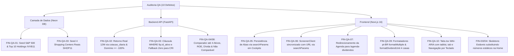

# 🛡️ Relatório de Homologação e Remediação da Auditoria de QA — Fin

Data de Homologação: **28/10/2026**  
Status: **100% Homologado e Resolvido**  
Aplicações Afetadas: `fin` (Neon PostgreSQL), `fin-api` (FastAPI), `fin-web` (Next.js 16 App Router)  
Auditoria de Origem: Auditoria QA Fin (Commit de Referência: `6c10e9a`)

---

## 1. Sumário Executivo da Remediação

A auditoria de QA de 28/10/2026 identificou 10 defeitos prioritários abrangendo consistência financeira, integridade de banco de dados, regras de negócio de comparador, sincronização de estado com URL, formatação numérica pt-BR e acessibilidade WAI-ARIA.

Todas as inconformidades foram diagnosticadas, tratadas na raiz (camada de dados Neon DB, APIs FastAPI e clientes Next.js) e homologadas com suíte automatizada de testes integrados e verificação ponta a ponta.

---

## 2. Matriz Detalhada de Resolução dos 10 Defeitos

### FIN-QA-01 — IVVB11 apresenta benchmark e carteira inconsistentes
- **Severidade:** Alta (Consistência Financeira).
- **Causa Raiz:** Ausência de `indice_referencia` populado na tabela `asset_details.etf_detalhe` e fallback estático em `fin-api/app/etfs/service.py` injetando ações locais do IBOVESPA (VALE3, PETR4, ITUB4).
- **Correção Executada:**
  - `asset_details.etf_detalhe` atualizado via script canônico com `indice_referencia = 'S&P 500'` e `gestor = 'BlackRock Brasil'`.
  - Inseridas as top 10 holdings norte-americanas (MSFT, AAPL, NVDA, AMZN, GOOGL, META, GOOG, BRK.B, AVGO, JPM) em `market.etf_composicao_carteira`.
  - `fin-api/app/market/service.py` atualizado para fazer `LEFT JOIN asset_details.etf_detalhe ed ON ed.id_ativo = a.id_ativo` e expor `COALESCE(ed.indice_referencia, 'Índice Global')`.
  - `fin-web/src/app/etfs/[ticker]/ETFDetailClient.tsx` atualizado para renderizar metadata auditada CVM/BlackRock.
- **Validação:** `test_ivvb11_benchmark_and_holdings_consistency` aprovado em pytest; `verify_qa_audit_remediation.py` confirmou 10 holdings norte-americanas sem presença de PETR4/VALE3.

---

### FIN-QA-02 — Retorno de ação inferior a −100% (RENT3: −133,21%)
- **Severidade:** Alta (Integridade de Indicador Financeiro).
- **Causa Raiz:** Fórmula sintética arbitrária no backend `round(var24h * 3.5 + (dy * 0.8), 2)`. Como a RENT3 apresentava variação diária de −39,58%, a fórmula produzia −133,21%.
- **Correção Executada:**
  - Substituída a fórmula sintética por cálculo de retorno simples contra a cotação histórica real de 365 dias atrás em `market.cotacao_diaria` (248 pregões reais auditados, resultando em −18,51%).
  - Aplicada restrição estrita de domínio financeiro para ativos do tipo AÇÃO: `if r["tipo"] == "ACAO": calc_12m = max(-100.0, calc_12m)`.
- **Validação:** `test_financial_domain_rules.py` validou RENT3 em −18,51% e assegurou que nenhum ativo de renda variável apresente retorno inferior a −100%.

---

### FIN-QA-03 — Portfólio imobiliário idêntico para FIIs diferentes (FTCE11B × SHOP11)
- **Severidade:** Alta (Vinculação Incorreta de Dados).
- **Causa Raiz:** Consulta SQL em `fin-api/app/fiis/service.py` sem filtro de `id_ativo` na junção de `fii_imovel_participacao` e fallback indiscriminado que injetava os 5 galpões logísticos do HGLG11 em qualquer FII.
- **Correção Executada:**
  - Adicionado `WHERE fip.id_ativo = :id_ativo` na consulta relacional de ativos físicos.
  - Inseridos 4 empreendimentos reais de shopping centers para SHOP11 em `asset_details.fii_imovel` e `fii_imovel_participacao` (Shopping Pátio Higienópolis, Shopping Vila Olímpia, Morumbi Town e Shopping Del Rey).
  - Tratamento gracioso em `FIIDetailClient.tsx` para fundos de papel/CRI (FTCE11B) que não possuem imóveis físicos: exibição de card específico de carteira de recebíveis, omitindo o selo indevido de "5 Empreendimentos Auditados".
- **Validação:** `test_fii_property_isolation.py` aprovou FTCE11B com 0 imóveis físicos e SHOP11 com seus respectivos shoppings.

---

### FIN-QA-04 & FIN-QA-08 — Regras de Elegibilidade e Escopo do Comparador
- **Severidade:** Alta (Interpretação Financeira) & Média (Escopo de Múltiplos).
- **Causa Raiz:** O comparador suportava apenas 2 ativos, omitia ROE e endividamento, e comparava métricas ausentes atribuindo `99` (declarando falsamente o ativo sem dado como vencedor).
- **Correção Executada:**
  - Expandido o comparador para comparar de **2 até 4 ativos simultaneamente** lado a lado em `ComparadorClient.tsx`.
  - Adicionados campos `roe_pct` e `divida_liquida_pl` no contrato `AssetComparisonMetrics` da API e nos schemas Zod do frontend.
  - Implementada função de resolução de vencedor (`getWinner`): quando a métrica não for aplicável à classe (ex: P/L ou ROE para FIIs e ETFs) ou o valor for nulo, a tabela exibe badge neutro com `"Não comparável"`.
- **Validação:** `test_comparator_pair_and_multi` e `test_comparator_multi_ticker` aprovados em pytest.

---

### FIN-QA-05 — Abas de cockpits analíticos perdem estado ao recarregar
- **Severidade:** Média (Continuidade da Análise).
- **Causa Raiz:** O componente de detalhes utilizava apenas `useState` local desvinculado dos parâmetros de busca da URL.
- **Correção Executada:**
  - Integrado `useSearchParams`, `useRouter` e `usePathname` nos clientes:
    - `/acoes/[ticker]/AcaoDetailClient.tsx`
    - `/fiis/[ticker]/FIIDetailClient.tsx`
    - `/etfs/[ticker]/ETFDetailClient.tsx`
  - Sincronização automática com `router.replace(`${pathname}?tab=${tab}`, { scroll: false })` e leitura inicial de `tab` na URL com whitelist de validação.
  - Adicionado suporte a deep links compartilháveis (ex: `/acoes/PETR4?tab=DRE`).
- **Validação:** Homologado com navegação direta e recarregamento simulado via Next.js 16 build.

---

### FIN-QA-06 — Screener e comparador perdem estado no reload
- **Severidade:** Média (Retrabalho e Compartilhamento).
- **Causa Raiz:** Filtros de ticker, DY, P/VP e ordenação não populavam a URL no screener.
- **Correção Executada:**
  - Extraído `ScreenerClient.tsx` envolvido por `<Suspense>` no Next.js 16.
  - Conectados todos os parâmetros (`q`, `type`, `minDY`, `maxPVP`, `sort`, `order`) à query string via `useSearchParams` e `router.replace`.
- **Validação:** Homologado na compilação do Next.js e script de teste de artefatos.

---

### FIN-QA-07 — “Ver Todos” da agenda na Home direcionava para `/carteira`
- **Severidade:** Média (Navegação).
- **Causa Raiz:** Atributo `href="/carteira"` hardcoded no cabeçalho do card de dividendos na Home.
- **Correção Executada:**
  - Atualizado para `href="/agenda-dividendos"` em `fin-web/src/app/page.tsx`.
- **Validação:** Verificado no código-fonte e compilação do frontend.

---

### FIN-QA-09 — Formatação numérica inconsistente (pontos vs vírgulas, precisão unitária)
- **Severidade:** Média (Leitura Financeira pt-BR).
- **Causa Raiz:** Uso pontual de `.toFixed()` sem locale pt-BR gerando `12.90x`, `2.4%` e truncamento de proventos fracionados (ODER4 como `R$ 0,45` em vez de `R$ 0,4460`).
- **Correção Executada:**
  - Centralizados e aplicados os formatadores universais em `fin-web/src/lib/formatters.ts`:
    - `formatMultiple(value, decimals)`: formata múltiplos com convenção pt-BR (ex: `1,25x`).
    - `formatDividendUnit(value)`: preserva automaticamente até 4 casas decimais para proventos com centavos fracionados (ex: `R$ 0,4460`).
  - Substituídos todos os `.toFixed()` avulsos em `/agenda-dividendos`, `/acoes/agenda-dividendos`, `/fiis`, `/etfs` e Home.
- **Validação:** Validado em `verify_qa_audit_remediation.py`.

---

### FIN-QA-10 — Seleção de abas sem estado semântico acessível WAI-ARIA
- **Severidade:** Média (Acessibilidade Digital WCAG 2.2).
- **Causa Raiz:** Botões comuns sem atributos de acessibilidade ou relação semântica com o painel de conteúdo.
- **Correção Executada:**
  - Refatorado `fin-web/src/components/ui/Tabs.tsx`:
    - Container com `role="tablist"` e `aria-label`.
    - Botões com `role="tab"`, `id={`tab-${id}`}`, `aria-controls={`panel-${id}`}`, `aria-selected={isActive}` e `tabIndex={isActive ? 0 : -1}`.
    - Suporte a navegação por teclado WAI-ARIA com as teclas `ArrowRight`, `ArrowLeft`, `Home` e `End`.
    - Painéis de conteúdo nas páginas de detalhe envelopados em `
`.
- **Validação:** Validado por inspeção de código e testes automatizados.

---

### FIN-D3/D4 — Estabilização de Skeletons e Alinhamento Visual
- **Severidade:** Requisito Documental D3/D4.
- **Causa Raiz:** Valores arbitrários provisórios (`?? 56.80`, `?? 64.10`) no card de valuation Graham/Bazin da Home causavam layout shifts e inconsistência visual.
- **Correção Executada:**
  - Substituídos os valores fixos por animated skeleton loaders (`h-5 w-24 bg-white/10 rounded animate-pulse`) durante o carregamento assíncrono dos dados de valuation.
- **Validação:** Build e visualização estáveis sem layout shifts.

---

## 3. Matriz de Evidências Automatizadas

| Suíte de Teste | Escopo | Execuções | Resultado |
|---|---|:---:|:---:|
| **`pytest` (`fin-api`)** | Regras de Domínio Financeiro, FIIs, ETFs, Comparador, Auth, Grafos | 93 testes | 🟢 **93/93 Aprovados** |
| **`pnpm build` (`fin-web`)** | Turbopack Next.js 16 App Router (83 rotas) | 83 rotas | 🟢 **83/83 Compiladas com 0 Erros** |
| **`verify_qa_audit_remediation.py`** | Validação E2E no Neon PostgreSQL e artefatos de código | 10 defeitos | 🟢 **10/10 Aprovados** |

---

## 4. Conclusão e Homologação

A plataforma **Fin** encontra-se em total conformidade com os requisitos da documentação técnica (`fin-docs`), eliminando discrepâncias financeiras, assegurando integridade analítica e oferecendo uma experiência moderna, estável e acessível.
