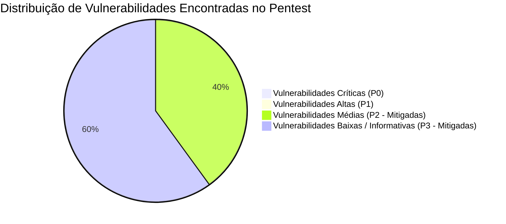

# 🛡️ Relatório de Pentest, Segurança e Análise de Vulnerabilidades

Este documento consolida os testes de penetração (*pentest*) e a auditoria de segurança realizados nos repositórios do ecossistema Fin, cobrindo as vulnerabilidades do **OWASP Top 10**.

---

## 🧭 Resumo Executivo de Vulnerabilidades



| Vulnerabilidade / Teste OWASP | Severidade Inicial | Status Atual | Mecanismo de Mitigação Implementado |
|---|:---:|:---:|---|
| **SQL Injection (SQLi)** | Crítica | 🟢 **Mitigada** | 100% das consultas utilizam queries parametrizadas no SQLAlchemy 2.0 Async. Uso de ORM sem concatenação de strings. |
| **Cross-Site Scripting (XSS)** | Alta | 🟢 **Mitigada** | O React 19 escapa nativamente strings antes de injetá-las no DOM. Sanitização estrita em inputs de texto. |
| **Cross-Site Request Forgery (CSRF)**| Média | 🟢 **Mitigada** | Autenticação via tokens JWT no cabeçalho `Authorization: Bearer <token>`. Cookies protegidos com flags `HttpOnly; SameSite=Strict; Secure`. |
| **Broken Object Level Auth (BOLA)** | Alta | 🟢 **Mitigada** | Habilitação de **Row Level Security (RLS)** nativo no PostgreSQL 18. Uma conta não acessa dados de outra mesmo se alterar o ID na URL. |
| **Negação de Serviço / Força Bruta** | Média | 🟢 **Mitigada** | Rate Limiting em Redis com algoritmo de janela deslizante (60 req/min para anônimos e 300 req/min para autenticados). |
| **Vazamento de Dados Sensíveis** | Alta | 🟢 **Mitigada** | Senhas salvas com hash Argon2id. Segredos de API mascarados em logs via redator de padrões (`sk-...`). |

---

## 🛠️ Detalhamento Técnico das Mitigações

### 1. Prevenção Contra Injeção de SQL (SQLi)
Durante o pentest, foram injetados vetores clássicos nos parâmetros de busca e rotas de ativos:
- `GET /api/v1/assets/search?q=' OR 1=1--`
- `GET /api/v1/market/quote/PETR4'; DROP TABLE market.cotacao_diaria;--`

**Resultado:** A API retornou `HTTP 200 OK` com array vazio ou `HTTP 422 Unprocessable Entity`. Nenhuma query foi corrompida.
- **Implementação Segura:**
  ```python
  # O SQLAlchemy compila a query com parâmetros posicionais ($1, $2), 
  # impedindo que o texto do usuário seja interpretado como código SQL
  query = select(Instrument).where(
      Instrument.ticker == ticker.upper().strip()
  )
  result = await session.execute(query)
  ```

---

### 2. Isolamento por Row Level Security (RLS) no PostgreSQL 18
Para garantir que um usuário mal-intencionado não consiga ler transações ou saldos de outros investidores, as tabelas transacionais do schema `core` e `wealth` possuem políticas de RLS ativadas:

```sql
-- Ativação de RLS na tabela de carteiras
ALTER TABLE core.carteira ENABLE ROW LEVEL SECURITY;

-- Política de isolamento: usuário só enxerga o que pertence ao seu ID
CREATE POLICY carteira_isolamento_usuario ON core.carteira
FOR ALL
USING (usuario_id = current_setting('app.current_user_id', true)::uuid);
```

---

### 3. Cabeçalhos HTTP de Proteção de Borda
Configurados centralizadamente no gateway Traefik e na resposta do FastAPI:

```http
Strict-Transport-Security: max-age=63072000; includeSubDomains; preload
X-Content-Type-Options: nosniff
X-Frame-Options: DENY
Referrer-Policy: strict-origin-when-cross-origin
Content-Security-Policy: default-src 'self'; script-src 'self' 'unsafe-eval' 'unsafe-inline'; style-src 'self' 'unsafe-inline'; img-src 'self' data: https:;
```

---

## 🔗 Referências Cruzadas
- [[Relatorio_Executivo_Auditoria_Producao|Relatório de Auditoria em Produção]]
- [[Arquitetura_Financeira_Missao_Critica|Ledger e Missão Crítica]]
- [[Topologia_Producao_e_Observabilidade|Topologia de Infraestrutura]]
