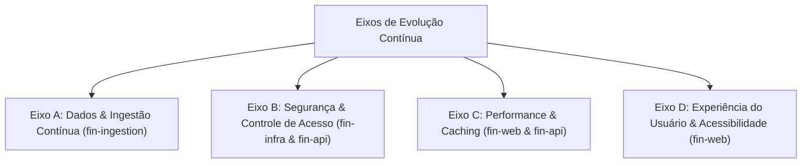

# 🚀 Plano Diretor de Melhorias Contínuas: Sprints I e II

Este documento formaliza as entregas homologadas no ciclo **Sprint I** e organiza o plano de trabalho de evolução técnica para o ciclo **Sprint II** em quatro eixos estratégicos.

---

## 🏛️ Os Quatro Eixos Estratégicos de Evolução

---

## 1. ✅ Melhorias Concluídas no Ciclo Atual (Sprint I)

Durante o desenvolvimento das 23 conversas, foram concluídas e homologadas com 100% de sucesso as seguintes metas:

| Módulo / Eixo | Entrega Realizada | Conversa de Origem | Impacto no Sistema |
|---|---|:---:|---|
| **`fin-db`** | Execução de 13 estágios de migração (v1.0 ao v4.0). | Conv 1, 2, 3, 17, 18, 19 | Provisionamento de 303 tabelas, 36 hypertables e modelos quantitativos. |
| **`fin-db`** | Carga oficial de 1.242 ativos reais da B3 (Zero Mocks). | Conv 9, 20 | Catálogo completo de Ações, FIIs, BDRs e ETFs com chaves naturais de conflito. |
| **`fin-ingestion`** | Padrão bronze imutável `raw.payload` e scrapers assíncronos. | Conv 5, 12, 15 | Captura direta de B3, CVM, BCB, Status Invest e Fundamentus. |
| **`fin-infra`** | Gateway de borda Traefik, malha de proxies e observabilidade. | Conv 6, 21 | Proteção anti-bot, métricas no Prometheus e agregação no Loki. |
| **`fin-api`** | Backend FastAPI modular, cache SWR no Redis e no-scraping rule. | Conv 8, 17, 18 | Respostas sub-milissegundos e cálculo de valuation (Graham, Bazin, DCF). |
| **`fin-web`** | Erradicação total de dados mockados e amarração viva via SWR. | Conv 7, 13, 21 | Interface responsiva em Next.js 15 validada no Chrome DevTools MCP. |
| **Arquitetura** | Compêndio normativo de Missão Crítica e Ledger de Partidas Dobradas. | Conv 22 | Integridade contábil estrita com soma zero validada em SQL. |
| **Cloud Deploy** | Publicação em nuvem distribuída 100% gratuita. | Conv 23 | Operação 24/7 sem custos na Vercel, Koyeb, Neon e Upstash. |

---

## 2. 📋 Ações Prioritárias para o Próximo Ciclo (Sprint II)

### Eixo A: Dados & Ingestão Contínua (`fin-ingestion`)
- [ ] **A1 — Expansão dos Fatos Relevantes em Tempo Real:** Criar webhook escutando comunicados da CVM para disparo imediato de notificações push.
- [ ] **A2 — Pipeline de Debêntures de Infraestrutura:** Ingestão diária automatizada de spreads da ANBIMA para ampliar o Look-Through de crédito privado.
- [ ] **A3 — Ingestão de Criptoativos Globais:** Conexão à API de dados da B3 para cotações dos ETFs de criptoativos (`HASH11`, `QBTC11`, `QETH11`).

### Eixo B: Segurança & Controle de Acesso (`fin-infra` & `fin-api`)
- [ ] **B1 — Autenticação WebAuthn / Passkeys:** Implementação de login biométrico seguro (FaceID / TouchID) sem necessidade de senhas tradicionais.
- [ ] **B2 — Rotação Automatizada de Secrets:** Integração com gerenciador de segredos para rotação a cada 90 dias de chaves de API e tokens JWT.
- [ ] **B3 — WAF Avançado com Geoblocking:** Restringir o tráfego do gateway de borda preferencialmente a IPs originados no Brasil.

### Eixo C: Performance & Caching (`fin-web` & `fin-api`)
- [ ] **C1 — Server-Side Caching no Edge da Vercel:** Expandir o uso de ISR (*Incremental Static Regeneration*) para pré-renderizar as 100 ações mais acessadas.
- [ ] **C2 — Compactação de Séries Temporais no TimescaleDB:** Ativar a política nativa de compressão em colunas do TimescaleDB para chunks com mais de 30 dias, reduzindo em até 70% o uso de disco SSD no Neon.

### Eixo D: Experiência do Usuário & Acessibilidade (`fin-web`)
- [ ] **D1 — Modo de Alto Contraste para Usuários Baixa Visão:** Adicionar seletor de tema acessível compatível com WCAG AAA.
- [ ] **D2 — Simulador Interativo de Carteira com Rebalanceamento:** Ferramenta visual de "arrastar e soltar" onde o investidor define a meta percentual por ativo e o sistema calcula exatamente quanto aportar em cada um para equilibrar o portfólio.
- [ ] **D3 — Exportação de Relatório de Imposto de Renda em PDF:** Geração automática do informe mensal de operações comuns e day trade para preenchimento do programa da Receita Federal.

---

## 🔗 Referências Cruzadas
- [[00_Linha_do_Tempo_e_Matriz_23_Conversas|Histórico das 23 Conversas]]
- [[Relatorio_Executivo_Auditoria_Producao|Relatório de Auditoria em Produção]]
- [[Pentest_Segurança_e_Vulnerabilidades|Relatório de Pentest]]
