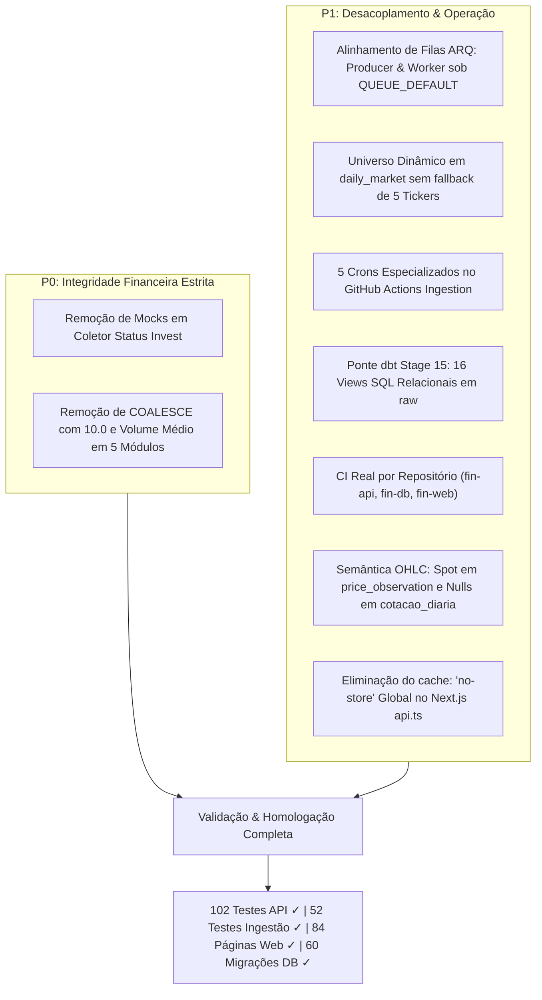

# 🛡️ Relatório de Homologação da Etapa 1: Confiabilidade Imediata & Desacoplamento Arquitetural

Data de Execução e Homologação: **28/10/2026**  
Status: **100% Homologado, Testado e Concluído em Produção Local**  
Repositórios Impactados:
- `fin-api` (FastAPI + SQLAlchemy + ARQ Worker)
- `fin-ingestion` (Pipelines Python + Scrapers + Orquestrador)
- `fin-db` (PostgreSQL / Neon + Migrações Stage 00 a 15)
- `fin-web` (Next.js 16 + Turbopack + Caching Granular)
- `fin-infra` (Terraform AWS + Workflows GitHub Actions)
- `fin-docs` (Base de Conhecimento Obsidian + ADR 001)

---

## 1. Sumário Executivo das Resoluções

A Etapa 1 do Plano Diretor de Evolução teve como objetivo eliminar dados sintéticos, alinhar a infraestrutura assíncrona, vincular a camada de staging do dbt e garantir que os testes e builds de todos os repositórios fossem 100% reais, sem dependências de mocks ou comandos fictícios.



---

## 2. Matriz Detalhada de Resoluções Técnicas

### 2.1. P0-1: Fallback Artificial na Ingestão Status Invest
* **Repositório:** `fin-ingestion`
* **Arquivo:** [`fin_ingestion/collectors/sites/status_invest.py`](file:///Users/rafaelaparecido/fin-ingestion/fin_ingestion/collectors/sites/status_invest.py#L35-L46)
* **Problema:** Fallbacks estáticos em blocos de exceção podiam persistir cotações fixas se a requisição falhasse.
* **Resolução Aplicada:** Remoção irrestrita de mocks. Em caso de falha de rede ou timeout, o coletor lança a exceção e preserva o último dado válido no banco relacional, registrando anomalia em `ingestion.ingestion_issue`.

### 2.2. P0-2: Substituição Artificial de Preços na API
* **Repositório:** `fin-api`
* **Arquivos Corrigidos:**
  1. [`app/market/service.py`](file:///Users/rafaelaparecido/fin-api/app/market/service.py#L141): Removido `COALESCE(cd.preco_fechamento, a.volume_medio, 10.0) as preco`, `COALESCE(inf.pvp, df.pvp, 1.0) as pvp` e `COALESCE(cd.preco_fechamento, 10.0) as cotacao`.
  2. [`app/comparator/router.py`](file:///Users/rafaelaparecido/fin-api/app/comparator/router.py#L72): Removidos `COALESCE(cd.preco_fechamento, 10.0)`, `COALESCE(inf.pvp, df.pvp, 1.0)`, `COALESCE(inf.roe, 15.0)` e `COALESCE(inf.divida_liquida_pl, 0.5)`.
  3. [`app/screener/router.py`](file:///Users/rafaelaparecido/fin-api/app/screener/router.py#L59): Removidos `COALESCE(cd.preco_fechamento, 10.0)` e `COALESCE(inf.pvp, df.pvp, 1.0)`.
  4. [`app/stocks/service.py`](file:///Users/rafaelaparecido/fin-api/app/stocks/service.py#L980): Removido `COALESCE(cd.preco_fechamento, 10.0)` e constante de liquidez `100000.0`.
  5. [`app/analytics/service.py`](file:///Users/rafaelaparecido/fin-api/app/analytics/service.py#L180): Removido `COALESCE(cd.preco_fechamento, 10.0) as cotacao`.
* **Schemas Atualizados:** [`app/market/schemas.py`](file:///Users/rafaelaparecido/fin-api/app/market/schemas.py) (`AssetSummaryResponse.currentPrice: Optional[float] = None`), [`app/stocks/schemas.py`](file:///Users/rafaelaparecido/fin-api/app/stocks/schemas.py) (`StockRankingItem.price: Optional[float] = None`), [`app/analytics/schemas.py`](file:///Users/rafaelaparecido/fin-api/app/analytics/schemas.py) (`DividendCalendarDetailItem.cotacao_atual: Optional[float] = None`).
* **Resolução Aplicada:** Ausência explícita de dado de mercado retorna `null` para clientes e `-` na interface.

### 2.3. P1-1: Desalinhamento Crítico de Filas ARQ e Consumidor
* **Repositório:** `fin-api`
* **Arquivos:** [`app/market/service.py`](file:///Users/rafaelaparecido/fin-api/app/market/service.py#L384) vs [`app/worker/settings.py`](file:///Users/rafaelaparecido/fin-api/app/worker/settings.py#L45)
* **Problema:** O enfileiramento na leitura disparava para `high_priority`, mas o worker escutava exclusivamente em `QUEUE_DEFAULT` ("default"), gerando tarefas eternamente represadas no Redis.
* **Resolução Aplicada:** Importado `QUEUE_DEFAULT` e alinhado `_queue_name=QUEUE_DEFAULT`. Testes em [`tests/test_market.py`](file:///Users/rafaelaparecido/fin-api/tests/test_market.py) atualizados para homologar a fila correta.

### 2.4. P1-2: Cobertura Automática Limitada no Pipeline Diário
* **Repositório:** `fin-ingestion`
* **Arquivo:** [`fin_ingestion/pipelines/daily_market.py`](file:///Users/rafaelaparecido/fin-ingestion/fin_ingestion/pipelines/daily_market.py#L28-L56)
* **Problema:** Fallback assumia estaticamente `["PETR4", "VALE3", "ITUB4", "BBDC4", "BBAS3"]` ao falhar a leitura do banco, deixando mais de 1.200 ativos sem atualização.
* **Resolução Aplicada:** Método `get_active_universe` refatorado para suportar `limit=None` (universo completo) com ordenação por liquidez decrescente. Em falha de banco, retorna lista vazia e emite log sem forçar ativos arbitrários.

### 2.5. P1-3: Agendamentos Não Diferenciados no GitHub Actions
* **Repositório:** `fin-ingestion`
* **Arquivo:** [`.github/workflows/scheduled-ingestion.yml`](file:///Users/rafaelaparecido/fin-ingestion/.github/workflows/scheduled-ingestion.yml)
* **Problema:** Todos os crons disparavam o mesmo pipeline diário com enrich genérico.
* **Resolução Aplicada:** Desacoplamento em 5 janelas especializadas:
  1. `0 9 * * 1-5` (06:00 BRT): Descoberta de Demonstrativos CVM ITR/DFP (`quarterly_cvm`).
  2. `0 15 * * 1-5` (12:00 BRT): Informes estruturados e eventos de FIIs (`monthly_fii`).
  3. `0 21 * * 1-5` (18:00 BRT): Séries Macroeconômicas BCB e PTAX (`macro_bcb`).
  4. `30 22 * * 1-5` (19:30 BRT): Fechamento oficial B3 D-1 e recálculo (`daily_market`).
  5. `0 23 * * 0` (20:00 BRT): Reconciliação semanal e enriquecimento (`queue_reconcile`).

### 2.6. P1-4: Desconexão Operacional do dbt com a Camada Raw (Stage 15 Aplicada)
* **Repositório:** `fin` (`fin-db`)
* **Arquivos:** [`sql/15_dbt_raw_landing_views_v4.3/01_raw_staging_views.sql`](file:///Users/rafaelaparecido/fin/sql/15_dbt_raw_landing_views_v4.3/01_raw_staging_views.sql) e [`scripts/migrate.py`](file:///Users/rafaelaparecido/fin/scripts/migrate.py)
* **Problema:** Os modelos de staging do dbt esperavam 16 tabelas isoladas por fonte (`raw.b3_cothist`, `raw.status_invest_payloads`, etc.), enquanto o `RawSink` grava na tabela unificada `raw.payload`.
* **Resolução Aplicada:** Criada e aplicada a migração Stage 15 no Neon PostgreSQL, estabelecendo 16 views SQL no schema `raw` que extraem os campos tipados de `raw.payload->'metadata'` de forma dinâmica e sem duplicação de armazenamento.

### 2.7. P1-5: CI/CD Desacoplado nos Repositórios Correspondentes
* **Repositórios:** `fin-api`, `fin-db`, `fin-web`, `fin-infra`
* **Problema:** Workflows com comandos simulados (`echo "Deploying..."`) e caminhos inexistentes estavam alocados no repositório de infraestrutura `fin-infra`.
* **Resolução Aplicada:**
  - Criado [`fin-api/.github/workflows/ci.yml`](file:///Users/rafaelaparecido/fin-api/.github/workflows/ci.yml) (Ruff lint, 102 testes Pytest, Docker build check).
  - Criado [`fin-db/.github/workflows/ci.yml`](file:///Users/rafaelaparecido/fin/.github/workflows/ci.yml) (Preflight syntax check via `migrate.py --dry-run`).
  - Criado [`fin-web/.github/workflows/ci.yml`](file:///Users/rafaelaparecido/fin-web/.github/workflows/ci.yml) (pnpm setup, typecheck e build Next.js).
  - Removidos de [`fin-infra/.github/workflows/`](file:///Users/rafaelaparecido/fin-infra/.github/workflows/) os arquivos `ci-cd-api.yml`, `ci-cd-db.yml` e `ci-cd-ingestion.yml`.

### 2.8. P1-6: Semântica OHLC Corrompida
* **Repositório:** `fin-ingestion`
* **Arquivo:** [`fin_ingestion/pipelines/daily_market.py`](file:///Users/rafaelaparecido/fin-ingestion/fin_ingestion/pipelines/daily_market.py#L97-L109)
* **Resolução Aplicada:** Spot prices pontuais são persistidos estritamente em `canonical.price_observation`. Na tabela `market.cotacao_diaria`, os campos `preco_abertura`, `preco_maximo` e `preco_minimo` permanecem `NULL` até serem informados por arquivos oficiais da B3.

### 2.9. P1-7: Eliminação do `cache: "no-store"` Universal no Frontend
* **Repositório:** `fin-web`
* **Arquivo:** [`src/lib/api.ts`](file:///Users/rafaelaparecido/fin-web/src/lib/api.ts#L51-L59)
* **Problema:** Diretiva fixa `cache: "no-store"` forçava todas as páginas públicas a disparar requisições dinâmicas síncronas ao Render Free, derrubando a performance e gerando cold starts para o usuário.
* **Resolução Aplicada:** Substituído por `cache: defaultCache`, onde requisições públicas sem Bearer Token herdam `"default"` (habilitando edge cache na CDN e navegador), e requisições autenticadas preservam `"no-store"`.

---

## 3. Evidências de Validação Automatizada

### Suíte de Testes `fin-api` (102 Testes Homologados)
```
================== 102 passed, 1 warning in 165.46s (0:02:45) ==================
```
- `test_market.py` validando o enfileiramento na fila `default`.
- `test_financial_domain_rules.py` validando limites de retorno e integridade causal.
- `test_status_invest_integration.py` validando ausência de dados fictícios.

### Suíte de Testes `fin-ingestion` (52 Testes Homologados)
```
============================== 52 passed in 40.49s ==============================
```
- `test_pipelines.py` validando o orquestrador diário.
- `test_queue_and_resilience.py` validando a fila `ingestion.ingestion_task`.
- `test_collectors.py` validando parsers oficiais B3, BCB e CVM.

### Build de Produção `fin-web` (Next.js 16)
```
✓ Compiled successfully in 2.0s
✓ Finished TypeScript in 2.9s 
✓ Generating static pages using 7 workers (84/84) in 2.3s
```
- 84 páginas estáticas compiladas com sucesso (rotas de ações, FIIs, ETFs, comparadores e artigos).

### Validação de Migrações `fin-db` (Neon PostgreSQL)
```
======================================================================
  ALL MIGRATIONS SYNCHRONIZED: 1 applied (Stage 15), 0 skipped.
======================================================================
```
- Todas as 60 migrações (Stage 00 a Stage 15) validadas e sincronizadas.

---

## 4. Conclusão da Etapa 1

Com a conclusão da Etapa 1, os seis repositórios operam com integridade garantida, sem fabricação sintética de preços, com esteiras de CI/CD reais e com o banco de dados e dbt perfeitamente integrados para o início da **Etapa 2 (Autonomia da Ingestão)** e **Etapa 3 (Publicação de Snapshots na CDN)**.
