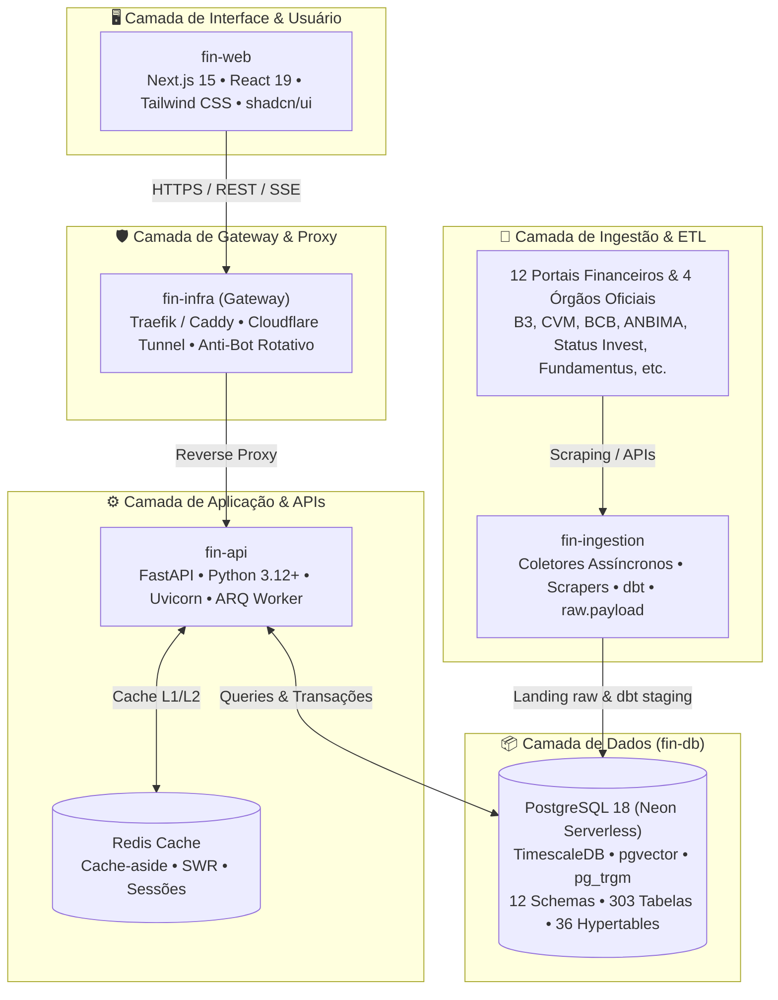

# 📚 fin-docs — Central de Arquitetura & Documentação do Ecossistema Fin

Repositório central de documentação técnica, especificações de engenharia reversa (REA), diagramas arquiteturais, modelos de dados, planos de implementação e guias de operação de todos os serviços da plataforma **Fin**.

---

## 🏛️ Visão Geral do Ecossistema Fin

A plataforma Fin é composta por **5 módulos interdependentes**, orquestrados e provisionados de forma desacoplada:

---

## 🧭 Catálogo de Documentação por Módulo

### 1. [📦 fin-db — Engenharia de Dados & Modelo Relacional](./fin-db/)
Repositório central de arquitetura, esquemas relacionais, séries temporais (TimescaleDB), vetores (pgvector) e migrações.
- **[README do fin-db](./fin-db/README.md)**: Visão geral da arquitetura, 12 schemas modulares, 303 tabelas, 36 hypertables e guia de migração.
- **[01. Pacote Completo DIYFin](./fin-db/01_pacote_completo_diyfin.md)**: DDL SQL completo, extensões, types, dicionário de dados e relacionamento relacional.
- **[02. Melhorias DDL v3.1](./fin-db/02_melhorias_ddl_v3.1.md)**: Evolução do schema e refinamento de constraints e índices temporais.
- **[03. Análise DDL v3.2](./fin-db/03_melhorias_ddl_v3.2_analise.md)**: Particionamento e otimização para grandes volumes de dados.
- **[04. Complementos Sites Análise v3.3](./fin-db/04_complementos_sites_analise_v3.3.md)**: Expansão de colunas e métricas financeiras.
- **[05. REA 12 Sites Coverage v3.4](./fin-db/05_rea_12_sites_coverage_v3.4.md)**: Matriz de cobertura de campos dos 12 portais de investimentos.
- **[06. REA Reversa 12 Sites & Órgãos Oficiais](./fin-db/06_rea_reversa_12_sites_e_orgaos_oficiais_especificacao.md)**: Engenharia reversa e especificação detalhada de contratos de dados.
- **[07. REA Sites Infra Gateway Spec](./fin-db/07_rea_sites_infra_gateway_spec.md)**: Especificação de infraestrutura de gateway e proteção de egress.
- **[08. REA Frontend Screen Plan & Design System](./fin-db/08_rea_frontend_screen_plan_design_system.md)**: Planejamento detalhado de telas, rotas e componentes UI.
- **[Superpowers Plans & Specs](./fin-db/superpowers/)**:
  - `plans/`: Planos de implementação de features financeiras, reconciliação de portfólio, testes de invasão e cobertura de portais.
  - `specs/`: Especificações arquiteturais (Deploy sem custo em nuvem, Graph reconciliation, etc.).

---

### 2. [⚙️ fin-api — Backend & APIs REST](./fin-api/)
Backend assíncrono de alto desempenho construído com FastAPI, cache-aside no Redis, autenticação Supabase e background tasks.
- **[README do fin-api](./fin-api/README.md)**: Estrutura da API, routers (`auth`, `assets`, `portfolio`, `market`, `analytics`), pooling com SQLAlchemy assíncrono, cache com stale-while-revalidate e suíte de testes pytest.

---

### 3. [🛡️ fin-infra — Infraestrutura, Gateway & Observabilidade](./fin-infra/)
Camada de infraestrutura como código (IaC), orquestração de contêineres, gateway de borda e observabilidade unificada.
- **[README do fin-infra](./fin-infra/README.md)**: Orquestração de Docker Compose, scripts de inicialização, túneis Cloudflare e configuração de ambiente.
- **[Arquitetura de Infraestrutura](./fin-infra/docs/ARCHITECTURE.md)**: Topologia de rede, isolamento de segurança AWS, monitoramento com Prometheus, Grafana, Loki e OpenTelemetry.
- **[REA Gateway & Proxy Spec](./fin-infra/docs/REA_ANALYSIS_AND_GATEWAY_SPEC.md)**: Especificação da malha de scraping, proxies residenciais rotativos, evasão de Cloudflare/Akamai e rate limiting.

---

### 4. [🔄 fin-ingestion — Pipelines de Ingestão & ETL](./fin-ingestion/)
Mecanismo de captura automatizada, parsing, raw landing e transformação de dados com dbt.
- **[README do fin-ingestion](./fin-ingestion/README.md)**: Arquitetura de coletores assíncronos, estrutura de pipelines, jobs e transformações analíticas.
- **[Especificação Técnica REA](./fin-ingestion/docs/REA_SPECIFICATION.md)**: Mapeamento de endpoints e estratégias de extração dos 12 portais de investimentos e 4 órgãos reguladores (B3, CVM, BCB, ANBIMA).

---

### 5. [🖥️ fin-web — Frontend Web & Dashboard](./fin-web/)
Aplicação frontend moderna construída com Next.js 15 (App Router), React 19, Tailwind CSS e biblioteca shadcn/ui.
- **[README do fin-web](./fin-web/README.md)**: Estrutura de rotas, componentes de interface, design tokens e integração com as rotas de backend do `fin-api`.
- **[Diretrizes e Regras de Agente](./fin-web/AGENTS.md)**: Padrões de código, convenções de tipagem TypeScript e regras de usabilidade.

---

## 🔗 Repositórios do Ecossistema no GitHub

| Módulo | Repositório | Escopo Principal |
|---|---|---|
| **fin-docs** | [`barrosrafa/fin-docs`](https://github.com/barrosrafa/fin-docs) | Central de documentação, especificações e arquitetura |
| **fin-db** | [`barrosrafa/fin-db`](https://github.com/barrosrafa/fin-db) | PostgreSQL 18, TimescaleDB, migrações e DDL |
| **fin-api** | [`barrosrafa/fin-api`](https://github.com/barrosrafa/fin-api) | Backend assíncrono em FastAPI, autenticação e cache |
| **fin-infra** | [`barrosrafa/fin-infra`](https://github.com/barrosrafa/fin-infra) | Terraform, Docker Compose, Gateway e Observabilidade |
| **fin-ingestion** | [`barrosrafa/fin-ingestion`](https://github.com/barrosrafa/fin-ingestion) | Coletores assíncronos, web scrapers e dbt |
| **fin-web** | [`barrosrafa/fin-web`](https://github.com/barrosrafa/fin-web) | Frontend Next.js 15, dashboard analítico e UI |

---

## 🚀 Como Utilizar este Repositório

### Visualização no Obsidian
Este repositório é 100% compatível como um **Cofre (Vault) do Obsidian**:
1. Abra o Obsidian.
2. Selecione **Open folder as vault** (Abrir pasta como cofre).
3. Selecione a pasta `/Users/rafaelaparecido/fin-docs`.
4. Todos os diagramas em Mermaid, links internos em Markdown e notas estarão renderizados com navegação gráfica completa.

### Visualização no GitHub
Ao navegar pelo GitHub em [`https://github.com/barrosrafa/fin-docs`](https://github.com/barrosrafa/fin-docs), utilize o menu e os links relativos acima para navegar diretamente para a documentação de cada módulo do sistema.
