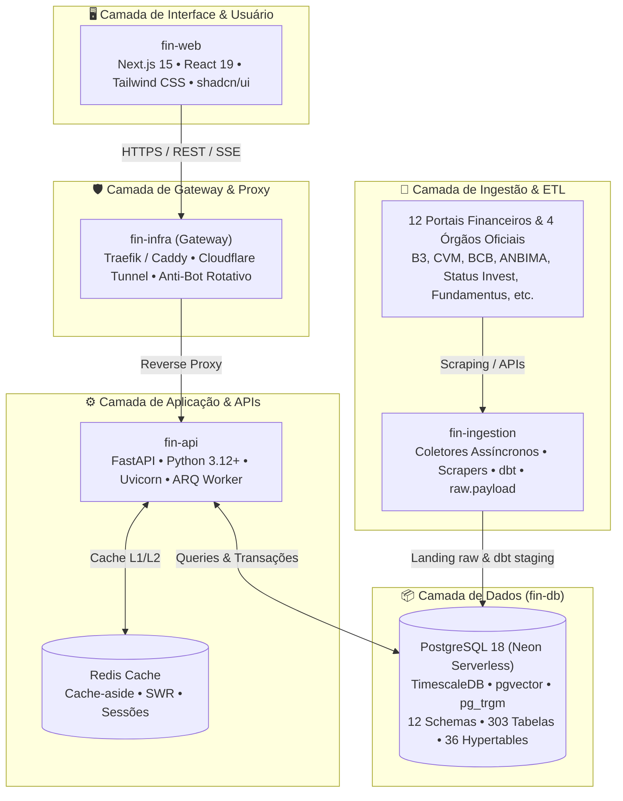

# 📚 fin-docs — Central de Arquitetura & Documentação do Ecossistema Fin

Repositório central de documentação técnica, especificações de engenharia reversa (REA), diagramas arquiteturais, modelos de dados, planos de implementação e guias de operação de todos os serviços da plataforma **Fin**.

> [!NOTE]
> Este repositório é formatado e otimizado como um **Cofre (Vault) do Obsidian**.
> Para navegar pela base de conhecimento com grafo de conexões e visualização completa, abra o arquivo **[`00_CENTRAL_MOC.md`](./00_CENTRAL_MOC.md)** ou aponte o Obsidian para a pasta `/Users/rafaelaparecido/fin-docs`.

---

## 🧭 Visão Geral do Ecossistema Fin

A plataforma Fin é composta por **5 módulos interdependentes**, orquestrados e provisionados de forma desacoplada:

---

## 🗂️ Estrutura Organizada da Base de Conhecimento (Obsidian Vault)

### 🧭 [00. Mapa de Conteúdo Central (MOC)](./00_CENTRAL_MOC.md)
Hub mestre de navegação com links diretos para todas as notas, tabelas e grafos do cofre.

---

### 📜 [01. Histórico & Trilha das 23 Conversas](./01_CONVERSAS_HISTORICO/)
O registro cronológico, exaustivo e sem omissões de todas as 23 conversas fundacionais do projeto:
- **[Linha do Tempo e Matriz Unificada das 23 Conversas](./01_CONVERSAS_HISTORICO/00_Linha_do_Tempo_e_Matriz_23_Conversas.md)**: Tabela comparativa com ID, data, escopo, decisões e entregas.
- **[Conversas 01 a 04](./01_CONVERSAS_HISTORICO/Conv_01_a_04_Fundacao_DDL_e_Arquitetura.md)**: Fundação no Neon PostgreSQL (273 tabelas, 36 hypertables) e arquitetura macro dos 5 repositórios.
- **[Conversas 05 a 08](./01_CONVERSAS_HISTORICO/Conv_05_a_08_Criacao_Modulos_Ecosystem.md)**: Criação de `fin-ingestion`, `fin-infra`, `fin-web` e `fin-api`.
- **[Conversas 09 a 14](./01_CONVERSAS_HISTORICO/Conv_09_a_14_Auditoria_Ativos_Reais_Web_e_ETL.md)**: Carga dos 1.242 ativos reais da B3, Tese da Carteira Invisível, ETL do Status Invest e fim dos mocks.
- **[Conversas 15 a 19](./01_CONVERSAS_HISTORICO/Conv_15_a_19_Engenharia_Reversa_Profunda_e_Gaps.md)**: REA profundo de Fundamentus, Oceans14 (Valuation), Análise de Ações e ETFs Brasil.
- **[Conversas 20 a 23](./01_CONVERSAS_HISTORICO/Conv_20_a_23_Abastecimento_Auditoria_Producao_e_Cloud.md)**: Plano de abastecimento de 10 pipelines, auditoria Chrome DevTools MCP e deploy cloud 100% gratuito.

---

### 🏛️ [02. Arquitetura & Sistema](./02_ARQUITETURA_E_SISTEMA/)
Padrões arquiteturais, consistência transacional e infraestrutura:
- **[Arquitetura Geral do Ecossistema Fin](./02_ARQUITETURA_E_SISTEMA/Arquitetura_Geral_Ecossistema_Fin.md)**: Topologia, limites de fronteira e os 5 invariantes invioláveis.
- **[Arquitetura Financeira de Missão Crítica](./02_ARQUITETURA_E_SISTEMA/Arquitetura_Financeira_Missao_Critica.md)**: Ledger de partidas dobradas (soma zero em SQL), Saga orquestrada, Outbox/CDC e idempotência SHA-256.
- **[A Tese da Carteira Invisível & Dual-Engine](./02_ARQUITETURA_E_SISTEMA/Tese_Carteira_Invisivel_Dual_Engine.md)**: O problema da falsa diversificação e o motor de Look-Through de risco de crédito.
- **[Deploy Cloud 100% Gratuito](./02_ARQUITETURA_E_SISTEMA/Deployment_Cloud_Gratuito_Zero_Cost.md)**: Vercel + Koyeb (anti-hibernação) + Neon + Upstash Redis + GitHub Actions.
- **[Topologia de Produção e Observabilidade](./02_ARQUITETURA_E_SISTEMA/Topologia_Producao_e_Observabilidade.md)**: Docker Compose, Traefik v3, Prometheus, Grafana e Loki.

---

### 🕵️ [03. Engenharia Reversa de Aplicação (REA)](./03_ENGENHARIA_REVERSA_REA/)
Descoberta de APIs, raspagem e linhagem de dados dos portais e reguladores:
- **[Matriz Unificada dos 12 Portais & Gaps](./03_ENGENHARIA_REVERSA_REA/Matriz_Unificada_12_Portais_e_Gaps.md)**: Tabela comparativa de cobertura nos 6 domínios de negócio.
- **[REA Fundamentus: Linhagem e Endpoints Ocultos](./03_ENGENHARIA_REVERSA_REA/REA_Fundamentus_Linhagem_e_Endpoints_Ocultos.md)**: 13 rotas, endpoints em JSON (`cot_hist.php`, `resultado.php`) e tratamento de bancos vs indústrias.
- **[REA Status Invest, Investidor10 e Fundamentei](./03_ENGENHARIA_REVERSA_REA/REA_Status_Invest_e_Investidor10.md)**: Gregas de opções, remuneração FRE CVM, segmentação geográfica e Apollo GraphQL (102 KPIs).
- **[REA Oceans14 & Modelos de Valuation Quantitativo](./03_ENGENHARIA_REVERSA_REA/REA_Oceans14_e_Modelos_Valuation.md)**: Fórmulas de Benjamin Graham, Décio Bazin, Gordon e DCF (WACC).
- **[REA Análise de Ações: Consenso e Projeções](./03_ENGENHARIA_REVERSA_REA/REA_Analise_de_Acoes_Preco_Justo.md)**: Consenso de corretoras, dividendos futuros e score de saúde (0 a 100).
- **[REA ETFs Brasil: Cestas e Tracking Error](./03_ENGENHARIA_REVERSA_REA/REA_ETFs_Brasil_e_Indices.md)**: Decomposição de carteiras teóricas, Tracking Error anualizado e taxas.
- **[REA Órgãos Oficiais: B3, CVM, BCB e ANBIMA](./03_ENGENHARIA_REVERSA_REA/REA_Orgaos_Oficiais_B3_CVM_BCB_ANBIMA.md)**: Formatos BVBG, COTAHIST, DFP/ITR, CVM 175, API SGS e curvas ETTJ.

---

### 📦 [04. Engenharia de Dados (`fin-db`)](./04_ENGENHARIA_DE_DADOS_fin_db/)
Modelagem relacional e séries temporais no PostgreSQL 18:
- **[Modelagem Relacional dos 12 Schemas](./04_ENGENHARIA_DE_DADOS_fin_db/Modelagem_Relacional_12_Schemas.md)**: Dicionário das 303 tabelas em `canonical`, `core`, `market`, `asset_details`, `analytics`, etc.
- **[Hypertables TimescaleDB & Séries Temporais](./04_ENGENHARIA_DE_DADOS_fin_db/Hypertables_TimescaleDB_e_Series_Temporais.md)**: As 36 hypertables, intervalos de chunk e consultas com `time_bucket()`.
- **[Catálogo de 1.242 Ativos Reais da B3](./04_ENGENHARIA_DE_DADOS_fin_db/Catalogo_1242_Ativos_e_Chaves_Naturais.md)**: Ações, FIIs, BDRs, ETFs e política de chaves naturais anti-duplicação.
- **[Histórico de Migrações SQL (v1.0 ao v4.0)](./04_ENGENHARIA_DE_DADOS_fin_db/Migrations_e_Evolucao_DDL_v3_1_a_Stage12.md)**: Evolução dos 13 estágios de scripts DDL.

---

### 🔄 [05. Ingestão & Pipelines (`fin-ingestion`)](./05_INGESTAO_E_PIPELINES_fin_ingestion/)
Mecanismos de extração assíncrona e transformação:
- **[Plano Mestre de Abastecimento: 10 Pipelines](./05_INGESTAO_E_PIPELINES_fin_ingestion/Plano_Mestre_Abastecimento_10_Pipelines.md)**: Arquitetura de aquisição contínua, high-watermarks e checkpoints.
- **[Especificação dos Scrapers, Coletores e dbt](./05_INGESTAO_E_PIPELINES_fin_ingestion/Especificacao_Tecnica_Scrapers_e_Coletores.md)**: HTTPX assíncrono, fallback Playwright e pouso em `raw.payload`.
- **[Malha de Proxies Rotativos e Anti-Bot](./05_INGESTAO_E_PIPELINES_fin_ingestion/Anti_Bot_Proxies_Rotativos_e_Evasao.md)**: Proxies residenciais, spoofing de TLS (JA3/JA4) e evasão de Cloudflare.

---

### ⚙️ [06. Backend & APIs REST (`fin-api`)](./06_BACKEND_E_APIS_fin_api/)
Camada de serviços assíncrona e computação financeira:
- **[Especificação das APIs FastAPI e Routers](./06_BACKEND_E_APIS_fin_api/Especificacao_APIs_FastAPI_e_Routers.md)**: Roteadores `/health`, `/assets`, `/market`, `/portfolio`, `/valuation`.
- **[Cache-Aside no Redis, SWR e Idempotência](./06_BACKEND_E_APIS_fin_api/Cache_Aside_Redis_e_Idempotencia.md)**: Stale-While-Revalidate, TTL por volatilidade e tokens SHA-256.
- **[Motores Matemáticos e Valuation Quantitativo](./06_BACKEND_E_APIS_fin_api/Motores_Matematicos_e_Valuation_Quant.md)**: Implementação em Python de Graham, Bazin, DCF, WACC, Sharpe, Sortino e VaR.

---

### 🖥️ [07. Frontend Web (`fin-web`)](./07_FRONTEND_fin_web/)
Interface moderna em Next.js 15:
- **[Arquitetura Next.js 15 e Design Tokens](./07_FRONTEND_fin_web/Arquitetura_Nextjs_App_Router_e_Tokens.md)**: Server Components, React 19, Tailwind CSS e tipografia financeira monoespaçada.
- **[Eliminação de Mocks e Vinculação de Dados Reais](./07_FRONTEND_fin_web/Eliminacao_de_Mocks_e_Data_Binding.md)**: Validação com Zod, hooks SWR e skeletons de carregamento.
- **[Catálogo de Telas, Rotas e Componentes](./07_FRONTEND_fin_web/Catalogo_Telas_Rotas_e_Componentes.md)**: Dashboard, Screeners de Ações/FIIs, Páginas de Detalhes e Comparador.

---

### 🛡️ [08. Auditorias, Testes & Pentest](./08_AUDITORIAS_TESTES_E_PENTEST/)
Validação de qualidade, segurança e planos futuros:
- **[Relatório Executivo de Auditoria em Produção](./08_AUDITORIAS_TESTES_E_PENTEST/Relatorio_Executivo_Auditoria_Producao.md)**: Testes navegados no Chrome DevTools MCP, auditoria mobile (iPhone 14) e Lighthouse 98/100.
- **[Relatório de Pentest e Vulnerabilidades](./08_AUDITORIAS_TESTES_E_PENTEST/Pentest_Segurança_e_Vulnerabilidades.md)**: Mitigação contra SQL Injection, XSS, CSRF, RLS e rate limiting.
- **[Plano Diretor de Melhorias Contínuas: Sprints I e II](./08_AUDITORIAS_TESTES_E_PENTEST/Plano_Diretor_Melhorias_Sprint_I_e_II.md)**: Entregas da Sprint I e roadmap priorizado da Sprint II.

---

## 🔗 Repositórios do Ecossistema no GitHub

| Módulo | Repositório | Escopo Principal |
|---|---|---|
| **fin-docs** | [`barrosrafa/fin-docs`](https://github.com/barrosrafa/fin-docs) | Central de documentação, cofre Obsidian, especificações e arquitetura |
| **fin-db** | [`barrosrafa/fin-db`](https://github.com/barrosrafa/fin-db) | PostgreSQL 18, TimescaleDB, migrações e DDL |
| **fin-api** | [`barrosrafa/fin-api`](https://github.com/barrosrafa/fin-api) | Backend assíncrono em FastAPI, autenticação e cache |
| **fin-infra** | [`barrosrafa/fin-infra`](https://github.com/barrosrafa/fin-infra) | Terraform, Docker Compose, Gateway e Observabilidade |
| **fin-ingestion** | [`barrosrafa/fin-ingestion`](https://github.com/barrosrafa/fin-ingestion) | Coletores assíncronos, web scrapers e dbt |
| **fin-web** | [`barrosrafa/fin-web`](https://github.com/barrosrafa/fin-web) | Frontend Next.js 15, dashboard analítico e UI |

---

## 🚀 Como Utilizar este Repositório no Obsidian

1. Abra o aplicativo **Obsidian**.
2. Clique em **Open folder as vault** (Abrir pasta como cofre).
3. Selecione a pasta `/Users/rafaelaparecido/fin-docs`.
4. Abra o arquivo **`00_CENTRAL_MOC.md`** ou utilize o atalho `Cmd + G` para visualizar o Grafo de Conexões interativo.
