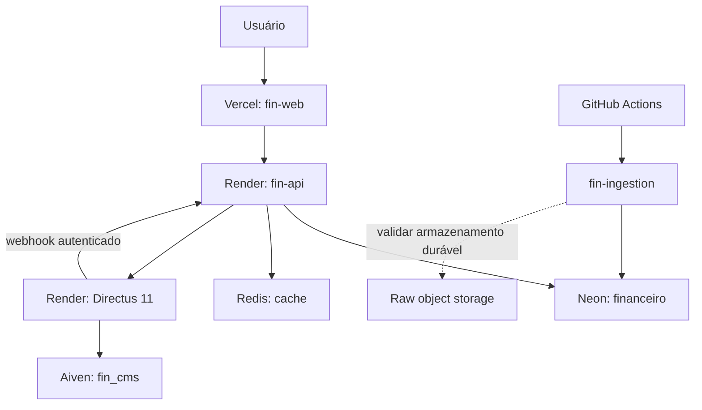

# Arquitetura operacional real

Inspeção autenticada de Render, Aiven, Neon e Vercel em 31/10/2026. Estado de execução e critérios restantes: [[EXECUCAO_MELHORIAS_2026-10-30]]. Plano completo: [[PLANO_MELHORIA_EXECUTAVEL_2026-10-30]]. Credenciais ficam fora dos repositórios.

| Componente | Provedor verificado | Autoridade e execução |
|---|---|---|
| fin-web | Vercel, projeto fin-web | Next.js; navegador usa rewrite /api/v1; servidor usa API_BACKEND_URL |
| fin-api | Render Free, https://fin-api-jbrz.onrender.com | autorização, contratos, leitura financeira e enfileiramento PostgreSQL |
| financeiro | Neon, projeto diyfin, production/neondb, PostgreSQL 18 + TimescaleDB | fonte financeira; proprietário administrativo não deve ser usado no runtime |
| fin-cms | Render Free, https://fin-cms-wo8q.onrender.com | Directus 11.17.4, repositório privado barrosrafa/fin-cms, main |
| CMS PostgreSQL | Aiven, fin-app-202610, banco dedicado fin_cms/schema cms | apenas editorial; runtime cms_directus_rw e migrations cms_migration_owner; CA verificada |
| Redis | configuração remota existente da API | cache descartável, rate limit e tarefas leves; nunca autoridade financeira |
| ingestão | GitHub Actions, fin-ingestion/main, commit 4c92fc0 | motor batch agendado com fila PostgreSQL e lease; não equivale a worker contínuo |
| object storage | integração no coletor; credencial cloud não comprovada nesta sessão | implantação de arquivo bruto durável ainda requer validação |
| Terraform AWS | reference-only | validação de referência; sem apply fictício de produção |

## Caminho das requisições

## Isolamento e credenciais

API e ingestão usam papéis distintos; fin_migration_owner é reservado a migrations. A migração 18 adiciona concessões explícitas e cercas RLS restritivas para usuários e carteiras, bloqueia alteração de role/tier pela API e protege registros filhos. Transferências de propriedade incompatíveis com Timescale gerenciado preservam o proprietário do provedor; isso não concede propriedade ao runtime. O bootstrap registra a lista preservada em arquivo privado.

Aiven mantém o domínio editorial isolado do Neon. O schema cms_v12_reference preserva o bootstrap vazio da versão 12; a versão ativa é 11 por escolha do usuário. O Directus tem editor, revisor, leitor e principal técnico sem acesso público. O fluxo editorial e suas permissões foram exercitados com registros temporários removidos após os testes.

Secrets são provisionados nos provedores e em arquivos locais 0600 sob fin-run/secrets. Apenas a API recebe token Directus e segredo do webhook; nenhuma variável NEXT_PUBLIC contém segredos. A conta administradora é rafa.a.barros@hotmail.com. Senha gerada permanece no arquivo privado cms-aiven.json.

## Ambientes e deploy

Desenvolvimento usa bancos e Redis isolados em loopback para testes. O frontend é publicado em Preview por padrão; uma URL Preview não demonstra ambiente de banco separado. Ainda não foi comprovado um staging cloud integral com credenciais e bancos próprios.

Render acompanha main de API/CMS. Vercel acompanha o repositório web; branches codex/* geram Preview. Ordem de release: testes/build, plano de migrations, migração expansiva transacional, configuração do runtime, push, deploy e verificação de saúde. Dois checkouts independentes de fin-db existem em /fin e /fin/fin-db: a raiz desta sessão é a fonte das novas alterações; o aninhado deve ser preservado e não executado em paralelo.

## Dependências, cache e recuperação

Aiven Developer-1: limite observado de 15 conexões; CMS usa pool reduzido e TLS com CA do provedor. Neon Free: histórico de restauração observado de seis horas. Backups Aiven ativos foram confirmados no painel. Esses recursos não substituem ensaio de recuperação.

A API limita leitura Directus a 3 segundos e 512 KiB. Redis guarda resposta corrente por 60 segundos e última versão válida por sete dias; falha devolve stale=true com versão/data originais, ou 503 sem snapshot. Readiness limita banco a três segundos e Redis a um segundo. ARQ não coleta dados financeiros nem anuncia tarefas vazias como concluídas.

O ensaio do Directus 11 ativo produziu dump cifrado AES-256-GCM e restaurou 40 tabelas em banco Aiven descartável com comparação de todas as contagens: backup 28,30 s e restauração 59,54 s, em 31/10/2026 às 16:30 UTC. O banco de teste foi removido. Recuperação financeira, alertas e simulação de incidente continuam critérios operacionais necessários.

Rollback de aplicação preserva migrations expansivas. Não desfazer RLS nem usar administrador como solução de indisponibilidade. Restaurar dados somente após validar artefato em ambiente descartável. RPO/RTO do plano permanecem metas até os exercícios finais.
